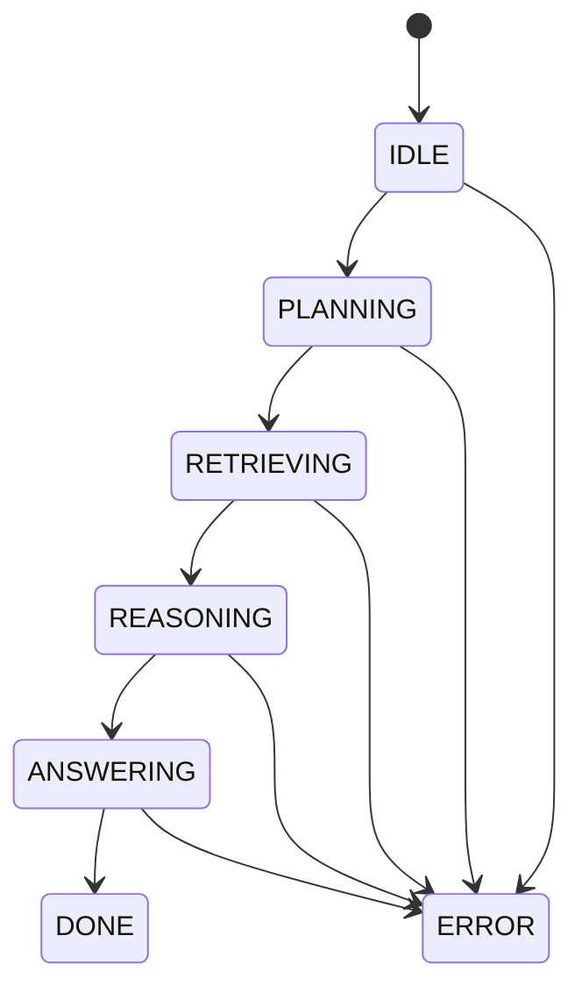

# Architecture

Scholar RAG Agent is a local-first FastAPI service and Python toolkit built with
Pydantic schemas/settings, HTTPX provider adapters, and SQLite stores. Its
Observe -> Decide -> Act orchestration is a hand-written state machine, not a
LangGraph integration. The default wiring lives in
[`AppContainer`](src/api/dependencies.py).

[`api.application.create_app(settings)`](src/api/application.py) constructs an
isolated app on demand; importing the factory or routers does not initialize a
database. `api.main:app` remains the environment-configured deployment entrypoint.
Offline demos use explicit validated defaults and ignore ambient environment,
dotenv, and secret-file settings rather than initializing that deployment app.

## Agent State Machine



Each transition is persisted to SQLite before the next phase. The event log
stores `timestamp`, `agent_id`, `run_id`, event type, and a JSON payload; state
transition payloads contain the source and target states. The plan includes
operational rationale, not a model's hidden reasoning.

New event payloads are serialized before opening SQLite. Non-finite floats
(`NaN`, positive/negative infinity), including nested values and mapping keys,
raise the standard JSON encoder's `ValueError`; unsupported objects raise
`TypeError`. Rejected payloads create no database file, row, or event ID.
Finite JSON serialization, key coercion, ordering, and transition envelopes are
unchanged. Existing rows are not repaired or migrated, and permissive legacy
reads remain unchanged; old non-finite rows can still fail strict JSON consumers.

## Query Analysis

`QueryAnalyzer` uses case-insensitive whole-word markers, not semantic intent
analysis. Precedence is comparison, then hypothesis validation, then synthesis,
with factual lookup when no marker matches. The explicit forms are:

| Intent | Recognized markers |
| --- | --- |
| Comparison | `compare`, `compares`, `compared`, `versus`, `vs`, `difference`, `differences` |
| Hypothesis validation | `hypothesis`, `validate`, `validates`, `validated`, `support`, `supports`, `supported`, `supporting`, `refute`, `refutes`, `refuted` |
| Synthesis | `synthesize`, `synthesizes`, `synthesized`, `summarize`, `summarizes`, `summarized`, `literature`, `literatures`, `overview`, `overviews` |

Punctuation and whitespace separate markers, so `GraphRAG vs. BM25` selects
comparison. Adjacent letters, digits, or underscores do not form boundaries:
`unsupported`, `invalidate`, `indifference`, and `literature_count` alone do not
select an intent. This is a finite lexical rule, not stemming or negation
analysis. Only outer query whitespace is trimmed; interior text and the existing
capitalized-entity extraction are unchanged.

## Retrieval Pipeline

This is the integrated `/query` path. Hybrid and graph retrieval are separate
lookups for each planned task, not a graph stage that consumes fused hits:

```mermaid
flowchart LR
  query[Research query] --> plan[Keyword intent and task plan]
  plan --> hyde[Deterministic HyDE template]
  plan --> graph[Entity co-mention traversal]
  hyde --> dense[Lexical hash-vector cosine]
  hyde --> sparse[BM25 Sparse]
  dense --> rrf[RRF Fusion]
  sparse --> rrf
  rrf --> merge[Merge by chunk ID and bound results]
  graph --> merge
  merge --> rerank[Lexical overlap reranking]
  rerank --> collapse[Optional lexical near-duplicate collapse]
  collapse --> quota[Optional per-document passage quota]
  quota --> snapshot[Persist exact context snapshot]
  snapshot --> minimum[Optional distinct-document minimum]
  minimum -->|Met or omitted| model[Routed provider or fake adapter]
  minimum -->|Insufficient| error[Persist ERROR without generation]
  model --> ground[Token-overlap citation mapping]
  ground --> done[Persist answer and completed run]
```

`DenseRetriever` defaults to deterministic `HashEmbeddingModel` vectors, not
learned semantic embeddings. `HyDEExpander` has no LLM in the API wiring: it adds
a fixed hypothetical-abstract template. `AdaptiveReranker()` uses lexical
overlap by default without importing or downloading a model. Enabling its
optional cross-encoder requires explicit Python wiring with
`AdaptiveReranker(use_cross_encoder=True)` and suitable model dependencies/weights;
installing the `all` extra alone does not enable it. Explicit opt-in propagates
dependency-import and model-construction errors unchanged rather than silently
falling back to lexical scores. The default API wiring remains unchanged; see
[performance tuning](docs/PERFORMANCE.md) for diagnosis and deliberate lexical use.

MMR, multi-HyDE, synonym rewriting, contextual compression, screening gates,
and most other retrieval helpers are opt-in library components. Their names or
presence in the [guide catalog](docs/README.md) do not imply execution in `/query`.

Optional `/query` `document_ids` selects eligible ingested papers for **all**
planned tasks. A shared validator snapshots bounded, deduplicated IDs as an
immutable tuple before awaits. Dense and BM25 filter before scoring/top-k/RRF;
BM25 statistics remain global. Graph SQL filters chunks before `LIMIT` and both
directions of edge ownership before neighbour deduplication and `LIMIT`, so
excluded documents cannot bridge selected ones. No shared index stores per-request
scope. Unscoped calls preserve old signatures; unsupported scoped components fail
rather than retrying globally.
See [Document scope](docs/guides/DOCUMENT_SCOPE_GUIDE.md) for the exact contract.

The opt-in `screened_collection` API selector resolves via
`SQLitePaperScreening.select_included` before either runner entrypoint is awaited.
Collection membership/revision and validated review records share one SQLite
read transaction; only current human `include` labels become a nonempty tuple.
Ordinary collection scope still includes all members. No empty selection becomes
unscoped, and no review is silently skipped. Existing plan/event/snapshot formats
retain actual selected IDs, not a new collection or review-history provenance
field. The transaction ends before retrieval: current text is not frozen and
later requests see later decisions. See the
[API/Python handoff guide](docs/guides/SCREENED_COLLECTION_GUIDE.md).

Graph neighbour lookup groups eligible edges by their stored `source_key` or
`target_key`, using the graph's existing Python `str.lower()` identity, including
non-ASCII casing. It returns one display spelling per key: `MIN(name)` in SQLite
binary order, considering only eligible edges. Neighbours are ordered by normalized
key before `LIMIT`, so case aliases and duplicate edges cannot consume extra
identity slots or change the bounded selection when insertion order changes.
A single spelling is preserved; ordering is by key rather than display name.
This is deterministic traversal, not relevance ranking, and does not change
multi-hop depth, visited-entity filtering, or result limits.

Optional `near_duplicate_threshold` on both endpoints and runner methods freezes
a finite strict number greater than zero and at most one in the existing
`EvidencePolicy`. `Executor.prepare_context` reuses `NearDuplicateCollapser`
after reranking and before quotas/capture/minimum assessment. Survivors keep
exact chunks, scores, and stable score order; their `near_duplicate_collapse`
label appends the prior retriever to `path`. Final-source validation reuses the
same algorithm without repairing invalid extension output. No candidate refill,
network, mutable global setting, or new snapshot field is introduced.
Threshold `1` means equal meaningful-term sets, not identical text or papers.
See [the integrated collapse guide](docs/guides/NEAR_DUPLICATE_COLLAPSE_GUIDE.md).

Optional `max_chunks_per_document` on `/query` and `/retrieve` freezes a strict
1-50 integer in `QueryObservation.evidence_policy` before awaits.
`Executor.prepare_context` applies the existing `DiversityCapGate` after normal
reranking and any requested collapse, before capture, within the bounded pool. It preserves
scores, order, and chunk ownership while appending the prior stage to gate
provenance. There is no extra retrieval, oversampling, or shared index mutation;
fewer passages may remain. The policy is recorded in the initial event and plan,
validated in previews/exports, and compared even when saved contexts match.
`RunConfiguration` keeps its four version-one fields; old records default to no
policy. Unsupported opt-in executor overrides fail rather than discard the quota.
See [Per-paper evidence limits](docs/guides/PER_PAPER_EVIDENCE_LIMITS_GUIDE.md).

Optional `min_evidence_documents` extends the same frozen policy with a strict
1-50 integer. Its count is taken from distinct actual document IDs in the final
captured context, after collapse and the quota. The runner saves an insufficient snapshot and
typed count diagnostic through `REASONING -> ERROR`, without invoking the
prepared-answer hook or recording generation/`DONE`. Sufficient requests use
`Executor.answer_prepared` on that same detached context; preparation and
generation share one reasoning timeout. Opt-in generative retrieval and
unsupported custom answer overrides fail explicitly, never switch algorithms.
The existing count primitive is shared with `MinUniqueSourcesGate`, but its
discard/provenance-rewrite behavior is not used. Passing is not a scientific
answerability claim. See [Minimum evidence documents](docs/guides/MINIMUM_EVIDENCE_DOCUMENTS_GUIDE.md).

## Generation-Free Retrieval Preview

`POST /retrieve`, in the separate `api.retrieval` router, calls
`AgentRunner.preview`. It uses the same analyzer, planner, task clamping,
bounded executor retrieval, and `Executor.prepare_context` as `/query`.
The latter method performs reranking, optional collapse, scope/quota enforcement, and detached
`EvidenceSnapshot.capture`; `Executor.answer` then adds generation and grounding
only for real queries.

Both entrypoints enforce the copied `RunConfiguration.max_source_docs` on
executor retrieval output and final captured sources, independent of quota or
minimum opt-ins. Queries reject retrieval overflow before reasoning and context
overflow in the capture callback before persistence or answer generation.
Extension overflows fail explicitly rather than silently dropping evidence;
preview retains its sanitized, event-free failure contract.

Preview returns an inspection-only plan (without a run ID), full ordered sources,
scores, ranks, paths, exact context/digest, and copied scope/limits. It does not
enter the state machine, call any live/fake generator, ground claims, or append
agent events. Its context-preparation budget uses the existing reasoning timeout
without running a reasoning model. LLM-backed HyDE is rejected rather than
silently replaced by a different retrieval algorithm.

With a minimum, preview adds `evidence_assessment` containing required/observed
distinct-document counts and `passed`. Insufficiency is a valid inspection:
context remains available, without events or generation. Operational failures
still return errors, not partial evidence. Without a minimum, the new field is
absent and the existing response shape remains unchanged.

Unknown document IDs produce empty evidence, not a widened search. Invalid HTTP
scope is 422; generative retrieval is 409; operational failures are sanitized
500 responses and timeouts are 504. No failed stage returns partial success.
Existing `/query` response/event contracts and legacy executor override binding
are unchanged. A preview does not freeze concurrent or subsequent corpus changes
and is not a saved evidence export. See the
[retrieval preview guide](docs/guides/RETRIEVAL_PREVIEW_GUIDE.md).

## Retrieval Policy Comparison

`POST /research/compare-retrieval` in `api.research` delegates to
`AppContainer.retrieval_comparator` / `RetrievalComparator.compare`.
It revalidates and detaches one bounded query, exclusive optional scope, and
exactly two named policy variants before awaiting. A collection's membership,
ID and revision come from one existing `resolved_collection` read transaction;
the connection closes before the baseline preview starts.

Baseline and candidate each call the real `AgentRunner.preview`, with unchanged
scope/policy enforcement and their actual copied effective limits. Complete
previews are copied and checked before the next await. The extracted pure
`agent.run_comparison.compare_sources` also serves completed-run comparisons,
preserving that API's behavior without inventing evidence bundles or run IDs.
Separate exact document identity sets, shared-field change counts, and context
UTF-8 byte deltas complement the source-pair comparison.

Both JSON and literal Markdown must fit 256 KiB; output is never shortened to
make a successful response. One cooperative 30-second deadline covers selection,
both previews, comparison and serialization preflight. Failure/cancellation
cannot return a baseline-only success. No model, event, corpus write, schema,
dependency or frontend is added. Scope membership is captured, but the corpus,
indexes and per-call runtime configuration are not transactionally frozen across
the two awaits: this is inspection, not a controlled experiment or quality metric.
See the [complete contract and measured demo](docs/guides/RETRIEVAL_COMPARISON_GUIDE.md).

## Read-Only Local Corpus Explorer

`GET /explore` and `GET /explore/document` in `api.explorer` render bounded
server-side HTML over `AppContainer.document_catalog.list_documents` and
`document_chunks.list_chunks`. Each synchronous handler calls one reader;
the existing request-local SQLite read-only connections run on FastAPI's
worker threads. No new SQL, schema/index, migration, front-end runtime or
framework dependency is introduced. Normal app initialization is unchanged.

Native GET forms omit only empty source/title filters. Fixed same-origin links
URL-encode exact query parameters and separately escape HTML; document IDs are
query values, not normalization-prone paths. Catalog filters and cursor survive
the document back link; chunk cursors stay document-bound. The UI labels actual
lexicographic ID order rather than implying ordinal or relevance order.
Projected prefixes retain explicit truncation notices. The complete HTML is
checked incrementally against a 1-MiB byte cap before any response is sent.

A route-local boundary converts validation, projected-data, and SQLite errors
to sanitized HTML without altering the existing JSON endpoints. Hash-authorized
static CSS, script/resource/frame restrictions, no-store/nosniff and no-referrer
headers protect rendering, not access rights. Page reads never enter ingestion,
retrieval/reranking, model generation, collection editing or event persistence.
See the [explorer guide and browser demo](docs/guides/CORPUS_EXPLORER_GUIDE.md)
for current-corpus consistency, privacy and operational limits.

## Source-Context Reader

`GET /documents/context` and `GET /explore/context` call the standalone
`SQLiteSourceContext.read` through `AppContainer.source_context`. Exact
document/chunk selectors use query parameters, preserving slash/dot/Unicode
identities. One read-only SQLite connection and `BEGIN` snapshot cover existence,
source-order validation, and selected evidence.

Ordering discovery is capped at 2,049 rows to detect the fixed 2,048-chunk
document ceiling. SQL gates metadata at 8,192 stored bytes before JSON parsing
and projects only bounded IDs and indices. Every same-document index must be
present, canonical and unique; duplicate index properties or identities fail.
A bounded in-memory numeric sort selects up to five stored neighbors per side,
allowing gaps without inventing missing passages. Only selected IDs use the
shared bounded `StoredChunk` projection/decoder; prefixes keep provenance and
truncation flags, and the typed response marks the exact anchor.

The explorer reuses its CSP, escape helpers and byte cap, adds native count and
recentering controls, and preserves catalog/passage return state. Existing
ID-ordered pagination, retrieval, generation, saved evidence and settings are
unchanged. There are no writes, schema changes or new dependencies. This is a
current-corpus human reading operation, not automatic sentence-window retrieval
expansion. See the [complete guide and measured demo](docs/guides/SOURCE_CONTEXT_GUIDE.md).

## Model-Free Literal Passage Search

`POST /research/search` delegates to `SQLiteLiteralSearch`, not the runner or
retrieval pipeline. The standalone reader resolves an escaped file URI in
read-only mode and uses parameterized SQLite `instr`/`substr` against current
chunk text. Collection membership and chunk reads share one transaction via
the existing collection validator's caller-owned-snapshot path. Explicit IDs
are filtered before limit; unknown IDs never widen scope.

Binary document/chunk keyset cursors bind the exact query and resolved scope,
including collection revision. First-occurrence Unicode offsets accompany
bounded excerpt/label projections; response bytes, stored text size, and a
cooperative scan deadline are bounded. A connection-local function validates
each eligible size-bounded passage's encoding; matching/projection stay in SQL.
There is no corpus materialization,
FTS index, migration, backfill, model call, or run/event write. One request is
a snapshot, not a series of pages. Existing app startup still initializes its
ordinary stores/indexes; standalone search avoids that startup path.
See [literal search semantics, errors, and offline demo](docs/guides/LITERAL_SEARCH_GUIDE.md).

### Native browser search-to-source path

`GET /explore/search` in `api.explorer` maps one validated native GET form to
`LiteralSearchRequest` and calls the existing `AppContainer.literal_search`
reader once. An omitted query opens only the form. The browser offers a single
exact paper or saved collection, while preserving the API's existing multi-ID
contract. Neither SQL/ranking nor cursor fingerprints are duplicated.

The renderer splits the returned excerpt at its exact Unicode first-match
offsets and escapes each segment before wrapping the match in `<mark>`.
Native pagination retains query/scope-bound cursors and separate catalog return
state. Exact result links enter the existing `/explore/context` reader; its
window/recenter links carry validated `search_*` state back to the original
search page. Incomplete search return state fails before source reading.
ASGI root paths are retained throughout native explorer navigation.

Shared read/response/deadline bounds and the existing complete-HTML cap, CSP,
escaping and error boundary remain enforced. Invalid UTF-8, unknown/duplicate
form fields and invalid/empty scopes fail instead of being normalized or
widened. This path makes no writes, model calls, ingestion or agent events.
The API search payload/result and existing catalog/chunk/context readers
are unchanged. See the [complete guide and measured showcase](docs/guides/BROWSER_PASSAGE_SEARCH_GUIDE.md).

## Model-Free Research Worksheets

`ResearchWorksheetService`, wired through `AppContainer.worksheets` and
`POST /research/worksheet`, composes `AgentRunner.preview` for each question
and selected paper. The existing collection store validates explicit IDs or
resolves a saved collection once before asynchronous work. Each cell receives
an immutable one-paper scope; no shared runner configuration is changed.

Requests are capped at five questions, ten papers, fifty cells, and three
returned passages per cell. The service validates preview ownership, ordering,
context and full-text digests, then exposes bounded excerpts with explicit
truncation flags. Both JSON and literal Markdown must fit 256 KiB. A cooperative
30-second overall deadline complements the existing preview phase timeouts.
Any failed cell rejects the whole worksheet; cancellation propagates.

Construction does not invoke generation or append agent events, and introduces
no schema or new retrieval algorithm. Membership is frozen, not corpus contents;
inspection links read current chunks. Existence is rechecked before completion.
See the [worksheet guide](docs/guides/RESEARCH_WORKSHEET_GUIDE.md) for schemas,
errors, privacy, limitations, and the measured offline demonstration.

`api.worksheet_explorer` adds native GET/POST `/explore/worksheet` over this
same service, not another retrieval or generation path. GET renders controls;
POST strictly decodes a bounded URL-encoded form, validates the shared request,
and builds exactly one worksheet. HTML exposes a question-by-paper grid and
exact local source links; JSON/Markdown reuse the service's serializers.
Validated catalog return fields and mount prefixes survive native navigation.
The browser adds a 64-KiB streaming body bound, 16-KiB URL bound, six-field
maximum and the shared 1-MiB HTML limit. Each submission is a new inspection;
no worksheet table, run ID, browser storage or scripts are introduced.

## Data Flow

1. `POST /ingest/text` accepts a title, text, and source. `TextChunker` normalizes
   whitespace and produces overlapping character windows (800 characters with
   120 overlap by default). Python callers may inject a custom chunker into
   `IngestionPipeline`: construction rejects non-integer/boolean geometry,
   nonpositive sizes, and overlap outside zero through size minus one, before
   ingestion can persist or index anything. The HTTP endpoint exposes no chunk
   geometry options. PDF and scholarly-service connectors are separate Python
   ingestion paths, not upload endpoints or automatic web searches. See the
   [chunking contract](docs/guides/RESEARCH_WORKFLOW_GUIDE.md#chunking-http-defaults-and-python-injection).
2. SQLite persists normalized documents and chunks. Hash-vector and BM25 indexes
   are in memory and are rebuilt from stored chunks when `AppContainer` starts.
   The graph store persists entity mentions and within-chunk co-mention edges.
3. Graph construction uses spaCy when its package and requested model can load;
   otherwise it uses a deterministic term extractor. Query entities come from
   the analyzer's capitalized-term heuristic. Graph paths connect co-mentions,
   not proven scientific relationships.
4. The keyword analyzer selects factual, synthesis, comparison, or hypothesis
   intent. The planner creates fixed task templates and logs their rationale.
   Supporting/counter-evidence task results are merged before generation; there
   is no automatic evidence adjudication.
5. The executor retrieves and reranks chunks, saves its bounded context, calls a
   model, and maps claims to chunks. If no parsed claims are provided, the whole
   response becomes one claim. Current live adapters return the context's chunk
   IDs; the default path does not parse prose citation markers or verify that a
   source entails a claim. The fake adapter echoes the query with IDs.
6. `/query` returns `{"result": ...}` with a `DONE` or `ERROR` run state; callers
   must inspect that state and `error`, not just the HTTP status. Read the saved
   event stream or export a completed run to inspect its exact evidence.

The API also exposes `/retrieve`, `/health`, `/runs`, `/runs/{run_id}/events`, and the export route
below, plus FastAPI's schema/docs. It has no built-in authentication, tenant
controls, PDF-upload UI, or public multi-turn chat endpoint. See
[API examples](docs/EXAMPLES.md) and [Safety](SAFETY.md).

### Exact-ID incremental indexing

Dense and BM25 `add_chunks` upsert by exact `chunk_id`: each ID has one current
chunk payload and vector or term-frequency record. Later values replace earlier
ones, including duplicates within one batch. Dense embedding is computed before
replacing an entry, so an embedding failure leaves that entry unchanged and
propagates to the caller. BM25 removes the old term contributions before adding
the replacement; corpus size, document frequencies, and average length describe
the unique current chunk IDs.

Dense and BM25 deep-copy the entire incoming batch, including each chunk's
metadata, before embedding or term-statistic preparation begins. Later-chunk edits
or list clearing, replacement, or appending during an injected embedder call
cannot change that batch's captured inputs. Hybrid prepares independent dense
and sparse input batches before invoking either component; each component then
owns its private snapshots. A successful hybrid call therefore makes four deep
copies per supplied chunk: two temporary component inputs and two indexed
snapshots. Copy cost scales with the incoming batch, including entries not reached
after a failure, rather than the previously indexed corpus. Dense also copies
each embedding list, so an injected embedder can reuse its output buffer.

Retrieval deep-copies only the chunks selected after ranking and the result
limit. `Chunk` and `SearchResult` remain mutable: editing an input or returned hit
does not change indexed IDs, document scope, payloads, scores, or other results.
To change an indexed chunk, explicitly call `add_chunks` with its updated value
and the same chunk ID. An embedding failure still propagates, preserving earlier
successful updates and the failed ID's last successful value while skipping the
remaining batch. If it occurs in hybrid's dense phase, sparse indexing is not run;
batch snapshots do not make these low-level upserts transactional across components.

Replaying identical ingestion into the same application does not consume extra
top-k slots or change retrieval scores. Rebuilding from the same persisted chunks
preserves results; ties still sort by chunk ID, and document scope still filters
candidates before top-k using global BM25 statistics. Different IDs remain
distinct even when their text is identical. Content-near-duplicate collapse and
MMR are separate opt-in behaviors, not part of this exact-ID indexing contract.

`GraphRAGBuilder.index_chunks` also replaces by exact `chunk_id`. It prepares
entities and co-mention edges before writing, then `SQLiteGraphStore.replace_chunk`
updates the chunk payload and replaces only that chunk's mentions and edges in
one transaction. Empty extraction clears old links; replay does not accumulate
edges, and repeated IDs in a batch use the last successful value. Preparation or
storage failure propagates without partially replacing that chunk's graph.
Edge ownership is validated before opening the replacement transaction.
Initialization adds missing chunk-ID indexes for these deletes without rewriting
existing graph rows.
Case-insensitive lookup, document scope, and unrelated chunks are unchanged;
the low-level `add_mentions` and `add_edges` methods remain additive.

These low-level upserts do not remove chunks with different IDs.
`SQLiteDocumentStore.add_documents` likewise remains a row upsert:
`add_documents([], chunks)` updates only the supplied chunk rows. It does not
update the live retrieval indexes or graph. Complete-document ingestion uses
the separate replacement boundary below.

### Complete-document reingestion

`IngestionPipeline.ingest_documents` treats each supplied `Document` as the
complete current value of its exact `document_id`. A repeated ID in one batch
uses the last document value, ordered by the ID's first appearance; discarded
versions are not chunked or combined. Input documents and generated chunks are
detached before subsequent preparation. Chunking, graph extraction/edge creation,
and dense/BM25 preparation finish before the replacement writes begin.

The document store's `replacing_documents` context reserves a `BEGIN IMMEDIATE`
transaction, rejects incoming chunk IDs owned by unrelated documents, replaces
the supplied document rows, and removes their previous chunks. The graph store
removes those documents' graph chunks, mentions, and edges before inserting the
prepared graphs. Default `AppContainer` wiring shares the same resolved database
path, so these SQL writes commit or roll back together. Only after that commit
do the retrievers publish their staged index state. Unrelated embeddings are
retained, the configured embedder and BM25 parameters are reused, and removed
chunks no longer contribute to BM25 corpus size, term frequencies, or mean length.
Input/result ownership, scope filtering, and deterministic dense/BM25 ties remain
unchanged.

Graph initialization idempotently adds `idx_graph_chunks_document_id` on
`graph_chunks(document_id, chunk_id)`. Both dependent deletion subqueries and
the final graph-chunk deletion use indexed document lookups instead of scanning
the entire graph once per supplied document. Fresh and reopened databases use
the same index, with no data migration, row rewrite, or change to internal edge IDs.

Empty or whitespace-only Python documents replace their previous evidence with
zero chunks while keeping the document row and collection membership. A shorter
revision also removes its superseded tail. Identical replay remains idempotent.
The HTTP endpoint still rejects blank text and derives a new `doc-api-v2-*` ID
when its parsed source/title/text changes; ID generation has not changed.

Writers sharing one hybrid instance are serialized, and each component's readers
are protected from partial index publication. A multi-stage retrieval, graph
traversal, or sequence of pages is **not** a frozen corpus-revision snapshot.
Separate application instances/processes do not hot-reload one another's indexes.
If Python wiring uses different document and graph SQLite files, the graph file
commits before the document transaction. A later document-commit failure leaves
the old document/live indexes but the new graph; it propagates, with no silent
repair. Explicitly retry the same complete batch to converge, or use one shared
database for atomic persistence. There is no distributed transaction guarantee.

Legacy custom writer overrides must opt in to the preparation/replacement hooks
instead of being silently bypassed; unsupported overrides raise before storage
writes. See the [Python ingestion contract](docs/EXAMPLES.md#replace-a-complete-document-in-python)
for those hooks. Existing stale rows are removed when their document is next
reingested, not by a startup migration. Completed frozen evidence, answer reviews,
annotations, collections, and unrelated documents are never rewritten.

### SQLite connection lifecycle

The core event, document, and graph stores open a connection per operation.
Their existing transaction context exits before the connection is explicitly
closed, including after SQL, serialization, or commit failures. Reads materialize
their rows before closing; connections do not depend on garbage collection for
release. This does not add connection pooling or synchronize retrieval indexes
across workers; the shared ingestion transaction described above coordinates
document and graph writes only.

## Persistent Corpus Discovery

`SQLiteDocumentCatalog` projects `GET /documents` directly from existing
`documents` and `chunks`, opening the database read-only. Source equality and
literal title-substring filters precede an exclusive ascending document-ID
cursor and a maximum 100-row page plus one-row lookahead. Bounded byte prefixes
preserve Unicode and embedded NUL characters without hydrating bodies or metadata.
IDs are never truncated; malformed/unselectable records fail explicitly.

An index on `chunks(document_id)` supports per-document stored chunk counts.
Browsing does not rebuild indexes, invoke models, or append agent events, though
normal application startup still reconstructs its retrieval indexes. Each page
is consistent within its SELECT; independent pages do not freeze corpus edits.
Recovered IDs can be passed to document-scoped `/query`. See the
[document catalog guide](docs/guides/DOCUMENT_CATALOG_GUIDE.md).

## Persistent Paper Collections

`SQLitePaperCollections` stores only a stable collection ID, unique trimmed
name, revision, and normalized JSON document IDs in one additive SQLite table.
`/collections` supplies bounded discovery and metadata CRUD; full replacement
and deletion require the expected revision. Document existence, name uniqueness,
revision checks, and writes share a `BEGIN IMMEDIATE` transaction. No corpus,
graph, or run data is copied, deleted, or backfilled.

Both `/query` and `/retrieve` accept either `collection_id` or `document_ids`,
never both. The API resolves collection membership and checks document existence
in one read transaction **before awaiting the runner**, then passes an immutable
ID tuple through the existing scope pipeline. Invalid, unknown, corrupt, or
broken selections fail explicitly; no failure means unscoped. Python callers
use `store.resolve(...)` and the existing runner `document_ids` argument.

Concurrent edits affect new requests, not an already resolved scope. This
freezes IDs, not source contents or multi-process indexes. Evidence exports
continue to use their saved actual IDs and chunks, independent of subsequent
collection replacement/deletion. No evidence schema or runner signature changes
are needed. See [Paper collections](docs/guides/PAPER_COLLECTIONS_GUIDE.md) for
schema, paging, conditional writes, errors, privacy, and the offline demo.

## Read-only Collection Duplicate Inspection

`AppContainer.collection_duplicates` and
`GET /collections/{collection_id}/duplicates` expose
`SQLiteCollectionDuplicates.inspect`. A standalone reader opens existing SQLite
storage with `mode=ro`, `sqlite3.Row` and one `BEGIN` transaction. It reuses
`SQLitePaperCollections.resolve_in_snapshot`, verifies the explicitly supplied
revision and probes type/byte sizes before decoding at most 100 selected
document metadata rows. It never reads document bodies or chunks. No schema
initialization, settings, network, retrieval or model calls belong to this reader.

Exact document-ID-sorted input goes to the existing `DuplicatePaperClusterer`,
with full bounded title/source and first nonblank raw DOI alias. Immutable
validated models partition every input into candidate groups or singletons;
cluster reasons remain the helper's non-exhaustive successful-link summaries.
JSON and dynamically fenced literal Markdown must each fit 262,144 UTF-8 bytes
before either format is returned. Invalid/oversized data fails explicitly.
No paper loss, selection, label or event mutation occurs. Collection revisions
do not version document contents; only the individual read uses one snapshot.
See the [complete contract and measured demo](docs/guides/COLLECTION_DUPLICATES_GUIDE.md).

## Human Paper Screening

`SQLitePaperScreening`, wired through `AppContainer.paper_screening` and the
collection screening router, stores the latest include/exclude/unsure opinion per
collection/document in the existing latest-decision table. It reuses
`SQLitePaperCollections.resolved_collection` to validate membership/existence
and the expected collection revision in the same transaction as dependent reads
or writes. Decision writes reserve the transaction and require the previous
decision revision, with zero only for the first write.

Queue reads derive status, global counts and exact included IDs from current
collection members in one snapshot. Old collection-revision decisions are
visible as stale, never included. Bounded member-order pages and a UTF-8 response
cap prevent unbounded queue downloads. Invalid records fail, not disappear.
This queue does not version corpus contents, expose decision history, or alter the
runner's inputs automatically. Existing query/preview scope and evidence schemas
are unchanged. See [Paper screening](docs/guides/PAPER_SCREENING_GUIDE.md).

Each successful `submit` also inserts the identical serialized `ScreeningReview`
into `paper_screening_history`, keyed by collection/document/decision revision,
inside that same reserved transaction. Failed inserts roll back the latest
decision; failed/stale submissions append nothing. Startup creates only this
additive table, with no backfill of legacy latest decisions.

`SQLitePaperScreening.list_history` and query-selected
`GET /collections/{collection_id}/screening/history` read current validated
membership, latest opinion, retained boundary and a descending revision page
in one `mode=ro` transaction. Indexed keyset reads load at most limit+1 history
rows plus bounded boundary/newest/cursor checks; responses are capped at 512 KiB.
Explicit first-retained metadata distinguishes legacy gaps from an unscreened
member. Removal/re-addition never makes old decisions current includes.
`GET /explore/screening-history` reuses this reader and the existing
escaping/CSP/root-path/navigation helpers; collection-member cards link to it.
Native HTML is capped at 1 MiB and history URLs at 64 KiB; API URLs at 16 KiB.
No model, network, retrieval, corpus/event write or full-history scan occurs.
See [the complete history contract](docs/guides/SCREENING_HISTORY_GUIDE.md).

`api.screening_explorer` adds a native `/explore/screening` GET/POST pair.
Collection cards link to exact query-selected members/revisions. GET delegates
to the existing history reader with a fixed five-row recent window and renders
local paper/source/history links; the selected decision revision is the one
displayed in that read. POST requires an exact Origin match (scheme/authority),
rejects conflicting Fetch Metadata, and decodes a bounded four-field URL-encoded
form. ASCII JSON hidden selection preserves opaque IDs through browser input
normalization. The shared `api.native_forms` parser also preserves the worksheet's
existing wire/error behavior; no global auth/session middleware is added.

The sole write is `SQLitePaperScreening.submit`, offloaded from the async route
to a worker thread, with both optimistic revisions. Its reserved transaction
owns latest/history atomicity. A prepared local 303 response avoids reason-bearing
URLs; redirected GET confirms only revisions actually present in retained history.
No new table, migration, retrieval selection, generation, event, network or JSON
API change is introduced. A dedicated write-aware renderer label/footer avoids
misrepresenting the workbench as read-only. Bounds are 64 KiB URL/body, 16,384
decoded field characters and 1 MiB complete escaped HTML. See the
[native workbench guide](docs/guides/HUMAN_SCREENING_WORKBENCH_GUIDE.md).

`SQLitePaperScreening.export_results` and
`GET /collections/{collection_id}/screening/export` reuse the queue's complete
status/count snapshot and existing review validators. Current title/source labels
are read on that same `resolved_collection` connection using the catalog's bounded
SQLite-encoding-aware decoder. No persistent schema, table, event or retrieval is
created by export. JSON and CSV are fully materialized and checked against a 524,288-byte
body cap before an attachment response is returned; no pagination or filtered
export can imply completeness. CSV prefixes every textual cell with one
reversible apostrophe and quotes every field. Export-only NUL label rejection
does not alter opaque document IDs or catalog/queue behavior. See
[Screening exports](docs/guides/SCREENING_EXPORT_GUIDE.md) for format and privacy
limits; this snapshot does not version paper contents or authenticate reviewers.

`api.collection_explorer` adds GET `/explore/collections` and `/explore/collection`
without a storage implementation or schema change. Discovery uses
`SQLitePaperCollections.list_collections`; detail decodes the existing bounded
JSON from `SQLitePaperScreening.export_results`, then pages/filters its complete
typed snapshot in memory. It never combines separate membership, count and label
reads into a claimed snapshot. Whole-collection counts and current include IDs
remain distinct from the visible member page.

The existing explorer renderer supplies literal escaping, privacy headers,
hash-only CSS CSP and a 1-MiB complete HTML bound. Validated structured return
state carries list/member pagination, status and catalog filters through the
existing paper/context/search/worksheet tools, including mounted paths. Those
return URLs have a finite 64-KiB query budget for maximum Unicode encoding;
collection list/detail retain 16 KiB. Downloads link directly to the existing
revision-checked APIs. No retrieval or generation runs while browsing collections.
See [the collection-browser guide](docs/guides/COLLECTION_BROWSER_GUIDE.md).

`api.collection_creation` connects both discovery pages to GET/POST
`/explore/collections/new`. GET delegates to the existing bounded document
catalog; source/title/cursor semantics are unchanged. POST reuses strict
`api.native_forms` wire/Origin guards and exact Unicode identity validators.
Unique indexed checkbox names retain global duplicate-field rejection; ASCII
JSON-string values preserve IDs through native input normalization. There is no
session, cart, second schema or filter expansion on submission.

Only the existing `SQLitePaperCollections.create` transaction writes, offloaded
to a worker thread. Every ID must still exist and the exact normalized name must
be unique; the store commits all metadata or none. The 303 uses the returned
persisted ID/revision to open existing collection inspection and workflow links.
GET queries are bounded to 16 KiB, POST bodies to 256 KiB and fully escaped HTML
to 1 MiB. A write-aware footer/header distinguishes creation from read-only
browsing. No models, retrieval, screening, corpus edits, agent events or JSON
contract changes occur. See the [native builder guide](docs/guides/NATIVE_COLLECTION_BUILDER_GUIDE.md).

### Native collection membership editing

`api.collection_editing` adds GET/POST `/explore/collections/edit`, discoverable
from list cards and collection detail. GET resolves complete validated membership
at the requested revision and separately reads bounded catalog candidates; it
does not claim those reads freeze corpus contents. Full membership is always
shown for explicit removals. Candidate filtering/pagination affects additions
only. Indexed ASCII JSON-string controls preserve exact IDs. Unsaved choices
are not carried between pages; there is no session, cart or hidden full-selection
replacement.

The shared native form parser/Origin guards and HTML renderer provide strict
wire validation, escaped labels, mounted links, sanitized failures and no-store
CSP. POST preview calls `SQLitePaperCollections.preview_edit`, showing complete
resulting membership without writes. Final save calls `edit`: `CollectionEdit`
validates exact, disjoint ordered deltas, and `resolved_collection(write=True)`
reserves and checks all old members plus the expected revision. The shared
replacement helper validates resulting IDs/name and writes atomically. The
original JSON full-replacement/recovery behavior is unchanged.

GET queries are capped at 16 KiB, POST bodies at 512 KiB (204 fields), and
complete escaped HTML at 1 MiB. Retained IDs keep saved order and additions
follow checkbox index. Missing old members, stale revisions, no-op/empty/
over-limit edits and conflicting names fail, never silently merge or repair.
Save advances the revision once and redirects to its actual persisted detail.
Documents, evidence, opinions/history and events are untouched; prior screening
becomes stale, including after a rename. No models, retrieval, network, new schema
or settings are involved. See the [editor guide](docs/guides/NATIVE_COLLECTION_EDITOR_GUIDE.md).

## Persistent Run Discovery

`SQLiteRunHistory` projects `GET /runs` summaries directly from `agent_events`,
without a duplicate run table, event backfill, or evidence deserialization.
Pages contain at most 100 summaries (20 by default), ordered by immutable first
event ID. An exclusive integer keyset cursor and latest-recorded-state filter
are applied before the one-row pagination lookahead.

The optional `question` filter is a strict, nonblank 1-200-code-point Unicode
literal. A connection-local SQLite scalar predicate decodes the complete first
PLANNING question, including suffixes beyond its 300-code-point preview, and
matches case-sensitively before pagination. SQL values are bound; invalid
full-question Unicode stays an error sentinel, never a silent nonmatch.
Only bounded summary rows are returned, but predicate decoding scales with
question size. No new index/schema or scan deadline is introduced.

One SELECT reads a consistent page; separate pages do not freeze changing states.
Query prefixes and identifiers are bounded, but grouping and transition checks
still scale with stored events. Legacy event-only runs have a null recorded state,
and missing planning queries stay null. Nonterminal states do not claim liveness
or resumability. Export links are navigation, not proof of export availability.
See [Run history](docs/guides/RUN_HISTORY_GUIDE.md) for errors, privacy, restart
behavior, and the reproducible synthetic demo.

### Native saved-run browser

`GET /explore/runs` reuses `SQLiteRunHistory` without per-row evidence reads.
`api.run_explorer` validates bounded exact state/cursor/ID and catalog-return
parameters, rejects duplicate/unknown fields and malformed UTF-8, and reuses
the explorer's static HTML shell with a distinct saved-record footer.
The current corpus links to this workflow; saved source links never silently
switch to current source context.

The shared history-return model carries `question` through reader, comparison,
notebook, human-review and annotation flows, including mounted paths. Only an
empty native field omits the filter; API/Python empty strings fail. The browser
explains matches not wholly visible in the unchanged preview. Search does not
restrict an explicitly selected comparison/reader run or search answer bodies.
See the [full contract and measured demo](docs/guides/SAVED_QUESTION_SEARCH_GUIDE.md).

`GET /explore/run?run_id=...` uses `container.saved_run_evidence`, a
`SQLiteEvidenceReader` around `BoundedRunEvents` and `EvidenceExporter`.
It opens an existing `mode=ro` connection and one read transaction, enforcing
100-event, 1-MiB-per-payload and 8-MiB-total UTF-8 text limits before rendering.
The existing static `evidence_html` renderer opts into validated local
history/catalog/download links, counted within its 4-MiB full-render cap.
Its default offline download output remains unchanged.

History stays creation-ordered and reports the latest transition; evidence
keeps first-terminal-event semantics. A `DONE` row receives an inspection link,
not a guarantee of exportability. Exact query-encoded legacy IDs are readable
when valid, without inventing incompatible download paths. Mount prefixes and
valid return selections are preserved; errors stay sanitized, no-store and
script-free. No schema, retrieval, generation, writes or current-corpus
hydration is added. See the [browser guide and real-frame demo](docs/guides/SAVED_RUN_BROWSER_GUIDE.md).

### Native saved-run comparison workbench

`GET /explore/runs/compare` in `api.run_comparison_explorer` connects saved-run
history to a script-free baseline/candidate chooser and side-by-side result.
`SavedRunComparator(container.saved_run_evidence)` reuses `compare_bundles` with
the bounded `SQLiteEvidenceReader`; the existing JSON API keeps its original
exporter. Each distinct side is validated in its own read-only transaction;
same-ID comparisons read once. Either failure rejects the entire comparison.

JSON-string select values and structured history-return state preserve opaque
IDs and controls; exact frozen-source links use query-addressed run IDs and
side-specific ranks, never current corpus lookup. Native pagination pins selected
IDs across bounded history pages. The 16-KiB query and 1-MiB full escaped HTML
limits include navigation, and existing per-side event bounds apply. All change
flags retain pure comparison semantics, not trace equality or quality scoring.
No tables, settings, dependencies, retrieval or providers are added. See the
[complete contract and executed illustration](docs/guides/SAVED_RUN_COMPARISON_WORKBENCH_GUIDE.md).

### Native human-review notebook

`api.review_notebook` exposes GET `/explore/run/notebook` and
`/explore/run/annotation`, discoverable from history and the frozen reader.
The notebook independently reads `saved_run_evidence`, `notebook_reviews` and
`evidence_annotations`; it does not claim a shared snapshot or consensus.
`notebook_reviews` is another `AnswerReviewService` using the bounded evidence
reader and the same initialized `SQLiteAnswerReviews` store as `answer_reviews`.
The original review APIs keep their original exporter semantics; no constructor
or schema write runs per GET.

`SQLiteEvidenceAnnotations.get_annotation` reuses `_sources`, `_read` and the
existing exact anchor validator in one `mode=ro` transaction, returning the
record and frozen source together. Run-scoped UUID links remain stable as new
opinions arrive. Highlighting escapes the source before/inside/after the
validated code-point slice; it never searches today's corpus. Native helpers
retain independent sequence cursors, saved-run/catalog return state and mount
prefixes, with 16-KiB query and 1-MiB full escaped HTML caps. These pages add no
new persistence, provider, dependency or model work. See the
[notebook contract and real-browser demo](docs/guides/HUMAN_REVIEW_NOTEBOOK_GUIDE.md).

### Native saved-answer review authoring

`api.review_explorer` adds GET/POST `/explore/run/review`, explicit POST
`/explore/run/review/save`, and GET `/explore/run/review/saved`. Reader/notebook
links carry typed ASCII-JSON return state, preserving opaque valid review IDs,
both notebook histories and root prefixes without arbitrary redirects.
Native controls require an explicit verdict and exact nonblank comment;
optional distinct checkboxes bind ranks to actual frozen chunk IDs.

GET and preview only read `saved_run_evidence`; Save constructs the existing
`ReviewSubmission`, preflights both complete escaped pages and return navigation,
then calls `notebook_reviews.create`. That existing `AnswerReviewService` uses
bounded frozen events and the same `SQLiteAnswerReviews` append transaction as
the original API. Maximum valid sequence/timestamp widths make persisted-reader
preflight conservative, not arbitrary padding. UUID retry/conflict semantics,
existing schemas, original JSON APIs and notebook pagination are unchanged.

`AnswerReviewService.get_review` / `SQLiteAnswerReviews.get_review` adds a
run-scoped UUID lookup, independent of newest-first history pages. The existing
database is opened read-only; stored type/byte checks precede hydration, followed
by exact UTF-8 accounting and existing record/frozen-reference validation.
UTF-16 databases use a conservative stored-byte preflight before exact UTF-8
accounting. Evidence and opinion are separate reads, not one shared snapshot.
No provider, retrieval, current-corpus read, event write, migration, dependency
or new setting is introduced. Shared native-form/origin/HTML/URL helpers retain
their established controls. See the
[complete review workbench guide and browser demo](docs/guides/SAVED_ANSWER_REVIEW_WORKBENCH_GUIDE.md).

### Portable human-review notebook export

`api.notebook_export` adds GET `/runs/{run_id}/notebook` and the exact-ID
query alias `/explore/run/notebook/export`, linked natively from the notebook.
`AppContainer.review_notebook` / `SQLiteReviewNotebook.export` uses
`SQLiteEvidenceReader.snapshot` for one existing-database `mode=ro` connection
and `BEGIN`. `BoundedRunEvents` feeds the unchanged `EvidenceExporter`, then
bounded metadata preflights and exact UTF-8 accounting cover both whole opinion
tables for that run. Existing review/reference and annotation/anchor validators
are reused. Concurrent appends cannot mix different evidence/history snapshots.

The returned `ReviewNotebook` nests the existing three record schemas, preserves
each history's original descending sequences and does not infer people,
consensus or a cross-table ordering. After closing the connection, both complete
serializations are checked: JSON and literal-safe Markdown, each at most 8 MiB.
Read caps are 1,000 records per history, 256-KiB/16-KiB per review/annotation text,
4-MiB combined history text, and the existing bounded event limits. All export
count/byte overflow is 413, never truncated success. No schema writes, runtime
index/provider construction, live corpus reads or new configuration occur in
the standalone exporter. Ordinary paginated APIs and evidence exports are unchanged.
See [portable notebook semantics, exact bounds and executed demo](docs/guides/PORTABLE_REVIEW_NOTEBOOK_GUIDE.md).

## Persistent Evidence Exports

Completed exports also feed a pure, typed saved-run comparison through
`GET /runs/{baseline_run_id}/compare/{candidate_run_id}`. The dedicated
`SavedRunComparator` accepts `EvidenceExporter` or `SQLiteEvidenceReader`; either side's export
failure rejects the operation. Owner-aware chunk identities, exact field changes,
bounded previews, and digests expose differences without copying full passages
or arbitrary diagnostics. There is no new retrieval, generation, event write,
corpus hydration, migration, or quality scoring. See the
[comparison contract and synthetic demo](docs/guides/RUN_COMPARISON_GUIDE.md).

`Executor.answer` calls the shared `Executor.prepare_context` to rerank and make
a detached, bounded `EvidenceSnapshot`.
Its ordered passages construct the exact `LLMRequest.context`; full chunk text,
source metadata, rank, final score, retrieval path, and UTF-8 digests are retained.
A run-local callback appends `evidence_snapshot` to the existing `SQLiteEventLog`
**before** calling the LLM. A second `generation_record` event captures only
returned provider/model identity and proposed claim citation IDs. Grounding uses
the same detached passages, not mutable index objects.

Each run copies its effective source/hop limits and retrieval/reasoning timeouts
before asynchronous work, persists only those allowlisted configuration fields
in the initial `PLANNING` payload, and uses the copy throughout execution.
Legacy executor overrides that cannot accept capture callbacks still run once
without them; their completed answers remain non-exportable rather than being
given a guessed snapshot.

Document selection is frozen separately in `plan.observation.document_ids` and
the initial event, leaving the four-field version-one configuration unchanged.
Exports cross-check saved scope and source/citation ownership. Old evidence
records without scope remain readable as unscoped; no corpus lookup or migration
is needed.

`EvidenceExporter` depends only on the event log. It validates a completed run,
resolves references against the saved snapshot, preserves the original answer
and warnings, and freezes the trace at the first terminal event.
`GET /runs/{run_id}/export?format=json|markdown|html` derives all downloads from this
versioned model, without document-store reads, retrieval, or generation.
Unknown event payloads are omitted explicitly rather than exporting arbitrary
diagnostic content. Snapshot/provenance trace entries reference the top-level
bundle fields to avoid duplicating those event payloads.

The pure `agent.evidence_html.render_html` consumes only that validated bundle.
Its semantic static document distinguishes proposed from grounded references,
uses rank-derived local fragment links, and escapes all captured values as text.
One fixed stylesheet is hash-authorized by CSP in both HTTP and saved-file
metadata. No scripts, remote resources, current corpus or generation are involved.
The full escaped UTF-8 document has a fixed 4 MiB cap; excess and unrepresentable
literal text fail explicitly without truncation or changing JSON/Markdown.
See the [offline reader guide](docs/guides/OFFLINE_EVIDENCE_READER_GUIDE.md).

No new database or event table is introduced. Existing `/query` responses are
unchanged; `/events` gains the two additive event types and therefore includes
full sensitive evidence text. Legacy runs without capture, failed runs,
incomplete runs, and invalid saved records are rejected rather than backfilled
from a changing corpus. See the [evidence export guide](docs/guides/EVIDENCE_EXPORT_GUIDE.md)
for schema, bounds, privacy, and error contracts.

## Saved Cited Bibliographies

`SQLiteSavedBibliography.export(run_id)`, wired as `container.saved_bibliography`
and `GET /runs/{run_id}/bibliography?format=bibtex|json`, reads only existing
saved events through one `mode=ro` transaction. The shared `BoundedRunEvents`
reader supplies count/byte-preflighted events to the authoritative
`EvidenceExporter`. No corpus table, retriever, generator, or writable store is
needed by the standalone service; ordinary API startup is unchanged.

Final-answer citation chunk IDs must resolve to the frozen snapshot with the
same document owner. Matching chunks are grouped by exact document ID in
first-cited-frozen-rank order. Captured title and 21 allowlisted metadata fields
come from that first cited rank; conflicts warn without merging later fields.
The public `BibTeXExporter.export_chunks` preserves exact identities and unique
collection keys. Empty citations produce no entries, with a JSON warning.

The JSON companion retains exact IDs, cited ranks/citation positions, raw
selected bibliographic fields, context digest, BibTeX, and warnings, not query,
answer, full passages, or arbitrary diagnostics. Both exact serialized formats
must fit 256 KiB, even when only one is requested. Formatting does not fetch
metadata or verify publication identity, author names, scientific claims, or
TeX safety. No events or evidence schemas change. See the
[complete contract and measured demonstration](docs/guides/SAVED_BIBLIOGRAPHY_GUIDE.md).

## Exact Frozen-Evidence Annotations

`SQLiteEvidenceAnnotations`, exposed as `container.evidence_annotations` and
POST/GET `/runs/{run_id}/annotations`, stores immutable human notes in one
additive `evidence_annotations` table. Construction adds only that table and
its index to an existing database; it does not initialize or backfill events.
There are no changes to old answer, snapshot, export, review, or screening shapes.

Each operation reads a completed snapshot through `BoundedRunEvents` and
`EvidenceExporter`. The exact chunk/document identity, whole-text UTF-8 digest,
strict Python Unicode offsets, and literal slice must agree. Any frozen source
may be annotated, whether or not it became a final answer citation. There is
no corpus lookup, term aligner, fuzzy relocation, retrieval, or model call.

Creation uses `BEGIN IMMEDIATE` so evidence validation, run/UUID retry lookup,
and insertion share one transaction. Identical retries return the same sequence
and UTC timestamp; changed payloads conflict. New records receive global
AUTOINCREMENT sequences. GET uses a single read-only snapshot for evidence and
newest-first annotations, with an exclusive sequence cursor and validated
lookahead. SQL count/type/byte preflights precede event and annotation hydration;
the complete compact UTF-8 response must fit 256 KiB. Every connection closes
on success or failure.

Notes and quotes are bounded to 1000 code points. Imported identities are
preserved exactly, not normalized as collection scope. Selected malformed or
inconsistent records fail explicitly with sanitized errors. Current corpus
edits/deletion do not invalidate a frozen anchor; inconsistent saved-evidence
changes do. This is provenance plus opinion, not author authentication,
semantic entailment, or signed tamper-proof history. See the
[complete contract and measured GIF](docs/guides/EVIDENCE_ANNOTATIONS_GUIDE.md).

## Saved Evidence Corpus Drift

`SQLiteCorpusDrift.report(run_id)`, exposed through the separate
`GET /runs/{run_id}/corpus-drift` router, opens one read-only SQLite transaction.
The existing `EvidenceExporter` validates a completed run through a structural
event-reader interface; shared `BoundedRunEvents` bounds event counts and bytes before
loading payloads. The original export logic and serialization are unchanged.

The same transaction looks up only frozen chunk IDs and original document
presence, with current text/record byte budgets derived from `CaptureLimits`.
Exact chunk/document identity, UTF-8 text/title/source digests, and canonical
string-metadata digests determine ordered unchanged/changed/missing findings.
Reassigned chunks are missing evidence, not shared sources. Any selected-record
corruption, size overflow, or operational failure rejects the entire report.

The service requires no model, retriever, settings, writable store, new table,
or migration. It does not inspect document bodies, rebuild indexes, append
events, modify frozen artifacts, or claim scientific validity. Standalone use
does not initialize storage; normal application startup remains unchanged.
See [corpus-drift bounds, errors, and measured demo](docs/guides/CORPUS_DRIFT_GUIDE.md).

## Model Providers

`ModelRouter` selects an adapter (`openai`, `anthropic`, `gemini`, `kimi`, or
the offline `fake`) per `TaskType`. Each adapter normalizes a provider-specific
JSON payload into the shared `LLMResponse`. `/query` requests `REASONING`, which
prefers configured Anthropic before the configured default family, OpenAI, and
fake fallbacks. This is selection before a call, not failover after an HTTP error.

Adapters preserve ordered answer-text parts and skip non-answer blocks. OpenAI
and Kimi use the first choice's content, Gemini the first candidate's answer
parts, and Anthropic its text blocks; they do not concatenate separate alternate
answers. Provenance records the requested model ID when known, not an immutable
resolved backend version.

Current defaults, overrides, payload constraints, and dated official sources
live in the [provider model guide](docs/guides/PROVIDER_MODELS_GUIDE.md).
