# Scholar RAG Agent

### LateLookerBiasCueExtractor

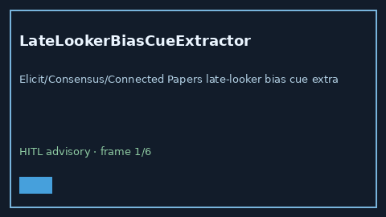

Offline cue extractor. Gap vs Elicit/Consensus/Connected Papers late-looker bias cue extractors. Stack: GPT-5.5 / Claude Sonnet 4.6 / Gemini 3.x / Kimi K2. See `docs/guides/LATE_LOOKER_BIAS_CUES_EXTRACTOR_GUIDE.md`.

### RightTruncationBiasCueExtractor

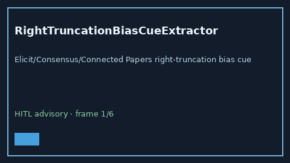

Offline cue extractor. Gap vs Elicit/Consensus/Connected Papers right-truncation bias cue extractors. Stack: GPT-5.5 / Claude Sonnet 4.6 / Gemini 3.x / Kimi K2. See `docs/guides/RIGHT_TRUNCATION_BIAS_CUES_EXTRACTOR_GUIDE.md`.

[](https://github.com/Francis1998/scholar-rag-agent/actions/workflows/ci.yml)
[](pyproject.toml)
[](LICENSE)

Load a small paper corpus, ask comparison or hypothesis questions, and inspect
the passages and run history behind the response. Scholar RAG Agent is a
**local-first Python toolkit and FastAPI service** for building inspectable
literature workflows, with SQLite persistence and optional model-provider adapters.

The default setup works without model credentials. Its fake adapter demonstrates
the workflow; it does **not** produce a scientific summary or validate a hypothesis.

## Start offline

With Python 3.11+ and [uv](https://docs.astral.sh/uv/) installed:

```bash
git clone https://github.com/Francis1998/scholar-rag-agent.git
cd scholar-rag-agent
uv sync --extra dev
uv run python scripts/demo_local.py
```

The demo explicitly uses the fake model, ingests a synthetic fixture into a
temporary database, and prints a run ID, `DONE` state, planner trace, and cited
placeholder answer. Its temporary database is removed on exit.

Next, use the [Quickstart](QUICKSTART.md) to start the API with an isolated
database and empty provider keys. The interactive API documentation is at
`http://127.0.0.1:8000/docs`. For read-only paper and passage browsing, open
`http://127.0.0.1:8000/explore`, including native literal passage search and
saved-run discovery with frozen-evidence reading. This is not a paper-chat or
PDF-upload UI.

## Choose a workflow

| What you can do | Integrated path | Next guide |
| --- | --- | --- |
| Explore a corpus you own or may process | Ingest text, ask a question, inspect source IDs and snippets | [Quickstart](QUICKSTART.md) |
| Browse stored papers in a normal browser | Filter the current catalog, copy exact IDs, and follow bounded passage pages without models or writes | [Local corpus explorer](docs/guides/CORPUS_EXPLORER_GUIDE.md) |
| Read around an exact stored passage | Follow a displayed chunk into a bounded, validated source-order window in the same paper; recenter without generation | [Source-context API/Python/browser reader](docs/guides/SOURCE_CONTEXT_GUIDE.md) |
| Recover paper IDs after restart | Browse bounded document summaries, filter by source/title, and select papers for queries | [Document catalog](docs/guides/DOCUMENT_CATALOG_GUIDE.md) |
| Find exact wording and read its source in a browser | Search from `/explore`, inspect highlighted Unicode spans, page within an exact paper/collection, and return from source context without generation | [Browser/API/Python passage search](docs/guides/BROWSER_PASSAGE_SEARCH_GUIDE.md) |
| Reuse a named paper selection after restart | Save a collection, then pass `collection_id` to `/query` or `/retrieve`; revisioned edits preserve old evidence | [Paper collections](docs/guides/PAPER_COLLECTIONS_GUIDE.md) |
| Browse saved collections and human screening | Discover collections from `/explore`, inspect membership/status/reasons, follow exact readers and download revision-bound screening/duplicate outputs | [Native collection browser and executed demo](docs/guides/COLLECTION_BROWSER_GUIDE.md) |
| Inspect duplicate candidates before screening | Read a revision-checked selection in one bounded snapshot; review exact IDs, raw metadata, reasons and singletons without hiding or deleting papers | [Collection duplicate inspection and measured demo](docs/guides/COLLECTION_DUPLICATES_GUIDE.md) |
| Screen papers before choosing evidence | Save human include/exclude/unsure decisions, resume the queue, and explicitly preview current included IDs | [Human paper screening](docs/guides/PAPER_SCREENING_GUIDE.md) |
| Inspect how a human screening judgment changed | Read append-only decisions with exact reasons, original timestamps, revisions and an honest legacy boundary through Python/API/native browser pages | [Screening decision history and executed offline illustration](docs/guides/SCREENING_HISTORY_GUIDE.md) |
| Download complete human screening results | Export every current collection member in one read snapshot as bounded JSON or spreadsheet-safe CSV, including stale and unscreened states | [Screening exports and measured offline demo](docs/guides/SCREENING_EXPORT_GUIDE.md) |
| Save an auditable human screening progress report | Download complete JSON/literal Markdown with resolved/pending totals and exact exclusion-reason membership, derived from one export without models or writes | [Human progress report: browser/API/Python/portfolio guide and executed illustration](docs/guides/SCREENING_REPORT_GUIDE.md) |
| Restrict a query to selected ingested papers | Pass `document_ids` through hybrid and graph retrieval; preserve scope in the saved evidence | [Document scope](docs/guides/DOCUMENT_SCOPE_GUIDE.md) |
| Inspect evidence before generating | `POST /retrieve` returns the actual prepared chunks and plan without any live/fake LLM call or agent-event writes | [Retrieval preview](docs/guides/RETRIEVAL_PREVIEW_GUIDE.md) |
| Compare evidence policies before generating | Two real previews share one query/scope and report exact source, provenance, and context-byte changes without saved runs | [Retrieval policy comparison and measured demo](docs/guides/RETRIEVAL_COMPARISON_GUIDE.md) |
| Collapse overlapping evidence before generating | Opt in to `near_duplicate_threshold` on `/query` or `/retrieve`; preserve exact survivors and reviewable transformation paths | [Near-duplicate evidence collapse](docs/guides/NEAR_DUPLICATE_COLLAPSE_GUIDE.md) |
| Limit how many passages one paper contributes | Opt in to `max_chunks_per_document` on `/query` or `/retrieve`; retain the quota and gate provenance in saved evidence | [Per-paper evidence limits](docs/guides/PER_PAPER_EVIDENCE_LIMITS_GUIDE.md) |
| Require a minimum number of evidence documents before generating | Opt in to `min_evidence_documents`; inspect count diagnostics with `/retrieve`, or retain exact evidence in an `ERROR` run without generation | [Minimum evidence documents](docs/guides/MINIMUM_EVIDENCE_DOCUMENTS_GUIDE.md) |
| Inspect the same questions against each selected paper | Submit a native browser form, inspect a question-by-paper grid and exact sources, or export JSON/Markdown without generation | [Browser/API/Python research worksheets](docs/guides/RESEARCH_WORKSHEET_GUIDE.md) |
| Compare methods or explore a hypothesis | Inspect comparison or supporting/counter-evidence retrieval tasks, then review the merged evidence | [Research workflow](docs/guides/RESEARCH_WORKFLOW_GUIDE.md) |
| Preserve a reviewable answer and its context | Export a completed run as JSON or Markdown with its exact recorded source chunks | [Evidence export](docs/guides/EVIDENCE_EXPORT_GUIDE.md) |
| Read a completed answer offline | Download one static HTML file with proposed/accepted citation links to frozen passages, recorded provenance and expandable trace; no scripts or network | [Offline evidence reader and measured demo](docs/guides/OFFLINE_EVIDENCE_READER_GUIDE.md) |
| Import only a saved answer's cited references | Download frozen-source BibTeX plus exact document/chunk provenance and metadata warnings; no generation or DOI lookup | [Saved bibliography and measured demo](docs/guides/SAVED_BIBLIOGRAPHY_GUIDE.md) |
| Record a human judgment on a saved answer | Append `accepted`, `needs_revision`, or `rejected` opinions with comments and frozen chunk references; recover history after restart | [Saved answer reviews](docs/guides/ANSWER_REVIEWS_GUIDE.md) |
| Attach a human note to an exact saved passage | Validate frozen source IDs, SHA-256, Unicode offsets, and quote; keep immutable retry-safe notes after corpus changes and restart | [Exact frozen-evidence annotations](docs/guides/EVIDENCE_ANNOTATIONS_GUIDE.md) |
| Read saved human feedback in a normal browser | Open a completed run's notebook, page independent review/annotation histories, and highlight an annotation's exact occurrence in its frozen source | [Human-review notebook and actual browser GIF](docs/guides/HUMAN_REVIEW_NOTEBOOK_GUIDE.md) |
| Take the complete human-review notebook offline | Download JSON/literal Markdown with frozen evidence and both entire opinion histories in one bounded read-only snapshot, not just visible pages | [Portable notebook: API/Python/browser/portfolio guide and executed illustration](docs/guides/PORTABLE_REVIEW_NOTEBOOK_GUIDE.md) |
| Find a previous run after restart | Page through saved query previews and recorded states, then follow events/export links | [Run history](docs/guides/RUN_HISTORY_GUIDE.md) |
| Find a saved answer in a normal browser | Preserve state/cursor selection, validate a complete capture, follow frozen sources and download existing artifacts without rerunning | [Saved-run browser, API/Python guide and actual browser GIF](docs/guides/SAVED_RUN_BROWSER_GUIDE.md) |
| Review changes between two completed runs | Choose an explicit baseline in the native browser, compare recorded outputs side by side, swap direction and open exact frozen sources | [Saved-run comparison workbench: browser/API/Python/portfolio](docs/guides/SAVED_RUN_COMPARISON_WORKBENCH_GUIDE.md) |
| Check whether saved source chunks still match the local corpus | Read unchanged/changed/missing findings in frozen rank order, without regenerating or rewriting evidence | [Corpus drift and measured demo](docs/guides/CORPUS_DRIFT_GUIDE.md) |
| Demonstrate your engineering work | Use synthetic notes, review warnings, save artifacts, and explain limitations | [Portfolio walkthrough](docs/guides/RESEARCH_WORKFLOW_GUIDE.md#6-present-a-portfolio-demonstration) |
| Catch retrieval regressions before a release | Compare real BM25/hybrid rankings on labeled passages and enforce per-retriever quality gates | [Offline benchmarks](docs/guides/RETRIEVAL_BENCHMARK_GUIDE.md) |
| Extend ingestion or retrieval | Explicitly wire Python connectors, ranking helpers, or screening utilities | [Categorized catalog](docs/README.md) |

## Browse papers and passages without generating

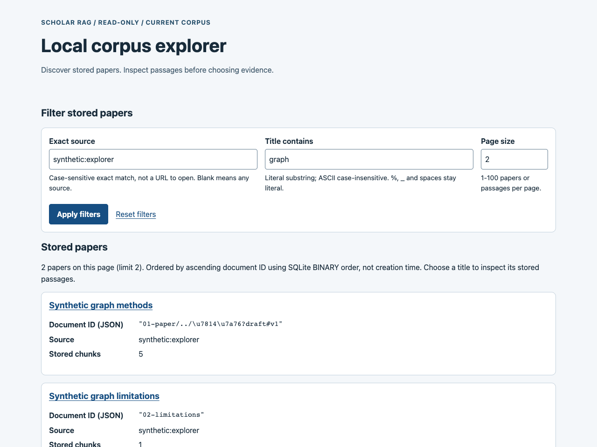

`GET /explore` connects filtered document discovery to exact-scope passage
pages using script-free native forms and links. These are actual browser
screenshots of synthetic data, not a continuous recording or scientific claims.
The [complete guide and offline demo](docs/guides/CORPUS_EXPLORER_GUIDE.md)
cover restart, bounds, privacy, errors, and GIF reproduction.

## Read the surrounding source, not just an isolated passage

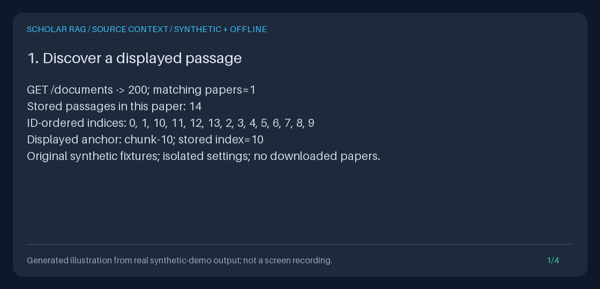

Choose **Read surrounding source context** in the corpus explorer, or call
`GET /documents/context` / `SQLiteSourceContext.read` with exact document and
chunk IDs. The selected passage stays anchored among up to five stored neighbors
per side, in validated numeric source order rather than lexicographic chunk-ID
order. Missing/ambiguous ordering fails explicitly; provenance and truncation
remain visible. Native links/forms preserve the original passage page.

This reads the **current corpus**, not frozen saved evidence or automatically
expanded retrieval. No models, network, events or corpus writes occur during
reads. The [complete guide](docs/guides/SOURCE_CONTEXT_GUIDE.md) covers bounds,
errors, restart/edits, privacy, and reproducing this actual-output illustration
with an isolated synthetic database. It is not a screen recording or a quality
benchmark.

## Find a saved answer and its frozen sources

[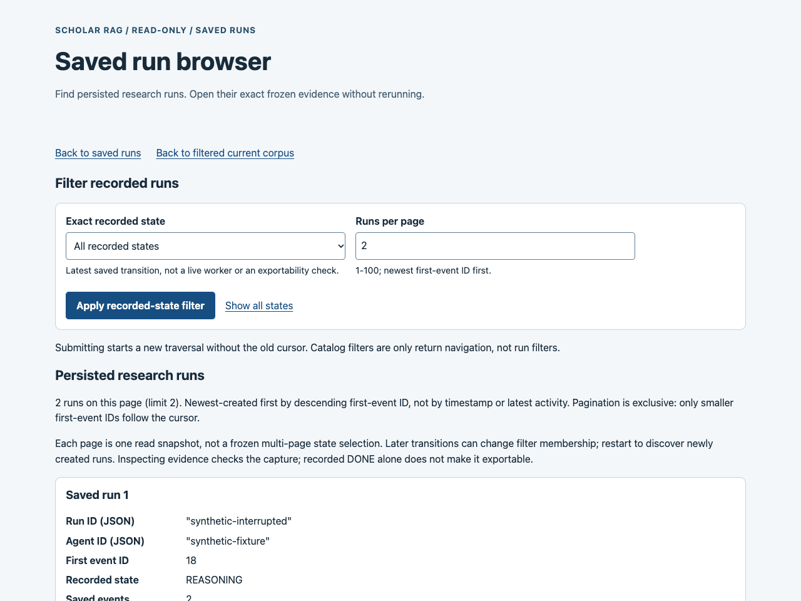](docs/assets/saved-run-browser.gif)

Choose **Browse saved runs** in `/explore`, filter exact recorded states and
follow stable first-event-ID pagination. **Inspect saved evidence** opens a
bounded validated capture, with native citation links and JSON/Markdown/offline
HTML downloads. `DONE` is not a promise of exportability; incomplete and legacy
traces have honest errors. History return filters and mount prefixes survive
navigation; frozen passages stay readable after current-corpus deletion.

No scripts, models, retrieval, corpus reads or event writes run while opening
frozen evidence. The [complete browser/API/Python and portfolio guide](docs/guides/SAVED_RUN_BROWSER_GUIDE.md)
reproduces the measured offline workflow and the [four actual browser frames](docs/assets/saved-run-browser.gif).
The still preview makes animation opt-in; the GIF is a screenshot sequence,
not a continuous recording, benchmark or scientific result.

### Compare two saved answers without rerunning

[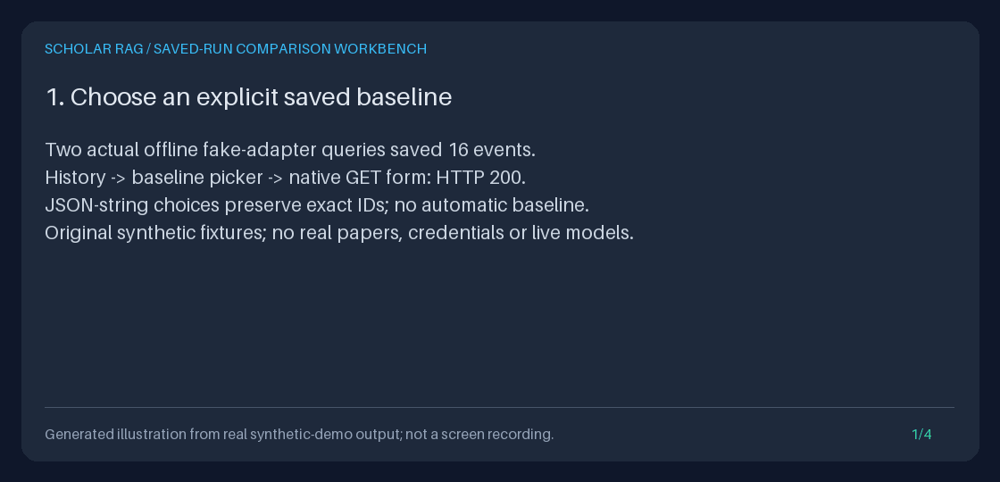](docs/assets/saved-run-comparison-workbench.gif)

Choose **Compare saved runs** or **Use as comparison baseline** in saved-run
history. Native GET controls preserve exact IDs, including controls and slashes;
inspect query/scope/configuration/provider-model/answer/evidence changes side by
side, explicitly swap direction, or compare a run to itself. Source links open
that side's precise frozen rank and retain the original history page.

The [complete user/API/Python/portfolio guide](docs/guides/SAVED_RUN_COMPARISON_WORKBENCH_GUIDE.md)
reproduces this **measured-output Pillow illustration, not browser footage**;
an [exact text transcript](docs/assets/saved-run-comparison-workbench.txt) is
available. The static preview makes animation opt-in. Bounded read-only events
and fail-closed HTML add no model calls, retrieval, writes or migration.
No-change is not a quality verdict, safe-release decision, full trace equality
or a fair A/B experiment. The existing JSON comparison API is unchanged.

### Inspect human feedback beside that answer

[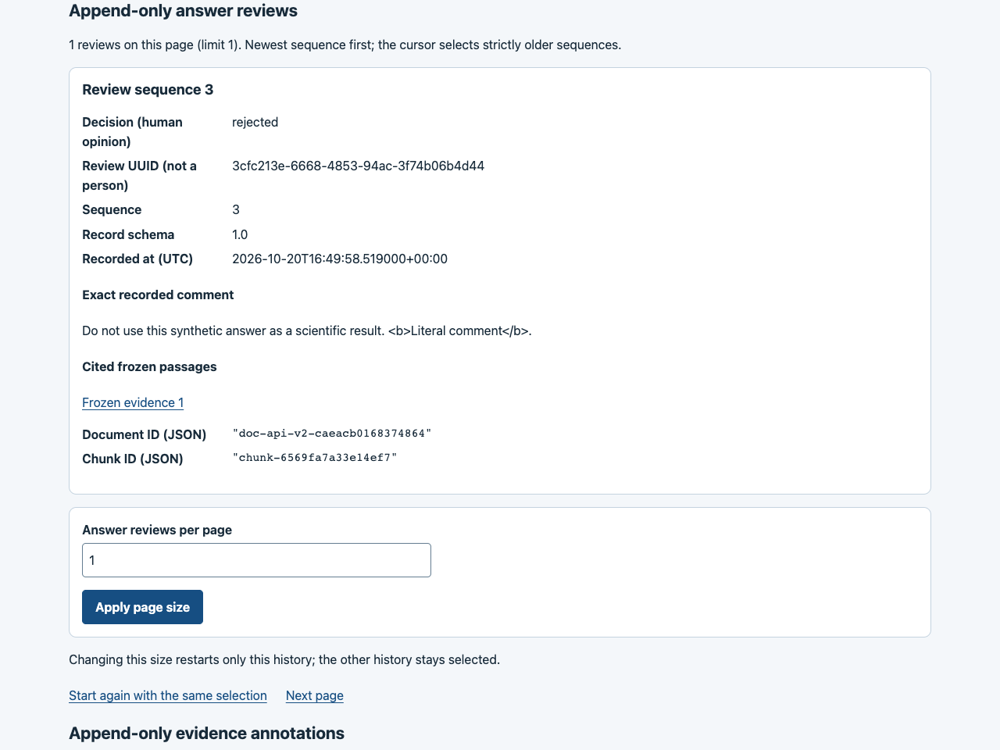](docs/assets/human-review-notebook.gif)

Choose **Human-review notebook** from a saved-run entry or its evidence reader.
Read exact append-only decisions/comments and annotations, page each history
independently, then follow a stable annotation into its full frozen source with
only the recorded occurrence highlighted. Human opinions remain separate from
model grounding and scientific truth; no browser writes or model calls occur.
The [user/portfolio guide](docs/guides/HUMAN_REVIEW_NOTEBOOK_GUIDE.md) reproduces
this actual screenshot sequence, including corpus deletion/restart checks.

### Take the complete review notebook offline

[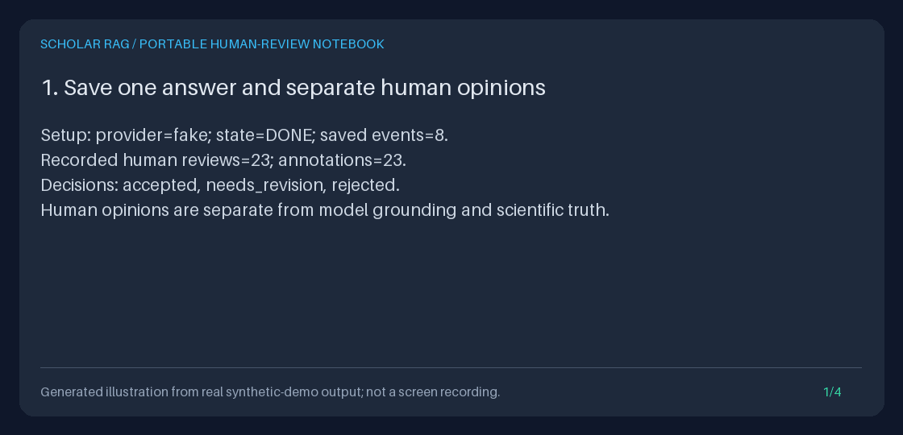](docs/assets/portable-review-notebook.gif)

Choose **Download complete notebook (JSON/Markdown)** on that notebook.
`GET /runs/{run_id}/notebook` reads frozen evidence and both whole histories
in one read-only snapshot, retaining original sequences, UUIDs, decisions,
timestamps, exact quotes/offsets/digests and source provenance. The query-addressed
native links preserve opaque IDs and mount prefixes. Fixed record/UTF-8 limits
return 413 rather than a partial notebook; ordinary paginated APIs are unchanged.

The [complete guide and portfolio walkthrough](docs/guides/PORTABLE_REVIEW_NOTEBOOK_GUIDE.md)
reproduces an offline demo with 23 reviews/23 annotations versus 20 on each
default page, unchanged exports after corpus deletion/restart, and JSON that
reproduces Markdown after removing the database. Human opinions are not
scientific validation or authenticated peer review. The opt-in GIF is an
executed-output Pillow illustration, not browser footage; a
[text transcript](docs/assets/portable-review-notebook.txt) is also available.

## Read saved evidence without the server

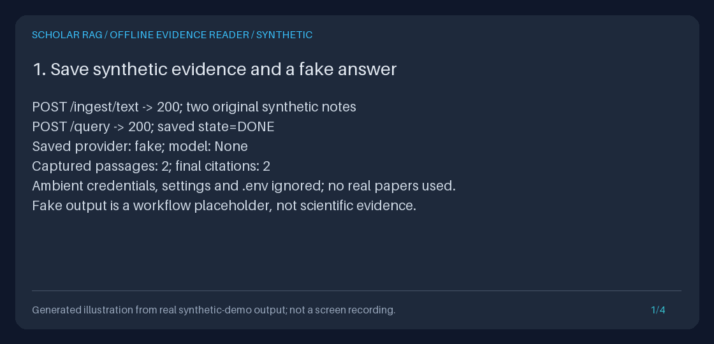

`GET /runs/{run_id}/export?format=html` saves a single script-free file with
browser-native citation links, collapsible trace, Find and Print support.
Proposed references are distinguished from accepted-by-recorded-grounding IDs;
missing references stay explicit. Full frozen passages, scores, paths, metadata
and digests remain available after corpus deletion and restart. This measured
synthetic illustration is not a screen recording or scientific validation.
The [complete API/Python guide](docs/guides/OFFLINE_EVIDENCE_READER_GUIDE.md) covers
hash-only CSS CSP, literal text safety, the fail-not-truncate 4 MiB cap, privacy,
workflow sources and reproducible artifacts. JSON remains the default.

## Compare retrieval policies without generating

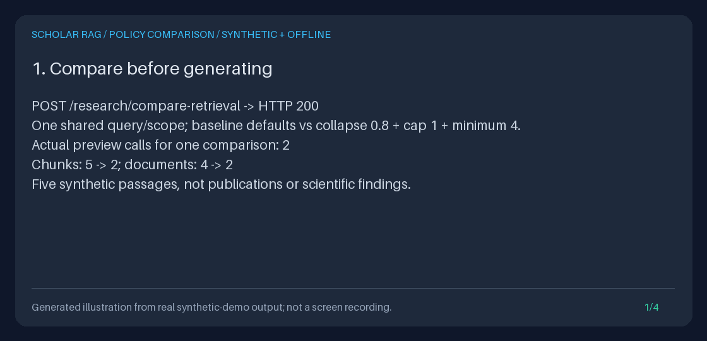

`POST /research/compare-retrieval` compares exactly two named baseline/candidate
policies using the real preview path. Full passages, plans, effective limits,
minimum assessments, exact identity/provenance changes and context byte
sizes/digests remain inspectable in bounded JSON/Markdown downloads. No fake or
live generation, events, or corpus writes occur. Two awaits can see concurrent
corpus changes: this is not a controlled experiment or a quality metric.
The [API/Python and portfolio guide](docs/guides/RETRIEVAL_COMPARISON_GUIDE.md)
reproduces this actual-output illustration, not a screen recording.

## Inspect near-duplicate evidence before generating

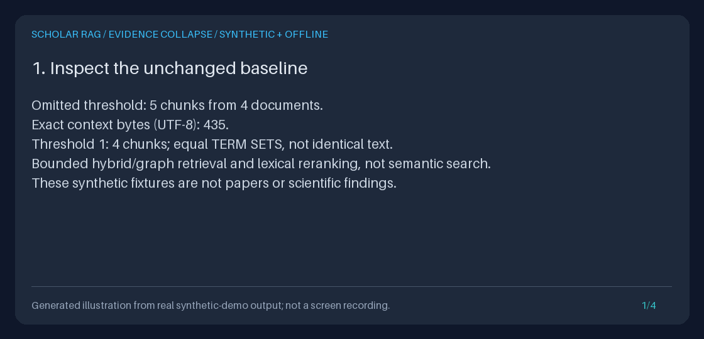

`near_duplicate_threshold` reuses the existing lexical collapser after reranking,
before paper quotas and minimum-document assessment. The measured fixture drops
five passages to three and changes context from 435 to 264 UTF-8 bytes, with zero
model/network calls. Threshold `1` means equal meaningful-term sets, not identical
text. Similar passages may contain important differences: inspect a baseline and
the [complete guide](docs/guides/NEAR_DUPLICATE_COLLAPSE_GUIDE.md), not a scientific
equivalence claim. Omission leaves existing behavior unchanged.

## Find exact wording without ranking

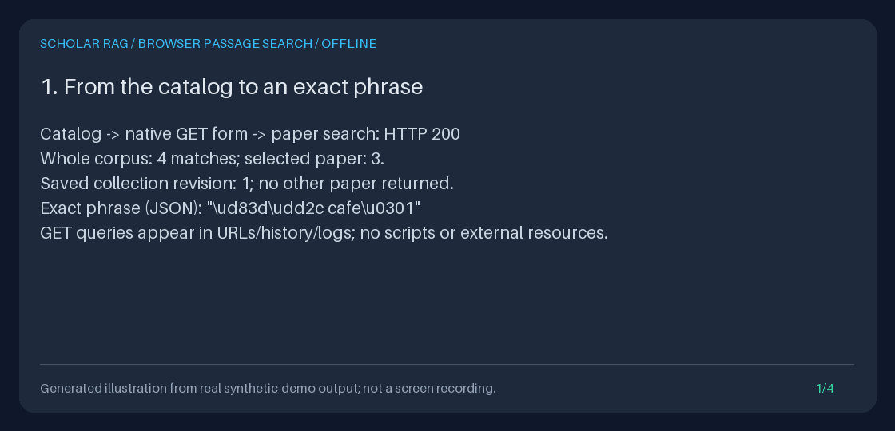

Choose **Search passages** or **Search this paper** in `/explore`. Native GET
forms reuse `SQLiteLiteralSearch` and `POST /research/search`, showing escaped
first-match highlights, exact Unicode offsets and bounded excerpts in stable
ID order. Narrow to one paper or saved collection, follow the exact result
into source context, and return to the same search page without losing scope.
Invalid/empty scopes never become whole-corpus searches.

No scripts, retrieval, generation, events or corpus writes occur. GET queries
appear in URLs/history/logs. The [complete browser/API/Python guide](docs/guides/BROWSER_PASSAGE_SEARCH_GUIDE.md)
covers limits, errors, privacy and reproducible offline output. This generated
actual-output illustration is not a recording or quality benchmark; the
[existing literal API contract](docs/guides/LITERAL_SEARCH_GUIDE.md) is unchanged.

## Compare selected papers before generating

[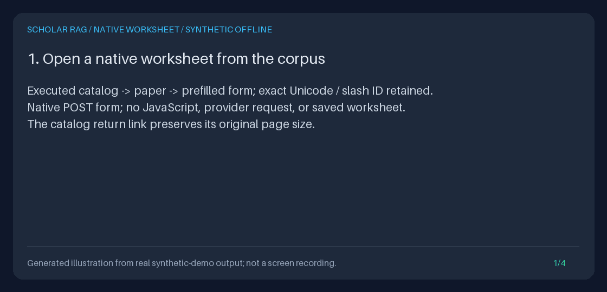](docs/assets/browser-worksheet.gif)

Choose **Build research worksheet** in `/explore`, or start with **Inspect this
paper in a worksheet** on a document page. A script-free native form inspects
up to five questions against each of up to ten selected papers. Follow the
question-by-paper grid into excerpts, provenance and exact current-source links,
or submit for the existing JSON/Markdown downloads. No model calls, saved runs,
or corpus writes occur.

This extends `POST /research/worksheet`, not its retrieval algorithm. Passages
are not answers or scientific judgments; each submission reruns retrieval
against the current corpus, not a frozen result. The [complete browser/API/Python
and portfolio guide](docs/guides/RESEARCH_WORKSHEET_GUIDE.md) covers bounds,
errors, privacy and reproduction. The linked GIF illustrates measured synthetic
output, not browser screenshots, a recording or a quality benchmark.

## Browse saved collections and human screening

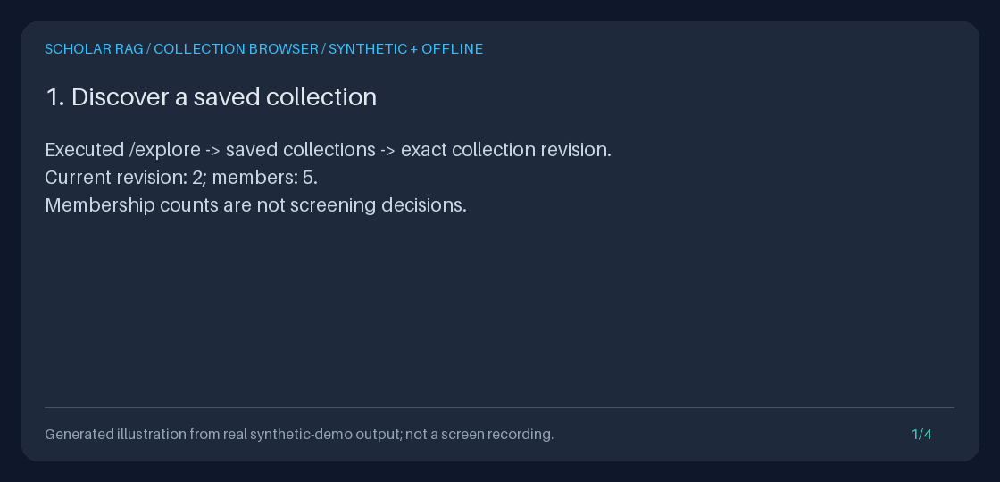

Choose **Browse saved collections** in `/explore`. Inspect current membership,
human statuses/counts/reasons and stale decisions, then follow exact paper/source
readers or open collection-scoped search and worksheet forms. Revision-bound
links download the existing screening JSON/CSV and duplicate JSON/Markdown.
Membership is not screened inclusion; separate requests are not one snapshot.
No models, network or writes run during these collection reads. The
[complete end-user/API/Python and portfolio guide](docs/guides/COLLECTION_BROWSER_GUIDE.md)
covers bounds, errors, privacy and reproduction. The GIF illustrates executed
synthetic output, not a recording or benchmark.

## Inspect duplicate candidates without losing papers

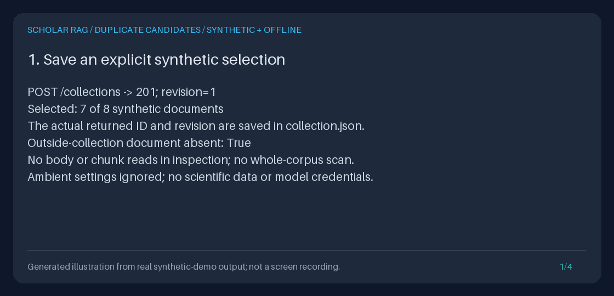

`GET /collections/{collection_id}/duplicates?collection_revision=N` and
`SQLiteCollectionDuplicates.inspect` inspect at most 100 saved members using
existing DOI/title heuristics. Complete JSON and literal-safe Markdown preserve
exact IDs, raw title/source/DOI, cluster-building reasons and every singleton.
Both formats must fit 256 KiB; oversized evidence fails rather than being clipped
into a match. One read-only snapshot ties membership and metadata together.

No papers are deleted, hidden, relabeled or automatically selected; no model,
network, retrieval or event writes occur during inspection. Transitive groups
and conflicting metadata are candidates, not proof of the same scientific work.
The [API/Python and portfolio guide](docs/guides/COLLECTION_DUPLICATES_GUIDE.md)
reproduces this actual-output illustration, not a browser recording or benchmark,
and hands explicit human-chosen IDs to preview or screening.

## Screen papers before retrieving evidence

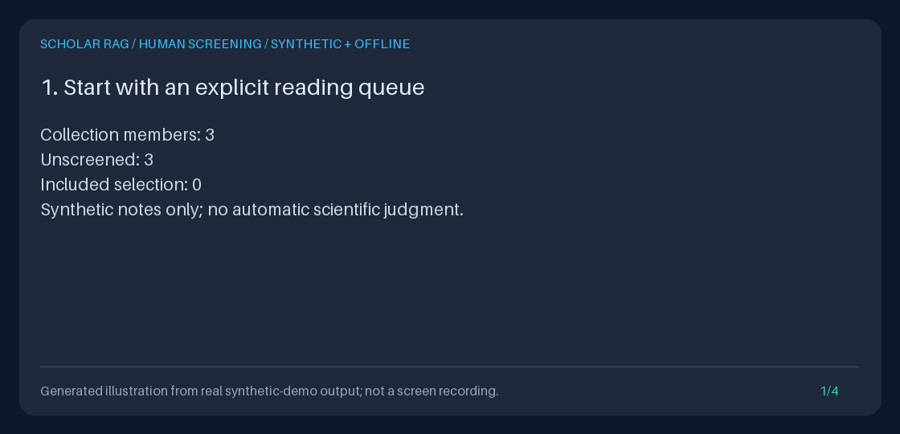

Collection screening saves human labels and reasons without generation or agent
events. Resume after restart, inspect stale decisions after a collection edit,
and explicitly pass current included IDs to retrieval. It is not automated
screening or scientific validation. The [complete guide](docs/guides/PAPER_SCREENING_GUIDE.md)
includes API/Python usage, revision conflicts, privacy limits, and GIF reproduction.

## Inspect human screening decision history

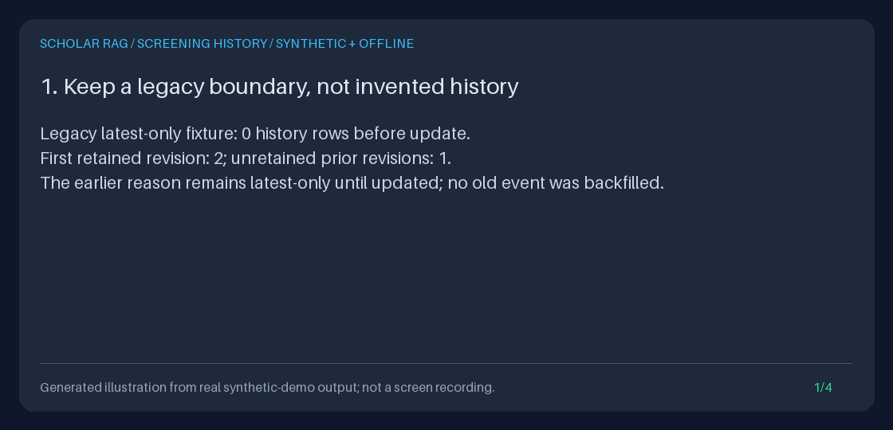

Choose **Inspect human decision history** on a collection member. Each new
successful submission appends its original reason, timestamp and revisions in
the same transaction as the latest decision. Bounded query-selected JSON,
Python and script-free browser readers expose the first retained revision
without backfilling legacy decisions. Historical includes never imply current
inclusion; removed/re-added members retain stale semantics. Existing queue and
export shapes remain unchanged.

The [complete user/API/Python and portfolio guide](docs/guides/SCREENING_HISTORY_GUIDE.md)
covers legacy boundaries, concurrency, pagination, errors, privacy and reproduction.
The GIF illustrates executed synthetic offline output, not browser frames or a
scientific benchmark. Reads run no model, network, retrieval or storage writes.

## Export complete human screening results

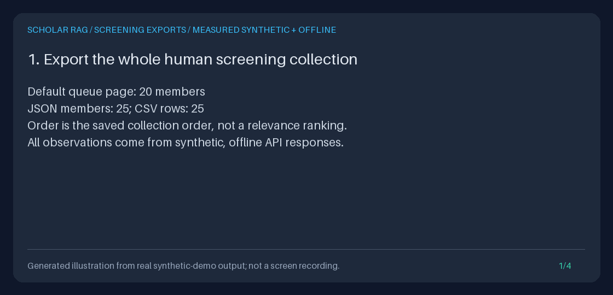

`GET /collections/{collection_id}/screening/export?collection_revision=N&format=json|csv`
downloads all current members, labels, reasons, timestamps, revisions and counts
in one read transaction. Stale includes never become current retrieval IDs.
CSV text cells use a reversible apostrophe prefix; oversized full downloads fail
instead of silently dropping rows. This measured synthetic/offline illustration
is not a live UI, active learning, a PRISMA audit or frozen paper contents.
The [complete API/Python guide](docs/guides/SCREENING_EXPORT_GUIDE.md) covers
escaping, limits, errors, privacy, peer workflow attribution and reproduction.

## Save an auditable human screening progress report

[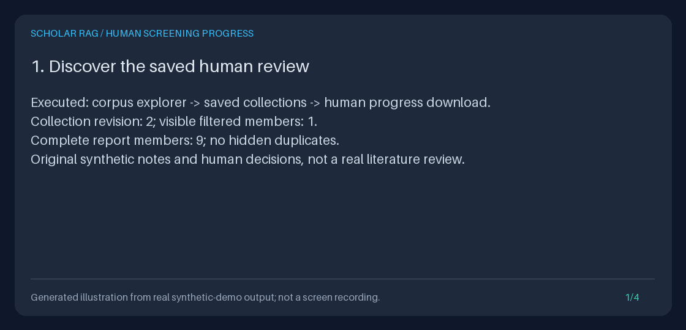](docs/assets/screening-progress-report.gif)

Choose **Human screening progress JSON/Markdown** under a collection's
**Revision-bound downloads**. `GET /collections/{collection_id}/screening-report`
requires the current revision and derives a complete report from one existing
screening export. Current includes/excludes are resolved; unsure, unscreened
and stale opinions still need human review. Exact case/whitespace-sensitive
reason groups retain every excluded member ID, original reason and the complete
source snapshot, with a digest identifying those exact values.

The [user/API/Python and portfolio guide](docs/guides/SCREENING_REPORT_GUIDE.md)
reproduces nine synthetic members despite one visible row: five resolved,
four needing review, and four current exclusions in reason groups `[2, 1, 1]`.
It measures restart-identical bytes, explicit revision conflicts, and zero
models/network/retrieval/writes. This is not PRISMA, automatic screening,
deduplication, scientific validation or a recall/stopping estimate.
The static preview links to an opt-in **generated illustration of executed
output**, not browser footage; the
[measured transcript](docs/assets/screening-progress-report.txt) is also available.

## Export cited sources to a reference manager

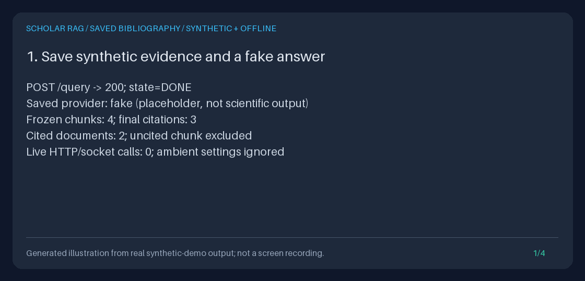

`GET /runs/{run_id}/bibliography` downloads BibTeX from only the completed saved
answer's cited chunks, deduplicated by exact document ID in frozen rank order.
Add `?format=json` for captured metadata, cited-chunk mappings, and explicit
conflict/empty-citation warnings. No current corpus, model, or DOI service is
consulted. Metadata is unverified; review before import, not by compiling LaTeX.
The [complete guide](docs/guides/SAVED_BIBLIOGRAPHY_GUIDE.md) includes offline
API/Python usage and reproduction of this actual-output illustration.

## Keep human notes on exact frozen quotes

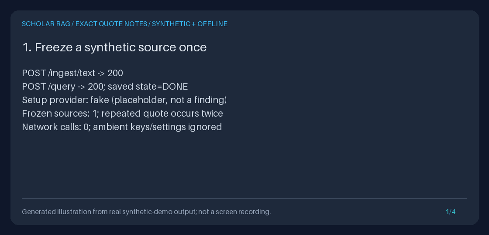

`POST /runs/{run_id}/annotations` saves a human note at an exact Unicode
character span in completed frozen evidence. Repeated phrases stay tied to
their selected occurrence; UUID retries are idempotent and changed payloads
conflict instead of overwriting. GET recovers bounded history after restart
even when the current corpus is removed. No model, retrieval, or agent-event
write is involved. A note is an opinion and a quote is provenance, not proof.
The [complete API/Python guide](docs/guides/EVIDENCE_ANNOTATIONS_GUIDE.md) covers
selectors, errors, privacy, and reproduction from measured synthetic results.

## Inspect a recorded run

To inspect retrieval **without creating a run**, use `POST /retrieve` or
`await container.runner.preview(...)`. The [retrieval preview guide](docs/guides/RETRIEVAL_PREVIEW_GUIDE.md)
includes a reproducible offline GIF, Python/API examples, exact chunk/rank/path
and context-digest contracts, scope, and errors. This is the shared `/query`
context preparation, not semantic entailment or a promise about a changed corpus.

To block answer generation below a chosen distinct-document count, use
[`min_evidence_documents`](docs/guides/MINIMUM_EVIDENCE_DOCUMENTS_GUIDE.md).
Previews with an unmet minimum keep their passages; queries with an unmet
minimum preserve a diagnostic and snapshot without generating. Operational
preview failures return errors, not partial evidence. Passing a count is not
proof of scientific support.

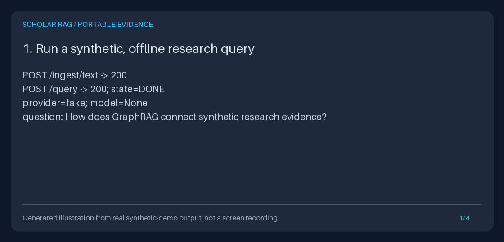

This generated animation illustrates the synthetic offline evidence-export demo,
not a live research UI or a real model's scientific findings. Follow the
[demo reproduction instructions](docs/DEMO.md) to inspect the actual output.

Forgot the run ID? `GET /runs?limit=20` discovers persisted runs with bounded
query previews and creation-ordered pagination. Its recorded state is not a
liveness claim; see [run history and restart recovery](docs/guides/RUN_HISTORY_GUIDE.md).

`GET /runs/{run_id}/export?format=json|markdown|html` reconstructs a completed run from
stored evidence, without another retrieval or generation call. Keep the query,
plan, answer, claims, exact source chunks, trace, and nonsecret model provenance
together for review. The saved context survives corpus changes and restart; this
is not a guarantee of identical output from a new LLM run or a signed audit record.

`POST /runs/{run_id}/reviews` records a bounded human judgment and comment in a
separate SQLite table. `GET /runs/{run_id}/reviews` reads retry-safe, paginated
history after restart without changing the saved answer or events. Acceptance is
an opinion, not factual verification or an authenticated approval. See the
[review guide and actual-output offline GIF](docs/guides/ANSWER_REVIEWS_GUIDE.md).

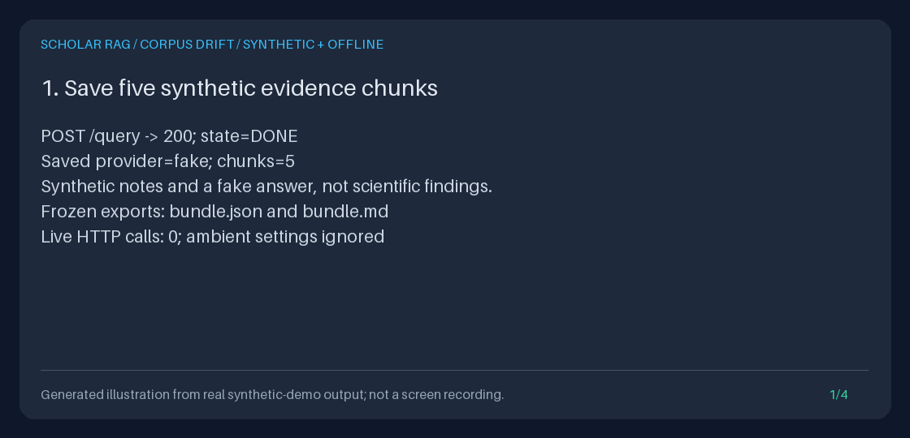

`GET /runs/{run_id}/corpus-drift` compares frozen chunk/document identities and
exact field digests with current persisted chunks in one read-only transaction.
It reports changed or missing evidence without retrieval, generation, or event
writes. “Unchanged” means matching chunk fields, not whole-paper equality or
scientific validity. The [guide](docs/guides/CORPUS_DRIFT_GUIDE.md) includes bounded
API/Python usage and reproduction of this actual-output offline illustration.

## What actually runs

The API uses a hand-written **Observe -> Decide -> Act** state machine, not
LangGraph. Pydantic validates settings and schemas; HTTPX connects optional live
providers; SQLite stores documents, graph data, and durable run events.

| Stage | Default behavior |
| --- | --- |
| Ingest | `/ingest/text` normalizes text into fixed-size overlapping chunks and indexes entity co-mentions |
| Plan | Keyword-based intent analysis creates bounded retrieval tasks and a rationale trace |
| Retrieve | Deterministic HyDE template expansion, hash-vector cosine retrieval, BM25, and reciprocal rank fusion |
| Expand | Bounded traversal of an entity co-mention graph; paths are retrieval aids, not reasoning proofs |
| Rerank | Lexical overlap via `AdaptiveReranker`, not a learned cross-encoder |
| Generate and check | A routed provider or the fake adapter; claim/source-ID mapping with token-overlap checks |
| Record | SQLite events and frozen evidence for completed-run exports |

`DenseRetriever` uses `HashEmbeddingModel`: deterministic lexical hash vectors,
**not learned semantic embeddings**. Installing optional ML dependencies does not
switch the API to semantic embeddings or cross-encoder reranking. MMR, multi-HyDE,
query rewriting, screening checklists, metadata boosts, paper chat memory, and
most other cataloged helpers require explicit library integration.

For the exact wiring and storage lifecycle, see [Architecture](ARCHITECTURE.md).
For current model IDs, per-provider overrides, routing, and dated official
sources, use the [provider model guide](docs/guides/PROVIDER_MODELS_GUIDE.md).
The **2026-10-23 America/Los_Angeles** catalog-only recheck identifies
`gemini-4-argon` as Google's latest flagship while retaining the selected
Astra, Sonnet 5.5, Gemini 3.8 Flash and Kimi K3 defaults. OpenAI 6.1 Sol and
Anthropic Haiku 5.5 are additional catalog alternatives, not new compatibility
claims. Selected defaults, endpoints, budgets and separately dated migration
contracts remain unchanged. No live account or inference verification was performed.
Human screening progress reports use none of these models or provider endpoints.
Gemini `CONTINUATION` hops now fail explicitly instead of becoming completed
answers; there is no long-decode loop or increase to the current 60-second
HTTPX timeouts and default reasoning deadline.
`/query` requests the reasoning route; the default-provider setting is not a
universal override. Provider availability depends on your account and credentials.

## Boundaries to understand

- **A citation is not verification.** `CitationGrounder` checks token overlap and
  source IDs, not factual correctness or entailment. Review original passages,
  opposing evidence, and warnings even when `grounded` is true.
- **This is not a complete review platform.** Supporting/counter-evidence tasks
  do not constitute a systematic review, novelty proof, or medical decision.
  The offline demo is a plumbing demonstration, not a quality evaluation.
- **Local-first is not production-hardened.** There is no built-in authentication,
  tenant isolation, or PDF-upload endpoint/UI. Keep the API on loopback.
- **Evidence exports contain source text.** Queries, documents, answers, and
  local metadata may be sensitive. Live providers receive retrieved context;
  review permissions and content before transmitting or sharing anything.

Read [Safety](SAFETY.md) before using non-synthetic material.

## Offline evidence extractors

Clinical and statistical cue extractors are **opt-in Python helpers**, not
additional `/query` stages or clinical assessments. Browse the
[categorized cue guides](docs/README.md#clinical-and-statistical-evidence-cues)
for study-design, outcome, statistical, and reporting cues. Each guide retains
its usage examples and illustration; these heuristics do not validate findings.

Existing cue illustrations remain available without interrupting the introduction:

| Opt-in helper | Illustration |
| --- | --- |
| PerProtocolAnalysisCueExtractor | [GIF](docs/assets/per-protocol-analysis-cue-extractor.gif) |
| BayesianInterimPriorCueExtractor | [GIF](docs/assets/bayesian-interim-prior-cue-extractor.gif) |
| DifferenceInDifferencesCueExtractor | [GIF](docs/assets/difference-in-differences-cue-extractor.gif) |
| NegativeControlExposureCueExtractor | [GIF](docs/assets/negative-control-exposure-cue-extractor.gif) |
| EValueSensitivityCueExtractor | [GIF](docs/assets/evalue-sensitivity-cue-extractor.gif) |
| DoseResponseCueExtractor | [GIF](docs/assets/dose-response-cue-extractor.gif) |
| SpilloverInterferenceCueExtractor | [GIF](docs/assets/spillover-interference-cue-extractor.gif) |
| PlaceboTestCueExtractor | [GIF](docs/assets/placebo-test-cue-extractor.gif) |
| HeterogeneousTreatmentEffectCueExtractor | [GIF](docs/assets/heterogeneous-treatment-effect-cue-extractor.gif) |
| RegressionDiscontinuityCueExtractor | [GIF](docs/assets/regression-discontinuity-cue-extractor.gif) |
| InterruptedTimeSeriesCueExtractor | [GIF](docs/assets/interrupted-time-series-cue-extractor.gif) |
| PropensityScoreMatchingCueExtractor | [GIF](docs/assets/propensity-score-matching-cue-extractor.gif) |
| SyntheticControlCueExtractor | [GIF](docs/assets/synthetic-control-cue-extractor.gif) |
| NegativeControlOutcomeCueExtractor | [GIF](docs/assets/negative-control-outcome-cue-extractor.gif) |
| MendelianRandomizationCueExtractor | [GIF](docs/assets/mendelian-randomization-cue-extractor.gif) |
| InstrumentalVariableStrengthCueExtractor | [GIF](docs/assets/instrumental-variable-strength-cue-extractor.gif) |
| TimeVaryingConfoundingCueExtractor | [GIF](docs/assets/time-varying-confounding-cue-extractor.gif) |
| MediationAnalysisCueExtractor | [GIF](docs/assets/mediation-analysis-cue-extractor.gif) |
| CompetingRiskCueExtractor | [GIF](docs/assets/competing-risk-cue-extractor.gif) |
| TransportabilityCueExtractor | [GIF](docs/assets/transportability-cue-extractor.gif) |
| ConfoundingAdjustmentCueExtractor | [GIF](docs/assets/confounding-adjustment-cue-extractor.gif) |
| MissingDataMechanismCueExtractor | [GIF](docs/assets/missing-data-mechanism-cue-extractor.gif) |
| EstimandIchE9CueExtractor | [GIF](docs/assets/estimand-ich-e9-cue-extractor.gif) |
| SimpsonParadoxCueExtractor | [GIF](docs/assets/simpson-paradox-cues.gif) |

| ResidualConfoundingCueExtractor | [GIF](docs/assets/residual-confounding-cues.gif) |
| IntervalCensoringCueExtractor | [GIF](docs/assets/interval-censoring-cues.gif) |
| EcologicalFallacyCueExtractor | [GIF](docs/assets/ecological-fallacy-cues.gif) |
| DetectionBiasCueExtractor | [GIF](docs/assets/detection-bias-cues.gif) |
| HealthyUserBiasCueExtractor | [GIF](docs/assets/healthy-user-bias-cues.gif) |
| InformationBiasCueExtractor | [GIF](docs/assets/information-bias-cues.gif) |
| NoveltyBiasCueExtractor | [GIF](docs/assets/novelty-bias-cues.gif) |
| ChannelingBiasCueExtractor | [GIF](docs/assets/channeling-bias-cues.gif) |
| PrevalenceIncidenceBiasCueExtractor | [GIF](docs/assets/prevalence-incidence-bias-cues.gif) |
| IncorporationBiasCueExtractor | [GIF](docs/assets/incorporation-bias-cues.gif) |
| WillRogersPhenomenonCueExtractor | [GIF](docs/assets/will-rogers-phenomenon-cues.gif) |
| ReferralBiasCueExtractor | [GIF](docs/assets/referral-bias-cues.gif) |
| HawthorneEffectCueExtractor | [GIF](docs/assets/hawthorne-effect-cues.gif) |
| RightCensoringCueExtractor | [GIF](docs/assets/right-censoring-cues.gif) |

## Documentation

| Guide | Purpose |
| --- | --- |
| [Quickstart](QUICKSTART.md) | Working offline setup and first API request |
| [Research workflow and portfolio](docs/guides/RESEARCH_WORKFLOW_GUIDE.md) | Corpus, questions, evidence review, export, and acceptance checklist |
| [API and library examples](docs/EXAMPLES.md) | Copyable requests and clearly separated network adapters |
| [Configuration](CONFIGURATION.md) | Runtime settings and provider setup |
| [Architecture](ARCHITECTURE.md) | Integrated pipeline and persistence |
| [Documentation catalog](docs/README.md) | All existing extension/source guides, operations, and historical records |
| [Contributing](CONTRIBUTING.md) / [Security](SECURITY.md) | Contribution workflow and vulnerability reporting |

## Quality gates

```bash
uv run ruff check . && uv run ruff format --check .
uv run mypy src/
uv run pytest tests/ -v --cov=src --cov-fail-under=70
```

[CI](.github/workflows/ci.yml) runs on Python 3.11 and 3.12.
[Security Scan](.github/workflows/security.yml) also audits dependencies and runs
Bandit. Passing these checks is not a scientific-accuracy benchmark.

| DiagnosticAccessBiasCueExtractor | [GIF](docs/assets/diagnostic-access-bias-cues.gif) |

| NonDifferentialMisclassificationCueExtractor | [GIF](docs/assets/non-differential-misclassification-cues.gif) |
| SocialDesirabilityBiasCueExtractor | [GIF](docs/assets/social-desirability-bias-cues.gif) |
| IndexEventBiasCueExtractor | [GIF](docs/assets/index-event-bias-cues.gif) |
| CompetingEventBiasCueExtractor | [GIF](docs/assets/competing-event-bias-cues.gif) |

## License

[Apache-2.0](LICENSE). Source papers and third-party service content retain their
own licenses and access terms.
