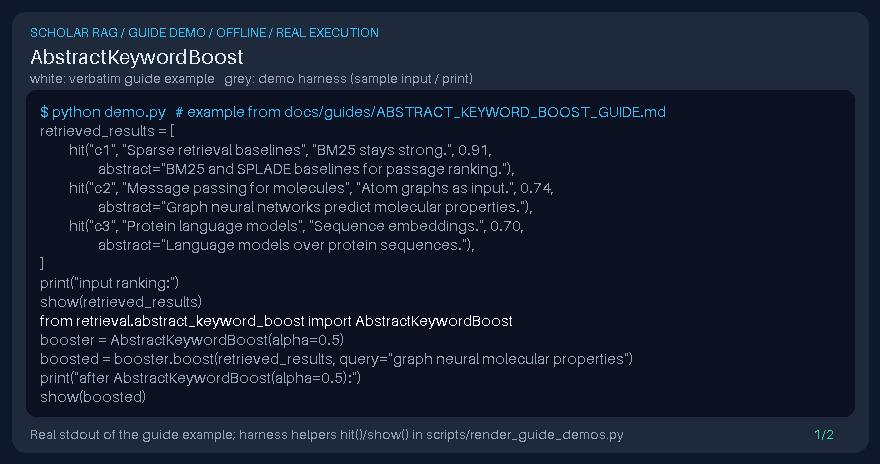

# AbstractKeywordBoost Guide



Local retrieval postprocessor for GPT-6 Astra / Claude Opus 5.5 / Gemini 4 Argon / Kimi K3.1 Pro pipelines (not a DOI connector).

Inspired by LlamaIndex/Haystack keyword boost postprocessors. Soft-boosts hits when abstract metadata or chunk text contains query keywords (from the query string, explicit ``query_terms``, or ``metadata["keywords"]``).

## Usage

```python
from retrieval.abstract_keyword_boost import AbstractKeywordBoost
```

See unit tests for edge cases.
