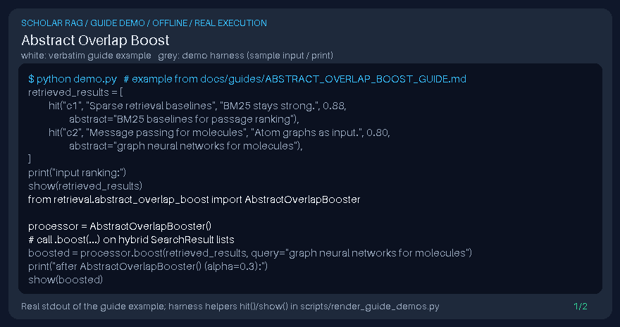

# Abstract Overlap Boost Guide



Inspired by LlamaIndex/Haystack keyword-overlap postprocessors; boosts hits whose abstract/summary metadata overlaps the query tokens (not a DOI connector).

Works with GPT-6 Astra / Claude Opus 5.5 / Gemini 4 Argon / Kimi K3.1 Pro answer stacks.

## Usage

```python
from retrieval.abstract_overlap_boost import AbstractOverlapBooster

processor = AbstractOverlapBooster()
# call .boost(...) on hybrid SearchResult lists
```

## Safety

Local metadata only — no network calls and no DOI connector side effects.
