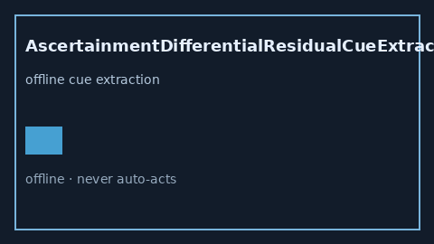

# AscertainmentDifferentialResidualCueExtractor Guide



Offline advisory cue extractor.
Gap vs Elicit/Consensus/Connected Papers ascertainment-differential residual cue extractors. Distinct from `AscertainmentBiasCueExtractor` / `SelectionBiasCueExtractor`.

Optional narrative via **GPT-5.5 / Claude Sonnet 4.6 / Gemini 3.x / Kimi K2**.

## Usage

```python
from retrieval.ascertainment_differential_residual_cues import (
    AscertainmentDifferentialResidualCueExtractor,
)

rows = AscertainmentDifferentialResidualCueExtractor().extract(
    [{"paper_id": "p1", "abstract": "ascertainment differential residual"}],
)
print(rows[0].flagged, rows[0].cues)
```

## Safety

Advisory only. No network I/O. Never auto-acts.
