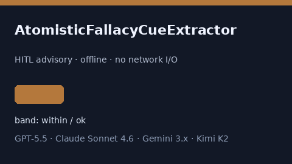

# AtomisticFallacyCueExtractor Guide



Offline HITL helper for `cues` bands.
Gap vs Elicit/Consensus/Connected Papers atomistic-fallacy cue extractors. Distinct from `EcologicalFallacyCueExtractor` / `SimpsonParadoxCueExtractor`.

Optional polish via **GPT-5.5 / Claude Sonnet 4.6 / Gemini 3.x / Kimi K2**.

## Usage

```python
from retrieval.atomistic_fallacy_cues import AtomisticFallacyCueExtractor

rows = AtomisticFallacyCueExtractor().extract(
    [
        {
            "paper_id": "p1",
            "abstract": "Authors note atomistic fallacy concerns.",
        }
    ],
)
print(rows[0].flagged, rows[0].cues)
```

## Safety

Advisory only. No network I/O. Never auto-acts. Humans decide.
