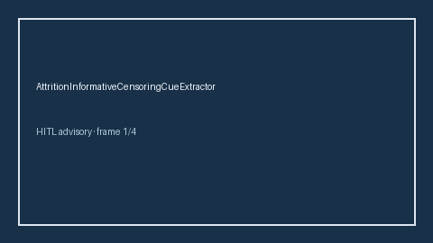

# AttritionInformativeCensoringCueExtractor Guide



Offline deterministic cue extractor. Never network I/O. Gap vs Elicit/Consensus/AJE attrition informative-censoring cue extractors.

Optional later narrative via **GPT-5.5 / Claude Sonnet 4.6 / Gemini 3.x / Kimi K2**.

## Usage

```python
from retrieval.attrition_informative_censoring_cues import AttritionInformativeCensoringCueExtractor

cues = AttritionInformativeCensoringCueExtractor().extract(
    [{"paper_id": "p1", "abstract": "Bias may arise from informative censoring in the cohort."}]
)
print(cues[0].flagged, cues[0].cue_kind)
```
