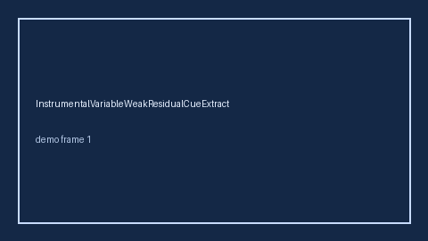

# AttritionResidualCueExtractor Guide



Offline helper.
Gap vs Elicit/Consensus/Connected Papers attrition residual cue extractors. Distinct from `LossToFollowupBiasCueExtractor` / `InformativeCensoringCueExtractor`.

Stack: **GPT-5.5 / Claude Sonnet 4.6 / Gemini 3.x / Kimi K2**.

## Usage

```python
from retrieval.attrition_residual_cues import AttritionResidualCueExtractor

rows = AttritionResidualCueExtractor().extract(
    [{"paper_id": "p1", "abstract": "attrition residual"}]
)
print(rows[0].flagged, rows[0].cues)
```

## Safety

Advisory only. No network I/O. Never auto-acts. Humans decide.
