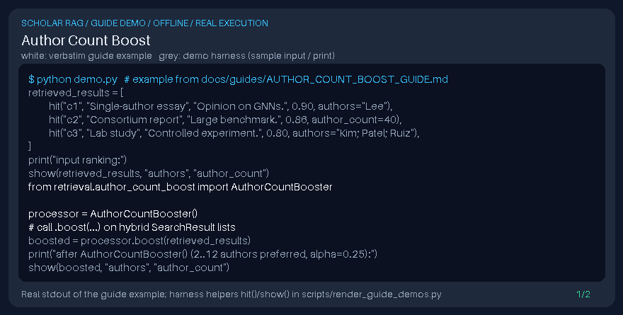

# Author Count Boost Guide



Inspired by bibliometric priors in scholarly RAG (Haystack-style metadata boosts); softly prefers mid-sized author lists over single-author or extreme mega-author rows (not a DOI connector).

Works with GPT-6 Astra / Claude Opus 5.5 / Gemini 4 Argon / Kimi K3.1 Pro answer stacks.

## Usage

```python
from retrieval.author_count_boost import AuthorCountBooster

processor = AuthorCountBooster()
# call .boost(...) on hybrid SearchResult lists
```

## Safety

Local metadata only — no network calls and no DOI connector side effects.
