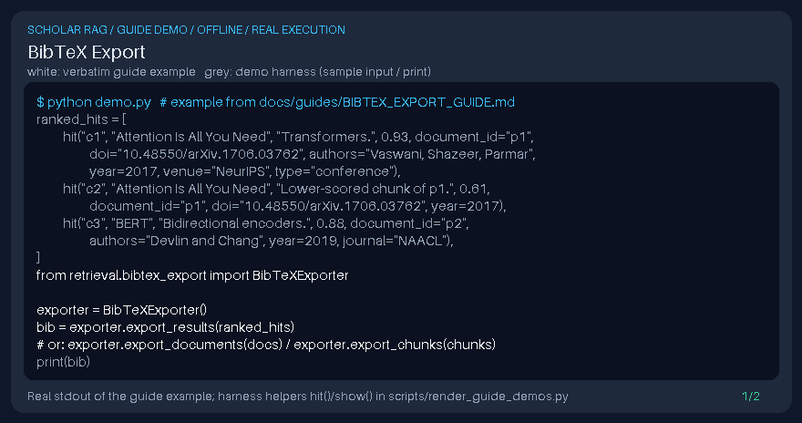

# BibTeX Export Guide



`BibTeXExporter` converts `Document`, `Chunk`, and `SearchResult` records into
BibTeX bibliography entries using title and common scholarly metadata fields
(`authors`, `year`, `journal`/`venue`, `doi`). Inspired by
[Zotero](https://www.zotero.org/) and
[PaperQA](https://github.com/Future-House/paper-qa) citation workflows.
This model-independent local transform makes no network calls and is distinct
from retrieval gates and live DOI connectors. For optional generation providers
and dated current-model guidance, see [Provider models](PROVIDER_MODELS_GUIDE.md).

## Usage

```python
from retrieval.bibtex_export import BibTeXExporter

exporter = BibTeXExporter()
bib = exporter.export_results(ranked_hits)
# or: exporter.export_documents(docs) / exporter.export_chunks(chunks)
```

## Identity, ordering, and citation keys

Collections deduplicate **exact** `document_id` strings, consistent with the
stored corpus. Case and whitespace are significant: `Paper`, `paper`, and
` paper` remain distinct records. Documents/chunks retain the first occurrence;
search results retain the highest-scoring occurrence, with the first winning
ties, then sort by descending score. Inputs are not mutated.

Citation keys still derive from the first available DOI or document ID using
the existing lowercase alphanumeric/underscore normalization. Collection
exports now disambiguate collisions with `_2`, `_3`, and subsequent suffixes.
All natural keys are reserved first: exporting `paper-a`, `paper_a`, and
`paper_a_2` yields `paper_a`, `paper_a_3`, and `paper_a_2`, respectively. A shared
DOI does not silently merge two distinct document identities.

Keys are deterministic for the same ordered collection, not persistent global
identifiers across different selections or reordered inputs. Single-record
exports and noncolliding collection keys retain their existing form. Export a
whole bibliography in one collection call rather than concatenating separate
single-record exports, which cannot coordinate their keys.

## Braces and backslashes in field values

Every field value is written inside braces. BibTeX and Biber end a value at the
brace that balances its opening brace, and they count every `{` and `}`, even
one after a backslash. The exporter therefore:

- doubles each backslash;
- writes a matched pair of literal braces as escaped braces, as before:
  `Analysis of {DNA} repair` becomes `Analysis of \{DNA\} repair`;
- writes an unmatched brace as the balanced LaTeX group `{\textbraceleft}` or
  `{\textbraceright}`, which prints a literal brace.

Untrusted metadata therefore cannot end a field early, forge another field
such as `author`, or swallow the following fields and entries:

```text
title:  Sets } , author = {Injected Person
BibTeX: title = {Sets {\textbraceright} , author = {\textbraceleft}Injected Person},
```

The rule applies to every exported field. Importers that instead treat `\{`
and `\}` as escaped characters read exactly the same field boundaries.
Verbatim fields such as biblatex's `doi` and `url` show escapes and groups
literally, so compare them with the original metadata.

## Metadata limitations

The exporter uses supplied metadata, not a verified citation registry. Author
and year parsing remain heuristic; review imported references in your reference
manager before publication. The brace handling above keeps entries structurally
intact, but this is not a LaTeX sandbox or a guarantee that arbitrary metadata is
safe to compile. No DOI, author, publication status, or scientific claim is verified.

Author strings that already contain `" and "` (case-insensitively) are kept as
written. When a semicolon or pipe is present, only semicolons and pipes separate
names, so the bioRxiv/medRxiv form `Doe, J.; Smith, A.` exports as
`Doe, J. and Smith, A.` (two authors in BibTeX's `Family, Given` form).
Otherwise commas separate names (`Ada Lovelace, Alan Turing`), except that a
list whose every second part is only initials keeps `Family, Initials` pairs
together: `Lee, B.` is one author. A comma-only `Family, Given` name with a full
given name, such as `Lovelace, Ada`, is still read as two names.
