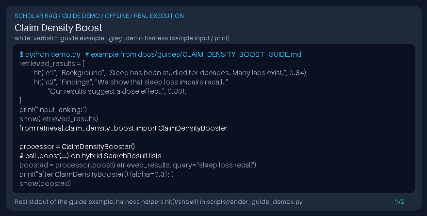

# Claim Density Boost Guide



Inspired by claim-centric reranking in scholarly RAG (PaperQA/LlamaIndex); boosts hits whose chunk text has higher density of claim-like sentences (not a DOI connector).

Works with GPT-6 Astra / Claude Opus 5.5 / Gemini 4 Argon / Kimi K3.1 Pro answer stacks.

## Usage

```python
from retrieval.claim_density_boost import ClaimDensityBooster

processor = ClaimDensityBooster()
# call .boost(...) on hybrid SearchResult lists
```

## Safety

Local chunk text only — no network calls and no DOI connector side effects.
