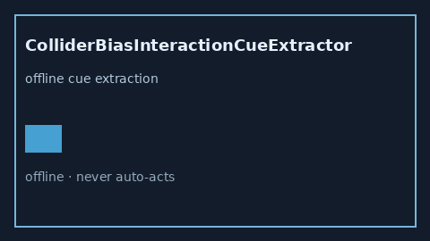

# ColliderBiasInteractionCueExtractor Guide



Offline advisory cue extractor.
Gap vs Elicit/Consensus/Connected Papers collider-bias interaction cue extractors. Distinct from `ColliderStratificationCueExtractor` / `OveradjustmentBiasCueExtractor`.

Optional narrative via **GPT-5.5 / Claude Sonnet 4.6 / Gemini 3.x / Kimi K2**.

## Usage

```python
from retrieval.collider_bias_interaction_cues import ColliderBiasInteractionCueExtractor

rows = ColliderBiasInteractionCueExtractor().extract(
    [{"paper_id": "p1", "abstract": "collider bias interaction"}],
)
print(rows[0].flagged, rows[0].cues)
```

## Safety

Advisory only. No network I/O. Never auto-acts.
