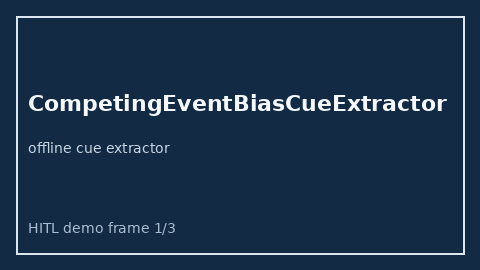

# CompetingEventBiasCueExtractor Guide



Offline cue extractor for deterministic title/abstract/methods patterns.
Gap vs Elicit/Consensus/Connected Papers competing-event bias cue extractors. Distinct from `RightCensoringCueExtractor` / `AttritionInformativeCensoringCueExtractor`.

Optional polish via **GPT-5.5 / Claude Sonnet 4.6 / Gemini 3.x / Kimi K2**.

## Usage

```python
from retrieval.competing_event_bias_cues import CompetingEventBiasCueExtractor

rows = CompetingEventBiasCueExtractor().extract(
    [{"paper_id": "p1", "abstract": "Authors warn about competing event bias."}]
)
assert rows[0].flagged is True
```

## Safety

Advisory only. No network I/O. Humans decide.
