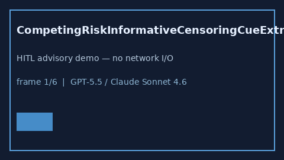

# CompetingRiskInformativeCensoringCueExtractor Guide



Offline advisory bias cues.
Gap vs Elicit/Consensus/Connected Papers competing-risk informative-censoring cue extractors. Distinct from `CompetingEventBiasCueExtractor` / `AttritionInformativeCensoringCueExtractor`.

Optional narrative via **GPT-5.5 / Claude Sonnet 4.6 / Gemini 3.x / Kimi K2**.

## Usage

```python
from retrieval.competing_risk_informative_censoring_cues import (
    CompetingRiskInformativeCensoringCueExtractor,
)

rows = CompetingRiskInformativeCensoringCueExtractor().extract(
    [
        {
            "paper_id": "p1",
            "abstract": "Competing-risk informative censoring may bias the cumulative incidence.",
        }
    ],
)
print(rows[0].flagged, rows[0].cues)
```

## Safety

Advisory only. No network I/O. Never auto-acts.
