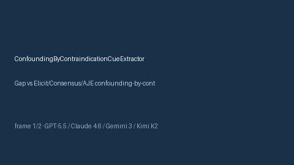

# ConfoundingByContraindicationCueExtractor Guide



Offline cue extractor for scholarly evidence screening.
Gap vs Elicit/Consensus/AJE confounding-by-contraindication cue extractors. Distinct from `ChannelingBiasCueExtractor` / `ResidualConfoundingCueExtractor`.

Optional polish via **GPT-5.5 / Claude Sonnet 4.6 / Gemini 3.x / Kimi K2**.

## Usage

```python
from retrieval.confounding_by_contraindication_cues import ConfoundingByContraindicationCueExtractor

rows = ConfoundingByContraindicationCueExtractor().extract(
    [
        {
            "paper_id": "p1",
            "abstract": "Analysis discusses confounding by contraindication carefully.",
        }
    ],
)
print(rows[0].flagged, rows[0].cues)
```

## Safety

Advisory cues only. No network I/O. Humans decide.
