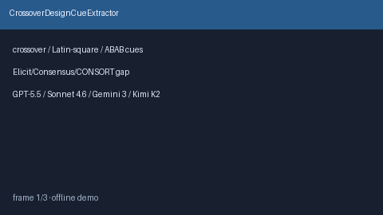

# CrossoverDesignCueExtractor Guide



Offline evidence-methods cue extractor for crossover / Latin-square / ABAB
designs. Never network I/O. Gap vs Elicit / Consensus / CONSORT crossover.

Optional later polish via **GPT-6 Astra / Claude Opus 5.5 / Gemini 4 Argon / Kimi K3.1 Pro**.

Distinct from `ClusterRandomizationCueExtractor` and `WashoutPeriodCueExtractor`.

## Usage

```python
from retrieval.crossover_design_cues import CrossoverDesignCueExtractor

rows = CrossoverDesignCueExtractor().extract(
    [{"paper_id": "p1", "abstract": "A randomized crossover trial of therapy."}]
)
assert rows[0].flagged is True
```
