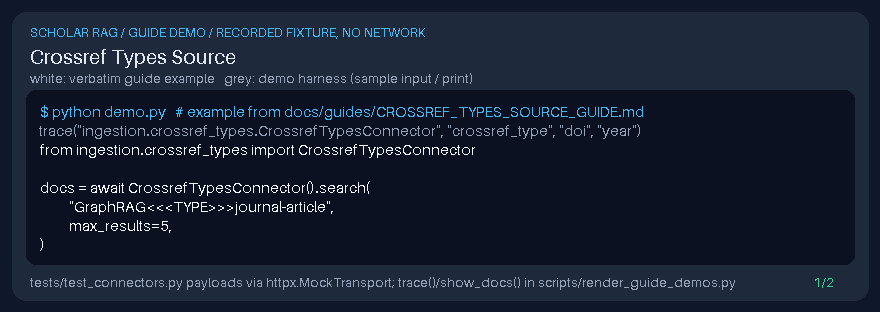

# Crossref Types Source Guide

Search Crossref works with a `filter=type:...` facet — a common gap vs base Crossref connectors in scholarly RAG stacks. Prefer **GPT-6 Astra**, **Claude Opus 5.5**, **Gemini 4 Argon**, **Kimi K3.1 Pro** for synthesis.



## Usage

```python
from ingestion.crossref_types import CrossrefTypesConnector

docs = await CrossrefTypesConnector().search(
    "GraphRAG<<<TYPE>>>journal-article",
    max_results=5,
)
```

`metadata.source_type` is `crossref_types`. Allowed types include `journal-article`, `proceedings-article`, `book-chapter`, `posted-content`, and `dataset`.
