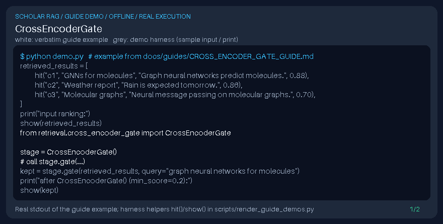

# CrossEncoderGate Guide



Gap fill vs SentenceTransformer cross-encoder gates without requiring model downloads.

Works with GPT-6 Astra / Claude Opus 5.5 / Gemini 4 Argon / Kimi K3.1 Pro scholarly RAG pipelines.
Not a DOI connector.

## Usage

```python
from retrieval.cross_encoder_gate import CrossEncoderGate

stage = CrossEncoderGate()
# call stage.gate(...)
```

See unit tests for edge cases.
