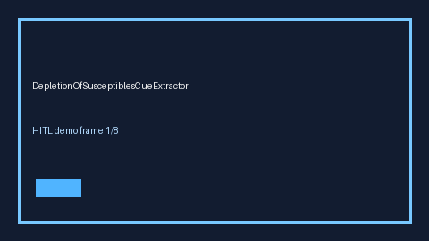

# DepletionOfSusceptiblesCueExtractor Guide



Offline cue extractor. Never network I/O. Gap vs Elicit/Consensus/AJE depletion-of-susceptibles cue extractors.

Optional narrative via **GPT-5.5 / Claude Sonnet 4.6 / Gemini 3.x / Kimi K2**.

Distinct from `HealthyWorkerEffectCueExtractor` / `SelectionBiasCueExtractor`.

## Usage

```python
from retrieval.depletion_of_susceptibles_cues import DepletionOfSusceptiblesCueExtractor

rows = [{"paper_id": "p1", "abstract": "We discuss depletion of susceptibles."}]
print(DepletionOfSusceptiblesCueExtractor().extract(rows)[0].flagged)
```

## Safety

Advisory cues only. Humans decide.
