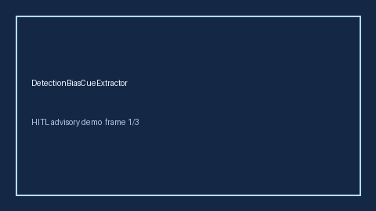

# DetectionBiasCueExtractor Guide



Offline evidence cue extractor. Never network I/O. Gap vs Elicit/Consensus/AJE detection/referral-bias cue extractors.

Optional later narrative via **GPT-5.5 / Claude Sonnet 4.6 / Gemini 3.x / Kimi K2**.

Distinct from `VerificationBiasCueExtractor` / `LeadTimeBiasCueExtractor`.

## Usage

```python
from retrieval.detection_bias_cues import DetectionBiasCueExtractor

rows = [
    {
        "paper_id": "p1",
        "abstract": "We discuss detection bias from differential screening intensity.",
    }
]
out = DetectionBiasCueExtractor().extract(rows)
print(out[0].flagged, out[0].cue_kind)
```

## Safety

Advisory cues only. Humans decide.
