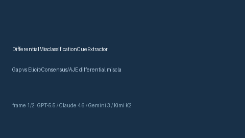

# DifferentialMisclassificationCueExtractor Guide



Offline cue extractor for scholarly evidence screening.
Gap vs Elicit/Consensus/AJE differential misclassification cue extractors. Distinct from `NonDifferentialMisclassificationCueExtractor` / `MeasurementErrorBiasCueExtractor`.

Optional polish via **GPT-5.5 / Claude Sonnet 4.6 / Gemini 3.x / Kimi K2**.

## Usage

```python
from retrieval.differential_misclassification_cues import DifferentialMisclassificationCueExtractor

rows = DifferentialMisclassificationCueExtractor().extract(
    [{"paper_id": "p1", "abstract": "Study notes differential misclassification in methods."}],
)
print(rows[0].flagged, rows[0].cues)
```

## Safety

Advisory cues only. No network I/O. Humans decide.
