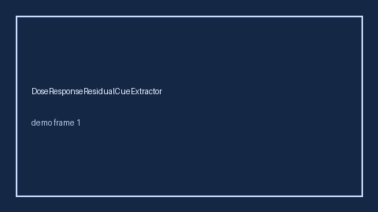

# DoseResponseResidualCueExtractor Guide



Offline helper.
Gap vs Elicit/Consensus/Connected Papers dose-response residual cue extractors. Distinct from `DoseResponseCueExtractor` / `SurrogateEndpointCueExtractor`.

Stack: **GPT-6 Astra / Claude Opus 5.5 / Gemini 4 Argon / Kimi K3.1 Pro**.

## Usage

```python
from retrieval.dose_response_residual_cues import DoseResponseResidualCueExtractor

rows = DoseResponseResidualCueExtractor().extract(
    [{"paper_id": "p1", "abstract": "We discuss dose response residual."}]
)
print(rows[0].flagged, rows[0].cues)
```

## Safety

Advisory only. No network I/O. Never auto-acts. Humans decide.
