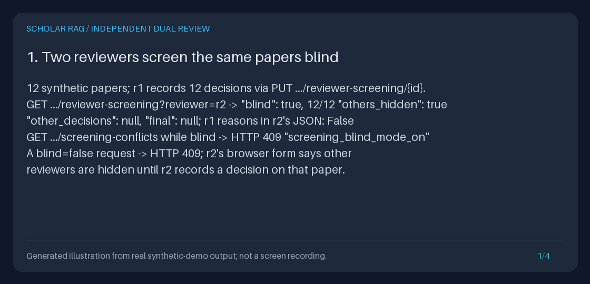

# Screen independently with two blind reviewers

Let two or more people screen the same saved collection **independently**, keep each
person's view **blind** to the others until they have decided a paper, list the papers
where their decisions **disagree**, record an **append-only resolution** that becomes the
paper's final decision, and report **inter-rater agreement**: confusion counts, observed
agreement, Cohen's kappa with a 95% confidence interval, PABAK and the Landis-Koch band.

Each reviewer works under a short **pseudonymous label** such as `r1` or `reviewer-b`.
Everything runs locally on the existing SQLite store: no model, retrieval, network call
or automatic decision is involved, and existing unlabeled decisions keep working
unchanged as the reviewer `default`.

[](../assets/dual-reviewer-screening.gif)

The static preview links to an opt-in four-frame GIF. It is a **generated illustration of
actual offline synthetic execution** (real API status codes and JSON fields, the rendered
team page and measured statistics), not browser footage. The
[measured transcript](../assets/dual-reviewer-screening.txt) is the text alternative. All
papers, labels and reasons are original synthetic fixtures.

**Who it is for:** review teams that follow duplicate-screening guidance, students
learning systematic-review methods, and anyone who must report how many people screened
each record, whether they worked independently and how often they agreed.

## Why this closes a workflow gap

Until now one collection held exactly one human decision per paper: revisioned
include/exclude/unsure decisions with reasons, append-only history, a browser workbench,
exports, a progress report and an opt-in prioritized queue, but no second screener,
no blinding, no conflict list and no agreement statistic (`git grep -i kappa` found
nothing). References checked on **2026-11-12 America/Los_Angeles**:

| Reference | What it says or does | How this feature relates |
| --- | --- | --- |
| [Cochrane Handbook, chapter 4.6.4](https://www.cochrane.org/authors/handbooks-and-manuals/handbook/current/chapter-04) and [MECIR C39](https://www.cochrane.org/authors/handbooks-and-manuals/mecir-manual/standards-conduct-new-cochrane-intervention-reviews-c1-c75/performing-review-c24-c75/selecting-studies-include-review-c39-c42) | "Use (at least) two people working independently to determine whether each study meets the eligibility criteria, and define in advance the process for resolving disagreements." Duplicate title/abstract screening is "desirable, but not mandatory". Disagreements "can generally be resolved by discussion" or "may require arbitration by another person". | Independent decisions per label, blind by default, a conflict list, and resolutions by any labeled resolver (one of the reviewers or a third person). |
| [PRISMA 2020 item 8](https://www.prisma-statement.org/prisma-2020-checklist) ([Page et al., BMJ 2021](https://www.bmj.com/content/372/bmj.n71)) | Report "how many reviewers screened each record and each report retrieved, whether they worked independently". | Per-reviewer progress, double-screened counts, a `blinded` flag on every labeled decision and PRISMA-style final counts; not a flow diagram. |
| [Covidence conflict resolution](https://support.covidence.org/help/resolving-conflicts-at-screening-stage) and [IRR export](https://support.covidence.org/help/exporting-inter-rater-reliability-data) | Disagreements appear on a Resolve conflicts page; when both exclude with different reasons "you will have to make a final decision on the reason for exclusion". In its kappa, "'maybe' votes are counted as 'yes' votes" and "Resolving conflicts does not affect the inter-rater reliability scores". | Same separation: resolutions never change kappa. Both the exact three-category kappa and Covidence's unsure-as-include kappa are reported. Optional exclusion-reason conflicts. |
| [Rayyan Blind Mode](https://help.rayyan.ai/hc/en-us/articles/17460918624145-How-to-Use-Blind-Mode-in-Rayyan) and [conflict resolution](https://help.rayyan.ai/hc/en-us/articles/25316026225041-How-to-Resolve-Screening-Conflicts-in-Rayyan) | Blind Mode is on by default; reviewers see "only their own decisions" and the Conflict filter is "not accessible" until it is turned off. Under consensus, reviewers change their own decisions; "The conflict history is not kept as a separate record after resolution." | Blind by default and team views refused while blind, but blinding also lifts **per paper** once you decide it, and every resolution is a separate append-only record with the exact decisions it resolved. |
| [ASReview LAB Server](https://asreview.readthedocs.io/en/stable/server/overview.html) and [Crowdscreen](https://asreview.nl/crowdscreen/) | "Multiple users can screen the same set of records at the same time. All users interact with the same AI model and the same set of records"; Crowdscreen "distributes the top-ranked records among all oracles". | ASReview pools a team's labels into one model; the cited pages do not describe blinding, duplicate decisions per record, conflicts or kappa. Here each reviewer's prioritized queue learns only from that reviewer's own decisions. |

## Quickstart: offline, synthetic data, no credentials

From the repository root with Python 3.11+ and [uv](https://docs.astral.sh/uv/):

```bash
uv sync --extra dev
OUTPUT_PARENT="$(mktemp -d)"
OUTPUT="$OUTPUT_PARENT/dual-reviewer"
uv run --no-sync python -m scripts.demo_dual_reviewer_screening --output-dir "$OUTPUT"
uv run --no-sync python -m scripts.create_dual_reviewer_screening_gif \
  --transcript "$OUTPUT/transcript.txt" \
  --output "$OUTPUT/preview.gif" --still "$OUTPUT/preview.png"
printf 'Actual artifacts: %s\n' "$OUTPUT"
```

The demo (under a second) creates 12 original synthetic papers in a temporary database.
Simulated reviewer `r1` records 12 decisions through the real JSON API, then reviewer
`r2` reads its blind queue, is refused the team view, opens its blind browser form and
records its own 12 decisions. A simulated lead turns blind mode off, lists the three
conflicts, resolves two and leaves one unresolved, then downloads the final decisions,
the agreement report in all three formats and the existing progress report. It saves
`r2-queue-blind.json`, `conflicts-blind.json`, `r2-member-blind.html`, `conflicts.json`,
`resolution.json`, `final-decisions.csv`, `agreement.json`, `agreement.md`,
`agreement.csv`, `report.json`, `team.html`, `checks.json` and the four-panel
`transcript.txt`. It refuses existing output paths, ignores ambient keys/database
settings and fails if any socket, HTTP client, retrieval, generation, legacy decision
write, event write or collection mutation is attempted after setup. Measured checks
include: r2's blind JSON contains none of r1's reasons, resolutions leave every
reviewer decision and the kappa unchanged, the browser's agreement line equals the
JSON report, and a restarted app returns byte-identical agreement JSON.

### Python: complete standalone example

This example writes only its own temporary database and needs no server, model or
network access. The test suite executes it and compares its output with the block below.

```python
from pathlib import Path
from tempfile import TemporaryDirectory

from retrieval.models import Document
from storage.document_store import SQLiteDocumentStore
from storage.dual_screening import (
    ProtocolChange,
    ResolutionSubmission,
    ReviewerSubmission,
    SQLiteDualScreening,
    agreement_line,
)
from storage.paper_collections import CollectionError
from storage.paper_screening import SQLitePaperScreening

decisions = {  # document ID: (reviewer r1, reviewer r2)
    "paper-a": ("include", "include"),
    "paper-b": ("include", "exclude"),
    "paper-c": ("exclude", "exclude"),
    "paper-d": ("exclude", "exclude"),
}
with TemporaryDirectory(prefix="dual-review-example-") as temporary:
    database = Path(temporary) / "synthetic.sqlite3"
    SQLiteDocumentStore(database).add_documents(
        [
            Document(
                document_id=key, title=f"Synthetic {key}", text="Abstract.", source="synthetic"
            )
            for key in decisions
        ],
        [],
    )
    screening = SQLitePaperScreening(database)
    dual = SQLiteDualScreening(screening, database)
    collection = screening.collections.create(name="Guide review", document_ids=list(decisions))
    review_id = collection.collection_id

    def decide(reviewer: str, column: int) -> None:
        for key, pair in decisions.items():
            submission = ReviewerSubmission(
                reviewer=reviewer,
                collection_revision=1,
                expected_decision_revision=0,
                decision=pair[column],
                reason=f"Synthetic reason from {reviewer}.",
            )
            dual.submit(review_id, key, submission)

    decide("r1", 0)
    queue = dual.reviewer_queue(review_id, reviewer="r2", collection_revision=1)
    print("r2 hidden before deciding:", sum(item.others_hidden for item in queue.items))
    decide("r2", 1)
    try:
        dual.conflicts(review_id, collection_revision=1)
    except CollectionError as error:
        print("team view while blind:", error.code)
    dual.set_protocol(
        review_id,
        ProtocolChange(
            blind=False,
            exclusion_reasons_must_match=False,
            expected_protocol_revision=0,
            changed_by="lead",
        ),
    )
    conflict = dual.conflicts(review_id, collection_revision=1).items[0]
    print("conflict:", conflict.document_id, [entry.decision for entry in conflict.decisions])
    dual.resolve(
        review_id,
        conflict.document_id,
        ResolutionSubmission(
            resolver="lead",
            collection_revision=1,
            expected_resolution_revision=conflict.resolution_revision,
            expected_basis=conflict.expected_basis,
            decision="exclude",
            rationale="Synthetic resolution after discussion.",
        ),
    )
    final = dual.final_decisions(review_id, collection_revision=1)
    report = dual.agreement(review_id, collection_revision=1)

# Both results are plain Pydantic models; they outlive the temporary database.
resolved = final.items[1].final
print("paper-b final:", resolved.status, resolved.decision, "via", resolved.source)
print("reviewer decisions kept:", [entry.decision for entry in final.items[1].decisions])
for pair in report.pairs:
    print(pair.scale, agreement_line(pair))
counts = report.final_counts
print("final include", counts.final_include, "exclude", counts.final_exclude)
```

Expected output:

```text
r2 hidden before deciding: 4
team view while blind: screening_blind_mode_on
conflict: paper-b ['include', 'exclude']
paper-b final: resolved exclude via resolution
reviewer decisions kept: ['include', 'exclude']
include_exclude_unsure n 4, p_o 0.750, p_e 0.500, kappa 0.500 (95% CI -0.235 to 1.000), moderate, PABAK 0.625
include_or_unsure_vs_exclude n 4, p_o 0.750, p_e 0.500, kappa 0.500 (95% CI -0.235 to 1.000), moderate, PABAK 0.500
final include 1 exclude 3
```

With four papers the interval is wide and clipped at 1: that is the honest result for
so little data. In an existing application use `container.dual_screening`, an actual
collection ID and its current revision.

## Browser walkthrough

1. Start the isolated loopback API from the [Quickstart](../../QUICKSTART.md), ingest
   papers you may process and save a [collection](NATIVE_COLLECTION_BUILDER_GUIDE.md).
2. Each reviewer opens `http://127.0.0.1:8000/explore/collections` and chooses
   **Screen independently under your own reviewer label** on the collection card (or the
   same link under *Independent dual-reviewer screening* on the collection page). The
   entry page asks only for a label; the optional checkbox keeps you blind even after the
   team turns blind mode off.
3. `/explore/reviewer-screening` lists every member with **your** status. In blind mode a
   member you have not decided says *Other reviewers: hidden until you decide*. **Most
   likely relevant first, from your own decisions only** reorders your pending papers with
   the existing TF-IDF + Naive Bayes model trained only on your labels.
4. Choose **Open your decision form**, read the paper (local paper/source links), choose a
   decision and write your reason; nothing is preselected. The 303 redirect confirms
   *Your stored decision revision N* and now shows the other reviewers' decisions on that
   paper only, the team outcome and any resolution.
5. When everyone has finished, the lead opens **Team view: reviewer progress, conflicts,
   resolutions and agreement** (`/explore/screening-conflicts`). While blind it shows only
   decided counts per label and a protocol form. Choose *Blind mode: Off*, a reason rule
   and your label, then **Save protocol change**.
6. The team page now shows each pair's agreement line, final-outcome counts, download
   links and one card per disagreement with every current decision and reason. Fill in a
   resolver label, final decision and rationale, then **Record a resolution**. After the
   303 the conflict shows *current: it is the final decision*; reviewer decisions are
   unchanged. Turn blind mode back on before a later screening stage if you need it.

Every page is script-free and escaped, uses `Cache-Control: no-store`, `nosniff`, frame
denial and a hash-only CSS policy, preserves a mounted `root_path`, and writes only on an
explicit same-origin POST (exact `Origin`, URL-encoded UTF-8 form, at most 64 KiB).
Wrong methods return 405 with `Allow`; invalid state returns an HTML 422 that echoes
nothing.

## Blind mode: exactly what is hidden and when it lifts

Blind mode is a per-collection protocol setting (`blind: true` by default, revision 0
until first saved). A read can also ask for blinding with `blind=true` even when the
collection is unblinded; asking for `blind=false` while the collection is blind returns
409 `screening_blind_mode_on`.

| Surface | Blinded member: you have no decision on it at the current collection revision | After you decide it, or with blind mode off |
| --- | --- | --- |
| `GET .../reviewer-screening` and the reviewer list page | Your own status and review only. `others_hidden: true`, `other_decisions: null`, `final: null`: no decision, reason, revision, timestamp, existence of another decision, conflict, resolution or team outcome. | Every other reviewer's latest decision (current or stale), the team outcome and the latest resolution for that member. |
| Reviewer member page (`/explore/reviewer-screening?...&document_id=`) | *Hidden by blind mode until you record your own decision*. | The other reviewers' decisions with reasons, the outcome and resolution. |
| `GET .../reviewer-screening-history` | Your own decisions only, always. | Your own decisions only, always. |
| `GET .../reviewer-screening-priority` and the reviewer priority page | Trained on your own current includes/excludes only; other reviewers never change your scores or order. | Same: still your own labels only. |
| Team routes (`screening-conflicts`, `screening-resolutions`, `screening-agreement`, `screening-final-decisions`) | Refused with 409 `screening_blind_mode_on` while the collection is blind. | Available once the collection's blind mode is off. |
| `/explore/screening-conflicts` and the progress report's `dual_review` section | Protocol and, per label, how many members it has decided (never which). | Decisions, conflicts, resolutions, outcomes and agreement. |

Blinding lifts **per member** when you record a decision at the current collection
revision; it lifts for everyone only by an explicit protocol change. Any collection edit
(even a rename) makes decisions stale, so members are hidden again until you re-decide.
Each labeled decision records `blinded: true` only when blind mode was on and it was your
**first** decision on that member in the collection; later revisions may have been
influenced by what you saw and record `false`. Unlabeled `default` decisions record
nothing (`blinded: null` in team views).

Blind mode prevents accidental exposure in the normal workflow; **it is not access
control**. Labels are not authenticated: anyone who can reach the service can open
another label's page, the unlabeled pages (the `default` reviewer's workspace) or the
SQLite file.

## API reference

Every route sits outside the legacy `/screening/{document_id:path}` PUT wildcard, uses the
collection error envelope `{"detail": {"code": ..., "message": ...}}`, sends `no-store` and
`nosniff`, and validates the exact collection ID. GET routes reject unknown, duplicate,
NUL-containing, invalid-UTF-8 and over-16,384-byte queries; integers must be unsigned ASCII
decimals of at most 19 digits. Invalid input returns 422
`invalid_reviewer_screening_request` without echoing it.

| Method and route | Body or query | Returns |
| --- | --- | --- |
| `GET /collections/{collection_id}/screening-protocol` | none | `ScreeningProtocol` |
| `PUT /collections/{collection_id}/screening-protocol` | `blind`, `exclusion_reasons_must_match` (JSON booleans), `expected_protocol_revision`, `changed_by` | the new protocol revision |
| `GET /collections/{collection_id}/reviewer-screening` | `reviewer`, `collection_revision`, optional `blind=true\|false`, `limit` 1-100, `cursor`, `status` | `ReviewerQueue` |
| `PUT /collections/{collection_id}/reviewer-screening/{document_id}` | `reviewer`, `collection_revision`, `expected_decision_revision` (0 first), `decision`, `reason` | your `ReviewerReview` only |
| `GET /collections/{collection_id}/reviewer-screening-history` | `reviewer`, `document_id`, `collection_revision`, `limit` 1-100, `cursor` | your own `ReviewerHistory` |
| `GET /collections/{collection_id}/reviewer-screening-priority` | `reviewer`, `collection_revision` | `ReviewerPriority` wrapping `ScreeningPriority` |
| `GET /collections/{collection_id}/screening-conflicts` | `collection_revision`, `limit` 1-100, `cursor` | `ScreeningConflicts` |
| `PUT /collections/{collection_id}/screening-resolutions/{document_id}` | `resolver`, `collection_revision`, `expected_resolution_revision`, `expected_basis`, `decision` (`include`/`exclude`), `rationale` | the appended `ScreeningResolution` |
| `GET /collections/{collection_id}/screening-agreement` | `collection_revision`, `format=json\|markdown\|csv` | attachment |
| `GET /collections/{collection_id}/screening-final-decisions` | `collection_revision`, `format=json\|csv` | attachment |

**Reviewer labels** are 1-32 characters of lowercase ASCII letters, digits, `.`, `_` and
`-`, starting and ending with a letter or digit (`r1`, `reviewer-b`, `screener.2`).
Uppercase, spaces, `@` and other characters are rejected rather than normalized, so names
and email addresses cannot be used. `default` is reserved for existing unlabeled
decisions. A collection accepts at most 8 labels.

```bash
BASE_URL='http://127.0.0.1:8000'
COLLECTION_ID='replace-with-your-col_id'
curl --fail-with-body --silent --show-error --request PUT \
  "$BASE_URL/collections/$COLLECTION_ID/reviewer-screening/paper-a" \
  --header 'Content-Type: application/json' \
  --data '{"reviewer": "r1", "collection_revision": 1, "expected_decision_revision": 0,
           "decision": "include", "reason": "Meets criterion C1."}'
curl --fail-with-body --silent --show-error --get \
  "$BASE_URL/collections/$COLLECTION_ID/reviewer-screening" \
  --data-urlencode "reviewer=r2" --data-urlencode "collection_revision=1"
```

Captured from the demo's `r2-queue-blind.json` before r2 decided anything (one of 12
items shown; the collection ID differs on every run):

```json
{
  "schema_version": "1.0",
  "collection_id": "col_fa0f0d1caf3f4718b23b7c70b13c9d33",
  "collection_revision": 1,
  "reviewer": "r2",
  "blind": true,
  "collection_blind": true,
  "total_documents": 12,
  "counts": {"unscreened": 12, "include": 0, "exclude": 0, "unsure": 0, "stale": 0},
  "items": [
    {
      "document_id": "near-miss-05",
      "title": "Citation recommendation for draft manuscripts",
      "title_truncated": false,
      "status": "unscreened",
      "review": null,
      "others_hidden": true,
      "other_decisions": null,
      "final": null
    }
  ],
  "next_cursor": null
}
```

The team view while blind, captured as `conflicts-blind.json` (HTTP 409):

```json
{"detail":{"code":"screening_blind_mode_on","message":"Blind mode is on for this collection: other reviewers' decisions, conflicts, resolutions and agreement stay hidden. Turn it off through the screening protocol."}}
```

One conflict from `conflicts.json` after the lead's protocol change. Resolutions must echo
`expected_basis` and `resolution_revision` exactly:

```json
{
  "document_id": "near-miss-05",
  "title": "Citation recommendation for draft manuscripts",
  "title_truncated": false,
  "conflict_type": "decision",
  "decisions": [
    {"reviewer": "r1", "current": true, "decision": "include",
     "reason": "Grounds answers in retrieved evidence: meets criterion C1.",
     "revision": 1, "collection_revision": 1,
     "updated_at": "2026-11-13T05:32:00.338313Z", "blinded": true},
    {"reviewer": "r2", "current": true, "decision": "exclude",
     "reason": "E1: does not ground generated answers in cited evidence.",
     "revision": 1, "collection_revision": 1,
     "updated_at": "2026-11-13T05:32:00.364011Z", "blinded": true}
  ],
  "expected_basis": [{"reviewer": "r1", "revision": 1}, {"reviewer": "r2", "revision": 1}],
  "resolution_revision": 0,
  "final": {"status": "conflict", "decision": null, "source": null,
            "exclusion_reason": null, "exclusion_reasons_differ": false,
            "conflict_type": "decision", "resolution_status": "none", "resolution": null}
}
```

The appended resolution (`resolution.json`):

```json
{"schema_version":"1.0","collection_id":"col_fa0f0d1caf3f4718b23b7c70b13c9d33","document_id":"near-miss-05","collection_revision":1,"revision":1,"resolver":"lead","decision":"exclude","rationale":"E1 after discussion: recommends citations, answers nothing.","conflict_type":"decision","basis":[{"reviewer":"r1","revision":1,"decision":"include"},{"reviewer":"r2","revision":1,"decision":"exclude"}],"updated_at":"2026-11-13T05:32:00.380731Z"}
```

### Errors

| HTTP | Stable code | Meaning |
| --- | --- | --- |
| 404 | `collection_not_found` | Exact collection is absent |
| 405 | `reviewer_screening_method_not_allowed` | Wrong method; `Allow` lists the right one; nothing recorded |
| 409 | `screening_blind_mode_on` | Team route while blind, or `blind=false` requested on a blind collection |
| 409 | `collection_revision_conflict` | The collection changed; reread its current revision |
| 409 | `screening_revision_conflict` | Your decision changed since you read it |
| 409 | `screening_no_conflict` | The member's current decisions do not disagree |
| 409 | `screening_conflict_changed` | A reviewer decision changed after you opened the conflict (`expected_basis`) |
| 409 | `screening_resolution_revision_conflict`, `screening_protocol_revision_conflict` | Another resolution or protocol change was recorded first |
| 409 | `screening_reviewer_limit` | The collection already has 8 labels |
| 409 | `invalid_reviewer_screening_record`, `invalid_reviewer_screening_history_record`, `invalid_screening_resolution_record`, `invalid_screening_protocol_record`, `invalid_screening_record`, `collection_documents_missing`, `invalid_document_record` | Saved data is invalid or missing; nothing is repaired |
| 413 | `screening_response_too_large`, `screening_history_response_too_large`, `screening_priority_too_large`, `screening_agreement_too_large`, `screening_final_decisions_too_large` | The complete response exceeds its byte cap (512 KiB reviewer reads, 1 MiB team reads and downloads); nothing partial |
| 422 | `invalid_reviewer_screening_request`, `screening_document_not_member`, `screening_cursor_invalid`, `screening_history_cursor_invalid`, `screening_protocol_unchanged` | Invalid input, member, cursor or a protocol change that changes nothing |
| 503 | `collection_storage_error`, `screening_storage_unavailable` | Existing storage unavailable, not an empty result |

## Conflicts, resolutions and final decisions

A member's **current decisions** are each reviewer's latest decision recorded at the
current collection revision, including the unlabeled `default` reviewer. They
**disagree** when at least two differ (include, exclude and unsure are three distinct
categories, so include vs unsure is a conflict). With
`exclusion_reasons_must_match: true`, two excludes whose exact reason strings differ are
an `exclusion_reason` conflict; agree on reason wording in advance, because comparison
is exact, like the progress report's reason grouping.

The **final decision** follows one rule, recorded in every export:

1. A **current resolution**: the latest resolution for the member, recorded at this
   collection revision, whose `basis` still equals every current reviewer decision.
   Its `decision` is final (`status: resolved`, `source: resolution`).
2. Otherwise two or more current decisions that agree: `status: agreed`,
   `source: agreement` (agreed `unsure` still needs review).
3. Otherwise `conflict` (disagreement without a current resolution), `single_review`
   (one decision), `stale` or `unscreened`.

Resolutions are append-only: each one is a new row with its own revision, resolver label,
decision, rationale and the exact basis (reviewer, decision revision, decision) it
resolved. A corrected resolution appends revision 2; revision 1 stays. If any reviewer
later changes a decision, the resolution becomes `outdated` (kept, never deleted) and the
member returns to the rule above until someone resolves it again. Reviewer decisions and
their histories are never rewritten.

`GET .../screening-final-decisions` downloads every member with its final outcome beside
every reviewer's latest decision. The CSV has one row per member and reviewer decision
(members without decisions get one row) and uses the existing reversible
`apostrophe-prefix-v1` text encoding. Captured rows for the resolved member:

```text
document_id        reviewer  reviewer_decision  final_status  final_decision  final_source  resolver
'near-miss-05      'r1       'include           'resolved     'exclude        'resolution   'lead
'near-miss-05      'r2       'exclude           'resolved     'exclude        'resolution   'lead
```

(Columns abridged and aligned here; the file quotes every field and also carries
collection, title, source, reason, revision, timestamp and blinding columns.)

## Agreement statistics

For each pair of labels with current decisions, over the members **both** decided at the
current revision (n), on two scales:

- `include_exclude_unsure`: the three recorded categories, k = 3.
- `include_or_unsure_vs_exclude`: unsure counted as include, k = 2, as in Covidence's
  title/abstract IRR export.

```text
p_o   = sum_i n_ii / n                                   (observed agreement)
p_e   = sum_i p_i. * p_.i                                (chance agreement from marginals)
kappa = (p_o - p_e) / (1 - p_e)                          (Cohen 1960)
Var   = [ sum_i p_ii * (1 - (p_i. + p_.i) * (1 - kappa))^2
        + (1 - kappa)^2 * sum_{i != j} p_ij * (p_.i + p_j.)^2
        - (kappa - p_e * (1 - kappa))^2 ] / (n * (1 - p_e)^2)
SE    = sqrt(Var)                                        (Fleiss, Cohen and Everitt 1969)
CI95  = kappa -/+ 1.959964 * SE, clipped to [-1, 1]      (Wald)
PABAK = (k * p_o - 1) / (k - 1)                          (Byrt, Bishop and Carlin 1993 for k = 2)
```

`p_i.` is the first reviewer's (row) proportion and `p_.i` the second's (column). The SE
is the corrected large-sample formula of
[Fleiss, Cohen and Everitt (1969)](https://doi.org/10.1037/h0028106); it matches
statsmodels' `cohens_kappa` to six decimals on the test tables. Exact rational arithmetic
is used until the square root, and values are rounded to six decimal places in JSON.

**Landis-Koch band** ([Landis and Koch 1977](https://doi.org/10.2307/2529310)): `poor` below
0, `slight` 0-0.20, `fair` 0.21-0.40, `moderate` 0.41-0.60, `substantial` 0.61-0.80,
`almost_perfect` 0.81-1.00, applied to the unrounded kappa with inclusive upper bounds
(exactly 0.40 is `fair`). The authors called these divisions arbitrary benchmarks; they
are not validated quality thresholds, and kappa depends on prevalence and reviewer bias
(the kappa paradox). That is why
[PABAK](https://doi.org/10.1016/0895-4356(93)90018-V) is shown beside it.

**Undefined kappa is an explicit null with a reason:** `no_shared_decisions` when n = 0
(also nulls for p_o, p_e and PABAK), and `chance_agreement_is_one` when both reviewers used
the same single category for every shared member (p_e = 1, so kappa = 0/0); PABAK is still
reported then. With very few shared members the asymptotic SE can be 0 (for example n = 1),
collapsing the interval to a point that is not meaningful.

Worked example from the demo (`agreement.json`, r1 rows, r2 columns):

| r1 \ r2 | include | exclude | unsure |
| --- | ---: | ---: | ---: |
| include | 4 | 1 | 0 |
| exclude | 1 | 5 | 0 |
| unsure | 0 | 1 | 0 |

n = 12 and p_o = 9/12 = 0.75. Marginals are r1 (5, 6, 1)/12 and r2 (5, 7, 0)/12, so
p_e = (25 + 42 + 0)/144 = 0.465278 and kappa = (0.75 - 0.465278)/(1 - 0.465278) = 0.532468
(`moderate`), SE 0.219001, 95% CI 0.103234 to 0.961701, PABAK = (3 * 0.75 - 1)/2 = 0.625.
Counting unsure as include gives [[4, 2], [1, 5]], p_e = 0.5, kappa 0.5 (CI 0.016862 to
0.983138) and PABAK 0.5. Resolving two of the three conflicts changed none of these values.

Each pair also reports `unblinded_decisions` (compared decisions recorded without enforced
blinding) and `unknown_blinding_decisions` (unlabeled `default` decisions). Both can inflate
agreement: record outcomes as resolutions instead of editing your own decision after seeing
the other reviewer's.

The JSON report adds the protocol, per-label progress, conflict counts, unresolved conflict
IDs, PRISMA-style final counts, exact final exclusion-reason groups and a `method` object
with these formulas. Markdown renders the same content with literal-safe blocks and the
complete JSON for audit. CSV has one row per pair and scale with every statistic plus the
confusion matrix as JSON text.

## PRISMA-style counts and the progress report

`final_counts` partitions every current member: `final_include` and `final_exclude`
(agreement plus resolution), and `needs_review` = unscreened + stale + single review +
agreed unsure + unresolved conflict, plus `screened_at_least_once` and `double_screened`.
These are counts for **one screening stage over current collection members**, useful
beside PRISMA 2020 item 8 and a flow diagram, but not identification, deduplication or a
full flow diagram.

The existing `GET /collections/{collection_id}/screening-report` (JSON and Markdown) gains
a `dual_review` section **only** when the collection has labeled decisions or resolutions,
so existing single-reviewer reports stay byte-identical. The section is read in its own
snapshot right after the export and the report fails with 409
`screening_report_snapshot_changed` if the unlabeled decisions changed in between. While
blind it carries only the protocol and per-label progress; once unblinded it adds the
final counts, conflict counts, agreement pairs and final exclusion reasons. The original
sections keep describing the unlabeled `default` reviewer's decisions exactly as before.

## Storage and migration

Startup creates four additive tables if missing: `paper_screening_reviewer_decisions`
(latest per collection, member and label), `paper_screening_reviewer_history` (append-only
per label), `paper_screening_resolutions` (append-only) and `paper_screening_protocols`
(append-only protocol revisions). Existing `paper_screening_decisions` and
`paper_screening_history` rows are never copied, moved, backfilled or rewritten; they are
read in place as the reviewer `default`, and the existing queue, history, export, report,
prioritization and screened-retrieval behavior is unchanged. Downgrading leaves the new
tables unused. Every write reserves the transaction (`BEGIN IMMEDIATE`) and checks the
expected revision; every read validates records and fails closed on corruption.

## Safety, privacy and limits

- **Pseudonymous labels only.** Labels are workflow names, not identities, and the label
  syntax rejects names with spaces and email addresses. Do not encode a person in a label;
  keep the mapping from label to person outside this tool. Reasons and rationales may be
  sensitive and are kept append-only: an edit does not erase earlier text.
- **Blind mode is not access control.** There is no authentication. Keep the service on
  loopback or behind your own access controls; anyone who can reach it can read any
  label's pages or the database.
- **Humans decide.** Nothing suggests, preselects, auto-resolves or auto-excludes a paper.
  Agreement and outcomes describe recorded human opinions, not scientific validity.
- **Limits:** at most 100 members per collection and 8 labels; reasons and rationales
  1-1000 characters; reviewer reads 512 KiB, team reads and downloads 1 MiB, browser HTML
  1 MiB, URLs and forms 64 KiB. One stage per collection: use separate collections (or
  protocol revisions) for title/abstract and full-text stages. No Fleiss' kappa for more
  than two raters: pairs are reported separately. No weighted kappa.
- Screened retrieval (`screened_collection`) still uses the unlabeled default decisions;
  pass final included IDs explicitly if you want team outcomes as a retrieval scope.

## Troubleshooting

| Symptom | What to do |
| --- | --- |
| 409 `screening_blind_mode_on` on a team route | Expected while blind. When independent screening is complete, `PUT .../screening-protocol` with `"blind": false` (or use the team page form). |
| 409 `screening_blind_mode_on` on your queue | You asked for `blind=false` on a blind collection; omit `blind`. |
| My queue shows nothing about the other reviewer | You have not decided that member at the current collection revision, or a collection edit made your decision stale. |
| 422 `invalid_reviewer_screening_request` | Check the label rules above; `default` and uppercase labels are rejected. |
| 409 `screening_conflict_changed` when resolving | Reread `GET .../screening-conflicts` and resend its `expected_basis` and `resolution_revision`. |
| A resolved paper is a conflict again | A reviewer changed a decision after the resolution (`resolution_status: outdated`). Resolve it again. |
| `unblinded_decisions` is not 0 | Some compared decisions were recorded with blind mode off or were revisions after a reviewer's first decision. Report this beside kappa. |
| kappa is `null` | Read `kappa_undefined_reason`: no shared decisions, or both reviewers used one same category for everything. |

## How this demo was recorded

`scripts/demo_dual_reviewer_screening.py` ran the steps above against a temporary database
through the FastAPI test client (real routes, real JSON and HTML), with sockets, HTTP
clients, retrieval, generation, legacy decision writes, event writes and collection
mutation patched to fail. It saved the response bytes and wrote `transcript.txt` from
measured values only. `scripts/create_dual_reviewer_screening_gif.py` rendered the four
transcript panels with the repository's existing Pillow panel renderer
(`scripts/create_evidence_gif.py`) into
[`docs/assets/dual-reviewer-screening.gif`](../assets/dual-reviewer-screening.gif) and the
still [`docs/assets/dual-reviewer-screening.png`](../assets/dual-reviewer-screening.png).
The test suite reruns the demo, compares its transcript with the committed
[text alternative](../assets/dual-reviewer-screening.txt) and re-renders the GIF and still
byte for byte.

```bash
uv run --no-sync pytest tests/test_screening_agreement.py tests/test_dual_screening.py \
  tests/test_dual_screening_explorer.py tests/test_dual_reviewer_screening_demo.py
```

**Portfolio use case:** show r2's blind queue and the refused team view, record one
decision and point out that only that member lifted, unblind deliberately, resolve one
conflict and show that kappa did not move, then derive the demo's kappa by hand from the
confusion table above.

Related guides: [paper screening](PAPER_SCREENING_GUIDE.md),
[human screening workbench](HUMAN_SCREENING_WORKBENCH_GUIDE.md),
[screening history](SCREENING_HISTORY_GUIDE.md),
[screening progress report](SCREENING_REPORT_GUIDE.md),
[screening prioritization](SCREENING_PRIORITIZATION_GUIDE.md) and
[screening exports](SCREENING_EXPORT_GUIDE.md).
