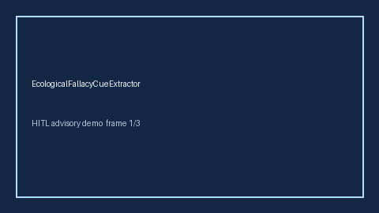

# EcologicalFallacyCueExtractor Guide



Offline evidence cue extractor. Never network I/O. Gap vs Elicit/Consensus/AJE ecological-fallacy cue extractors.

Optional later narrative via **GPT-5.5 / Claude Sonnet 4.6 / Gemini 3.x / Kimi K2**.

Distinct from `SimpsonParadoxCueExtractor` / `TransportabilityCueExtractor`.

## Usage

```python
from retrieval.ecological_fallacy_cues import EcologicalFallacyCueExtractor

rows = [
    {"paper_id": "p1", "abstract": "We discuss ecological fallacy when interpreting group rates."}
]
out = EcologicalFallacyCueExtractor().extract(rows)
print(out[0].flagged, out[0].cue_kind)
```

## Safety

Advisory cues only. Humans decide.
