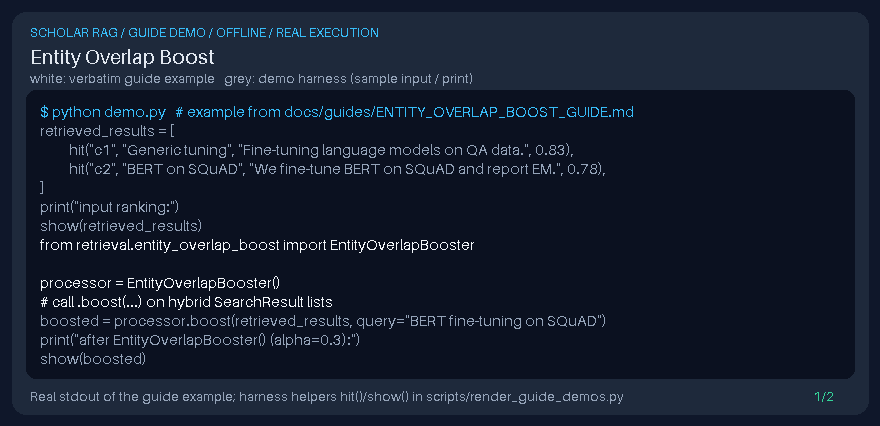

# Entity Overlap Boost Guide



Inspired by entity-centric retrieval in GraphRAG/Haystack; boosts hits whose chunk text shares capitalized entity tokens with the query (not a DOI connector).

Works with GPT-6 Astra / Claude Opus 5.5 / Gemini 4 Argon / Kimi K3.1 Pro answer stacks.

## Usage

```python
from retrieval.entity_overlap_boost import EntityOverlapBooster

processor = EntityOverlapBooster()
# call .boost(...) on hybrid SearchResult lists
```

## Safety

Local chunk text only — no network calls and no DOI connector side effects.
