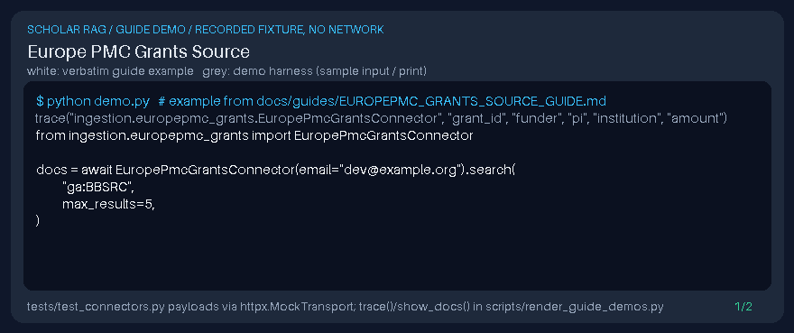

# Europe PMC Grants Source Guide



Use this guide when wiring Europe PMC **GRIST grants** into **scholar-rag-agent**.
Discovery is deterministic HTTP against the public Grist API — enrichment with
GPT-6 Astra / Claude Opus 5.5 / Gemini 4 Argon / Kimi K3.1 Pro is optional after documents
are collected.

## Why Europe PMC grants

Europe PMC Funders publish award metadata (title, abstract, funder, PI,
institution, dates, amount) through the GRIST registry. Grant-aware retrieval
complements paper-first connectors and OpenAlex / Crossref funder lookups.

## Usage

```python
from ingestion.europepmc_grants import EuropePmcGrantsConnector

docs = await EuropePmcGrantsConnector(email="dev@example.org").search(
    "ga:BBSRC",
    max_results=5,
)
```

Free-text keywords and fielded Grist queries (`ga:`, `gid:`, `pi:`, `title:`,
`aff:`, `cat:`, ...) are supported. Results use `resultType=core`.

## What you get

| Field | Source |
|---|---|
| `title` | `Grant.Title` |
| `text` | Grant descriptor (abstract, funder, PI, institution, dates, amount) |
| `metadata.source_type` | `europepmc_grants` |
| `metadata.grant_id` | `Grant.Id` / `Alias` |
| `metadata.funder` | `Grant.Funder.Name` |
| `metadata.pi` | Person given/family name |
| `metadata.institution` | Institution name |
| `metadata.doi` | Grant DOI when present |

## Safety notes

- Public Grist API only — no authenticated endpoints.
- Failures return an empty list rather than raising.
- `max_results` caps response size (Grist pages hold up to 25 grants).
- Optional constructor `email` identifies polite traffic.

## Suggested repo metadata

- **Description:** Agentic scholarly RAG with multi-source ingestion, hybrid retrieval, and GPT-6 Astra / Claude Opus 5.5 / Gemini 4 Argon / Kimi K3.1 Pro reasoning.
- **Topics:** `rag`, `scholarly`, `europepmc`, `grants`, `funding`, `arxiv`, `pubmed`, `llm`, `python`
