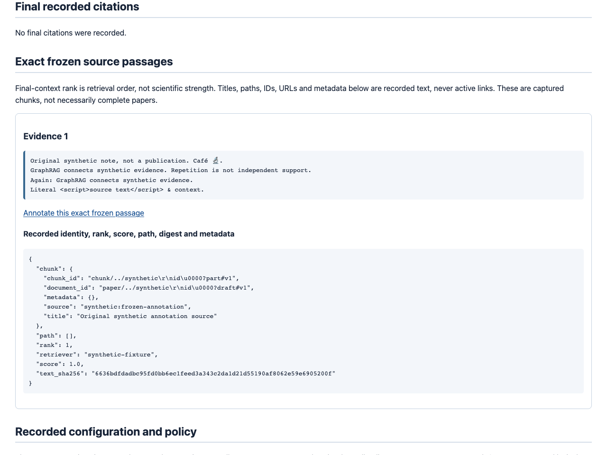

# Author a human note on exact frozen evidence

Open a completed saved run, choose one captured passage, explicitly select its
Unicode code-point span, preview your own note, then save it. The native browser
workflow uses the existing `SQLiteEvidenceAnnotations.create` service: no second
annotation engine, new table, migration, dependency or model call.

[](../assets/frozen-annotation-workbench.gif)

The still makes animation opt-in. The GIF contains **four actual local browser
screenshots** of the executed original synthetic fixture, not a continuous
recording, third-party screenshots, benchmark or scientific result.
[Read the text alternative and measured outcomes](../assets/frozen-annotation-workbench.txt).

## Native browser workflow

Start the [loopback Quickstart](../../QUICKSTART.md) with the database containing
your saved run. Use only material you own or are authorized to process.

1. From `/explore`, choose **Browse saved runs**, then **Inspect saved evidence**.
   Each captured source offers **Annotate this exact frozen passage**. Alternatively,
   open **Human-review notebook** and choose **Annotate frozen evidence N**.
   This also works when no opinions exist yet. An empty evidence capture has no
   invented source to annotate.
2. Inspect the complete frozen passage, JSON-displayed run/document/chunk IDs
   and full-source SHA-256. Enter **Start (0-based, inclusive)** and **End
   (exclusive)** yourself. They count Python Unicode code points, not UTF-8 bytes,
   UTF-16 units, glyphs or normalized characters. An astral emoji counts as one;
   a combining mark is separate; CR and LF count separately. Nothing chooses
   a repeated occurrence for you.
3. Type a nonblank human note and press **Preview exact annotation**. This POST
   only validates and renders; it does not save. Inspect the single highlighted
   occurrence, exact quote, span, note and retry UUID. **Edit and preview again**
   preserves that UUID. The save form contains the previewed values, not mutable
   note controls.
4. Press **Save annotation** explicitly. A successful POST returns **303** to the
   existing persisted exact-quote notebook reader. This fresh GET reads the record
   and frozen source together, displaying the original sequence and UTC timestamp.
   Reloading it does not resubmit. **Back to this notebook page** preserves both
   opinion-history cursors/limits and the saved-run/catalog return selection.

For the reproducible fixture below, the second `GraphRAG connects synthetic
evidence` occupies **[139, 175)** in the 225-code-point frozen passage. These
offsets apply only to that fixture. Do not copy offsets from ingestion input,
a snippet, current corpus text or visually normalized browser text.

GET and preview allocate no draft records. The form's UUID is a client retry
identity, **not an author identity**. After a network failure, inspect the notebook
or resubmit the **unchanged preview**: the same run/UUID/payload returns the
original record and timestamp. A different valid payload under an already saved
UUID conflicts with 409. Malformed payloads fail validation first. Opening a new
composer makes a new UUID and may create a separate opinion; it is not a retry.
Old notes cannot be edited or deleted here.

Human opinions do not verify claims, alter model grounding, change screening,
select retrieval evidence or imply consensus. The saved source remains frozen
after current-corpus changes, deletion and restart. Missing, failed, incomplete,
legacy or corrupt captures fail explicitly rather than using today's corpus.

## API contract

| Route | Contract |
| --- | --- |
| `GET /explore/run/annotate` | Read-only composer; exactly one `selection` query field containing structured JSON. |
| `POST /explore/run/annotate` | Preview only; URL-encoded `selection`, `annotation_id`, `start`, `end`, `note`. |
| `POST /explore/run/annotate/save` | Explicit persistence; URL-encoded `selection` and `submission` JSON. Returns a local 303 for a new record or identical retry. |
| `GET /explore/run/annotation` | Existing persisted exact-quote reader; run-scoped annotation UUID and existing notebook return fields. |
| `POST /runs/{run_id}/annotations` | Unchanged JSON API: 201 for new, 200 for identical retry; no new Origin requirement. |
| `GET /runs/{run_id}/annotations` | Unchanged newest-first bounded JSON history. |

`selection` contains exact `run_id`, `document_id`, `chunk_id`,
`source_text_sha256`, and the existing notebook/history/catalog return fields.
Use generated links instead of constructing it manually. Return state is typed
navigation, not an arbitrary `return_to` URL or an authorization credential.
`submission` is the existing `AnnotationSubmission`: UUID, document/chunk IDs,
source digest, start/end offsets, exact quote and note. The server derives the
quote from the selected frozen span during preview, then revalidates the
complete selector on save. It never searches, trims, normalizes or fuzzy-matches.

Hidden selection/submission values are **ASCII JSON**. Slashes, dot segments,
punctuation, CR/LF, NUL in opaque IDs and Unicode survive HTML form normalization.
JSON is decoded once; duplicate keys at any depth fail. IDs stay in encoded
query values, never interpreted as route paths. Mounted root prefixes are
preserved. Path-hostile legacy run IDs should use the native query-addressed
workflow or Python, not manually interpolated JSON API paths.

An existing reviewed JSON submission can still be sent directly:

```bash
curl --fail-with-body --silent --show-error -i \
  http://127.0.0.1:8000/runs/REPLACE_WITH_PATH_SAFE_RUN_ID/annotations \
  -H 'Content-Type: application/json' \
  --data-binary @/absolute/path/reviewed-annotation.json
```

Resend that same file for a retry; do not generate a fresh UUID. The
[annotation API guide](EVIDENCE_ANNOTATIONS_GUIDE.md) covers preparing and retaining
that file. Native POSTs additionally require the exact `Origin` of the app
(scheme, host and explicit port); `Sec-Fetch-Site`, if present, must be one
`same-origin` value. Missing/null/duplicate/different Origin and invalid/duplicate
Fetch Metadata return 403. Referer and untrusted forwarded-host headers are not
fallbacks. A command-line client can set headers; this is not authentication.

### Fixed bounds and errors

| Boundary | Limit / behavior |
| --- | --- |
| URL query / streamed body | Each at most 65,536 bytes; GET has one field, preview five, save two. Declared body length must be single, numeric and equal the received length. |
| Encoding | Only UTF-8 `application/x-www-form-urlencoded` (optional UTF-8 charset), no content encoding. ASCII wire, valid percent escapes and decoded UTF-8; unknown/duplicate fields, POST queries and GET bodies fail closed. |
| Decoded values | Names at most 32 characters; selection at most 16,384; submission at most 32,768. Unknown/duplicate JSON properties, invalid Unicode and excessive nesting fail. |
| IDs / digest | Existing opaque Unicode IDs of 1-256 code points; exact lowercase 64-hex SHA-256. |
| Span / note | Explicit unsigned decimal offsets, at most 19 digits and 262,144; start < end <= source length. Quote and nonblank note each 1-1000 Unicode code points. Notes cannot contain NUL. |
| Native HTML | Whole escaped page at most 1 MiB, including forms and full passage; no partial or truncated preview. Unrepresentable source text, including NUL, fails before a browser write; use existing Python/JSON interfaces. |
| Return navigation | Existing saved-reader query limit: 16,384 bytes. Oversized return links fail before persistence. |
| Frozen reads / records | Existing 100-event, 1-MiB-per-payload, 8-MiB-total event bounds; existing annotation row/response limits remain authoritative. |

The server validates Python code-point counts rather than imposing a browser
UTF-16 `maxlength`. Browsers serialize textarea newlines as CRLF; preview makes
the submitted text explicit. Hidden JSON preserves that exact preview on save.
There is no trimming or server-side normalization.

404 means no exact run/source; 409 includes UUID conflicts, invalid/unsupported
captures and unrepresentable source text; 413 means a byte/output bound; 415
unsupported encoding; 422 malformed fields/selectors; 503 storage unavailable.
Unsupported methods return 405. Errors are sanitized and logged by code without
echoing submitted notes. GET/preview never call `create`; save preflights both the
composer and the **complete persisted reader**, including escaped frozen metadata,
navigation and annotation fields, before its one transactional service call.
The reader's shared renderer uses the exact submission and source with the
maximum valid sequence and UTC timestamp widths until persistence supplies them.
This conservative bound is not arbitrary byte padding; it can reject a submission
very close to the output cap even if a shorter eventual sequence/time would fit.
It prevents saving successfully only to redirect into an oversized-reader error.

## Python

The same existing service works without the web app, provider credentials or
retrieval. This example performs an **explicit write only after confirmation**.
Replace the database, run/chunk IDs and code-point offsets with your inspected
selection. Preserve the submission JSON on disk if retrying in another process.

```python
from pathlib import Path
from uuid import uuid4

from storage.evidence_annotations import AnnotationSubmission, SQLiteEvidenceAnnotations
from storage.evidence_export import SQLiteEvidenceReader

database = Path("/absolute/path/existing-evidence.sqlite3")
if not database.is_file():
    raise FileNotFoundError(database)
run_id = "COPY_EXACT_RUN_ID"
chunk_id = "COPY_EXACT_CHUNK_ID"
start = int("COPY_START_CODE_POINT")
end = int("COPY_END_CODE_POINT")
bundle = SQLiteEvidenceReader(database).export(run_id)
source = next(item for item in bundle.snapshot.sources if item.chunk.chunk_id == chunk_id)
submission = AnnotationSubmission(
    annotation_id=uuid4(),
    document_id=source.chunk.document_id,
    chunk_id=source.chunk.chunk_id,
    source_text_sha256=source.text_sha256,
    start=start,
    end=end,
    quote=source.chunk.text[start:end],
    note="Synthetic human opinion: inspect this exact occurrence.",
)
print(submission.model_dump_json(indent=2))
if input("Type SAVE to persist this exact preview: ") != "SAVE":
    raise SystemExit("Not saved.")
store = SQLiteEvidenceAnnotations(database)
saved, created = store.create(run_id, submission)
retried, created_again = store.create(run_id, submission)
assert created and not created_again and retried == saved
reopened, frozen = SQLiteEvidenceAnnotations(database).get_annotation(
    run_id, submission.annotation_id
)
assert reopened == saved and frozen.chunk.text[start:end] == saved.quote
print(saved.model_dump_json())
```

Constructors retain their existing initialization semantics; the browser adds
no schema. The service validates document, chunk, digest, offsets and quote
transactionally; a direct Python caller is responsible for explicit preview
and confirmation, as shown above.

## Local/trusted use only

There is **no authentication**, reviewer attribution, tenant isolation or
tamper-proof audit trail. Use loopback or your own access controls and trusted
host/proxy configuration. Origin checks do not protect against direct clients,
malicious local processes or **DNS rebinding**. Do not expose an unauthenticated
instance to an untrusted network. A mismatched external scheme/host fails closed;
fix proxy configuration instead of weakening the check.

Composer pages, previews, redirects and errors reuse no-store, nosniff, frame
denial and a script-free, hash-only CSS CSP with same-origin form actions.
Their `Referrer-Policy: same-origin` lets native Chromium POSTs retain a valid
Origin instead of `null`. Read-only readers keep `no-referrer`. The local
selection URL may be sent back to this same server, never as a cross-origin
referrer. Notes are absent from GET/redirect URLs, not from browser resubmission
state, backups or infrastructure logs. No-store cannot prevent screenshots or
saving. Do not enter credentials or personal data.

No models, retrieval, network or current corpus reads run during authoring.
Normal app startup still initializes stores and indexes. No JavaScript, cookies,
draft store, session token store, external assets or new framework is introduced.

## Reproduce the isolated demo and GIF

From an installed development checkout, choose unused absolute output paths:

```bash
uv run --no-sync python -m scripts.demo_frozen_annotation \
  --output-dir /tmp/scholar-frozen-annotation-demo
uv run --no-sync python -m scripts.demo_frozen_annotation \
  --serve /tmp/scholar-frozen-annotation-demo --port 8776
```

The demo explicitly ignores ambient credentials, dotenv and database settings.
It seeds one original synthetic eight-event trace through real evidence/event
contracts, **not a generated answer**. TestClient drives the mounted native
workflow and saves actual HTML, annotation JSON, measured checks, URLs,
transcript and its isolated SQLite database. It proves GET/preview byte
invariance, exact second-occurrence selection, 303 save/retry, original timestamp,
rejected writes, API/Python parity and unchanged preview/record after corpus
edit/deletion/restart. Forbidden runtime calls are guarded and counted.

The optional server accepts native writes only in that synthetic database and
binds `127.0.0.1`; forbidden model/retrieval/corpus/event work remains guarded.
It verifies the measured database fingerprint before starting. Browser saves
change it, so a subsequent demonstration should use a newly generated directory.
Existing output paths and symlinks are refused. No existing corpus is touched.

Open `http://127.0.0.1:8776/review/explore/runs?limit=1&state=DONE`, inspect the
source, fill [139, 175) and your synthetic note, preview, then save using the
native buttons. Capture four 1280x960 PNG viewport screenshots named
`frozen-source.png`, `compose.png`, `preview.png`, `saved-quote.png` in a new
directory, scrolling only to the relevant content. Do not alter DOM text.
Then use the existing bounded screenshot renderer:

```bash
uv run --no-sync python -m scripts.create_frozen_annotation_gif \
  --frames-dir /absolute/path/browser-frames \
  --output /tmp/frozen-annotation-workbench.gif \
  --still /tmp/frozen-annotation-workbench.png
uv run --no-sync pytest tests/test_annotation_explorer.py tests/test_frozen_annotation_demo.py
```

The committed GIF was captured from real local native form submissions: preview
200, then save 303 with browser-generated same-origin Origin/Fetch Metadata;
the persisted quote/note matched. It is a screenshot sequence, not continuous
footage. UUIDs/timestamps are genuinely generated, while fixture content and
expected offsets/statuses are deterministic. The text alternative contains
stable measured assertions, not a claim of byte-identical fresh screenshots.

## Portfolio use case, inspiration and current stack

Demonstrate why the *second* occurrence matters: inspect exact IDs/digest,
preview offsets and a cautious opinion, save, then show that an unchanged retry
keeps its timestamp while changed content conflicts. Delete only the synthetic
current corpus and restart; the frozen source and note remain. Explain the
separation between source provenance, human judgment and scientific validity.

Public sources verified **2026-10-26, America/Los_Angeles**:
[PaperQA](https://github.com/Future-House/paper-qa) illustrates scientific RAG
with source citations;
[Hypothesis client](https://github.com/hypothesis/client) and
[annotation basics](https://web.hypothes.is/help/annotation-basics/) illustrate
source-grounded browser annotation. These are **workflow inspiration only**,
not feature parity, code/asset reuse, dependencies, endorsements or performance
claims. All captured source text and screenshots here are original synthetic work.

The surrounding stack remains Python 3.11+, FastAPI/Pydantic, SQLite, explicit
frozen-evidence contracts and optional routed generation. Model catalogs checked
**2026-10-27, America/Los_Angeles**: [OpenAI](https://developers.openai.com/api/docs/models.md)
lists GPT-6 Astra flagship, GPT-6.1 Sol balanced, GPT-6 Luna volume, and GPT-6.1
Terra as another catalog option (not a release-date or live-compatibility claim);
[Anthropic](https://platform.claude.com/docs/en/models/overview) lists Opus 5.5
recommended, Fable 5.1 demanding, and Sonnet/Haiku 5.5;
[Google](https://ai.google.dev/gemini-api/docs/models/gemini-4-argon) lists Gemini
4 Argon flagship; [Kimi](https://platform.kimi.ai/docs/models) lists Kimi K3.1
Pro/highspeed flagship. The selected live defaults remain **GPT-6 Astra,
Sonnet 5.5, Gemini 3.8 Flash for SPEED, and Kimi K3.1 Pro**; catalog alternatives
are not claims of tested adapter compatibility or newly selected endpoints.
This feature changes none of them and needs **no model or key**. See the
[provider guide](PROVIDER_MODELS_GUIDE.md) for the actual adapter configuration.
