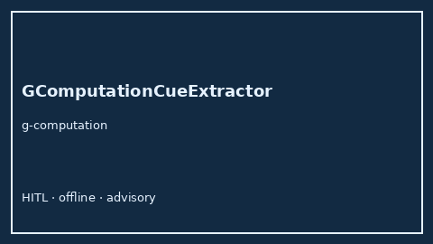

# GComputationCueExtractor Guide



Offline advisory bias/method cue extractor.
Gap vs Elicit/Consensus/Connected Papers g-computation cue extractors. Distinct from `TargetTrialEmulationCueExtractor` / `TimeVaryingConfoundingCueExtractor`.

Optional narrative via **GPT-5.5 / Claude Sonnet 4.6 / Gemini 3.x / Kimi K2**.

## Usage

```python
from retrieval.g_computation_cues import GComputationCueExtractor

rows = GComputationCueExtractor().extract(
    [{"paper_id": "p1", "abstract": "We discuss g computation."}]
)
print(rows[0].cues)
```

## Safety

Advisory only. No network I/O.
