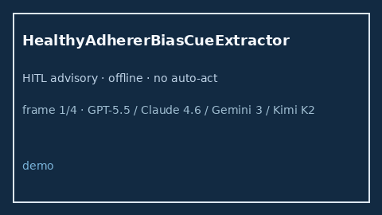

# HealthyAdhererBiasCueExtractor Guide



Offline bias-cue extractor for literature triage.
Gap vs Elicit/Consensus/Connected Papers healthy-adherer bias cue extractors. Distinct from `HealthyUserBiasCueExtractor` / `VolunteerBiasCueExtractor`.

Stack: **GPT-5.5 / Claude Sonnet 4.6 / Gemini 3.x / Kimi K2**.

## Usage

```python
from retrieval.healthy_adherer_bias_cues import HealthyAdhererBiasCueExtractor

rows = HealthyAdhererBiasCueExtractor().extract(
    [{"paper_id": "p1", "abstract": "Suspected healthy adherer bias in the adherence cohort."}],
)
print(rows[0].flagged, rows[0].cues)
```

## Safety

Advisory cues only. No network I/O. Humans decide inclusion.
