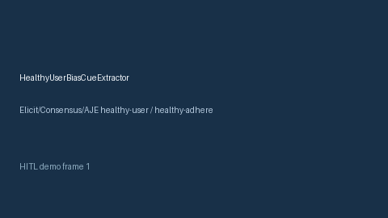

# HealthyUserBiasCueExtractor Guide



Offline cue extractor. Gap vs Elicit/Consensus/AJE healthy-user / healthy-adherer bias cue extractors. Distinct from `HealthyWorkerEffectCueExtractor` / `VolunteerBiasCueExtractor`.

Optional narrative via **GPT-5.5 / Claude Sonnet 4.6 / Gemini 3.x / Kimi K2**.

## Usage

```python
from retrieval.healthy_user_bias_cues import HealthyUserBiasCueExtractor

out = HealthyUserBiasCueExtractor().extract(
    [
        {
            "paper_id": "p1",
            "abstract": "Results may reflect healthy user bias among adherent participants.",
        }
    ]
)
print(out[0].flagged, out[0].cue_kind)
```

## Safety

Advisory cues only. No network I/O.
