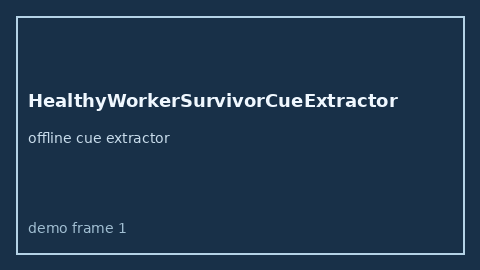

# HealthyWorkerSurvivorCueExtractor Guide



Offline advisory cue extractor.
Gap vs Elicit/Consensus/Connected Papers healthy-worker survivor cue extractors. Distinct from `HealthyAdhererBiasCueExtractor` / `HealthyUserBiasCueExtractor`.

Optional narrative via **GPT-5.5 / Claude Sonnet 4.6 / Gemini 3.x / Kimi K2**.

## Usage

```python
from retrieval.healthy_worker_survivor_cues import HealthyWorkerSurvivorCueExtractor

rows = HealthyWorkerSurvivorCueExtractor().extract(
    [
        {
            "paper_id": "p1",
            "abstract": "Healthy Worker Survivor bias may attenuate occupational exposure associations.",
        }
    ],
)
print(rows[0].flagged, rows[0].cues)
```

## Safety

Advisory only. No network I/O. Never auto-acts.
