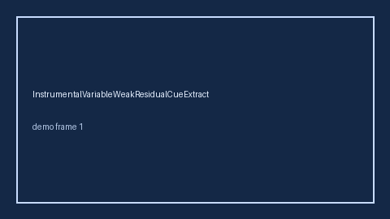

# HeapingBiasResidualCueExtractor Guide



Offline helper.
Gap vs Elicit/Consensus/Connected Papers heaping-bias residual cue extractors. Distinct from `MeasurementErrorBiasCueExtractor` / `SurveyModeEffectCueExtractor`.

Stack: **GPT-5.5 / Claude Sonnet 4.6 / Gemini 3.x / Kimi K2**.

## Usage

```python
from retrieval.heaping_bias_residual_cues import HeapingBiasResidualCueExtractor

rows = HeapingBiasResidualCueExtractor().extract(
    [{"paper_id": "p1", "abstract": "heaping bias residual"}]
)
print(rows[0].flagged, rows[0].cues)
```

## Safety

Advisory only. No network I/O. Never auto-acts. Humans decide.
