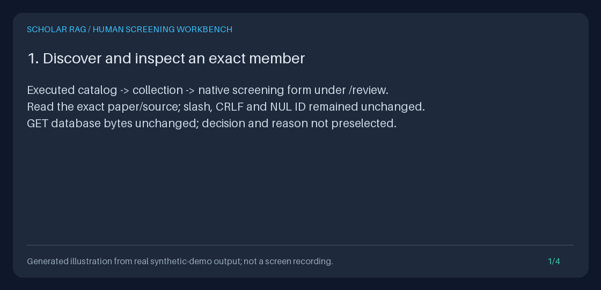

# Native human paper-screening workbench

Discover an existing collection, read an exact member's stored paper/source,
and explicitly record `include`, `exclude`, or `unsure` with your own reason.
The native form uses the existing revisioned screening service and SQLite
history, not a second label store. Nothing is screened automatically.

[](../assets/human-screening-workbench.gif)

The static preview makes animation opt-in. This is a **measured-output Pillow
illustration, not browser footage**, a benchmark or a scientific result.
The [exact text alternative](../assets/human-screening-workbench.txt) and
reproducible offline demo below expose what actually ran.

## Native browser workflow

Start the isolated loopback service using the [Quickstart](../../QUICKSTART.md).
Use original synthetic notes or papers you are authorized to process. Ingest
them and save a collection through the existing
[collection API/Python interface](PAPER_COLLECTIONS_GUIDE.md); this workbench
does not ingest, create, rename or remove collections.

1. Open `http://127.0.0.1:8000/explore`, choose **Browse saved collections**,
   and follow **Inspect membership and human screening**. Titles/source labels,
   current membership and status filters remain in the existing read-only page.
2. On an exact member, choose **Open explicit human screening form**. Check the
   JSON-displayed collection/document IDs, collection revision, current status,
   latest reason, decision revision and original timestamp. Follow **Read this
   exact paper / choose source context**, then the paper's existing exact chunk
   links. Source labels are untrusted text, not external URLs. A paper with no
   stored passages has no invented source link. Return via collection inspection.
3. Choose `include`, `exclude`, or `unsure`, write a nonblank reason, and press
   **Record human decision**. The controls start blank even for reviewed papers.
   The only write is one explicit POST with the collection revision and the
   expected latest decision revision from the opened form.
4. A successful write redirects with HTTP **303** to a fresh GET. **Stored
   decision revision N confirmed** means that revision exists in the recent
   retained history read, not merely that a URL says `saved_revision=N`.
   The latest opinion and up to five newest history entries are shown separately.
   **Inspect all retained decision history** opens the existing paged history
   reader. The same database recovers them after application restart.

Reloading the redirected page does not resubmit. Two tabs holding the same
expected revision cannot silently overwrite one another: one succeeds, the
other gets 409. Reopen the member, inspect the new opinion, then decide again.
Do not blindly retry a network failure: the commit may already have happened;
read history first. If a confirmation is older than the five-entry window or
absent, the page does not claim submission success. History is ordered by
decision revisions, not wall-clock time; legacy gaps are not backfilled.

All decisions are human opinions, not authenticated approvals or scientific
validation. A collection name/membership revision change makes old decisions
`stale`; re-screening requires that new collection revision and the existing
latest decision revision, never a reset to zero. Changes to corpus text under
the same ID are **not** detected by collection revisions. Review source changes
yourself. The workflow does not implicitly modify retrieval selection:
`collection_id` still means every current member, including excluded/unsure/
stale/unscreened members. For a later, separately initiated retrieval, explicitly
use current included IDs as described in the [screening guide](PAPER_SCREENING_GUIDE.md).
An empty include list is not permission to use the entire corpus.

## API contract

The original JSON endpoints and response shapes are unchanged:

| Route | Purpose |
| --- | --- |
| `GET /explore/screening` | Read-only native form; exact `collection_id`, `collection_revision`, `document_id`; optional validated `collection_return` and `saved_revision`. |
| `POST /explore/screening` | Native URL-encoded form only; `selection`, `expected_decision_revision`, `decision`, `reason`; no URL query fields. Success is a local 303, not JSON. |
| `PUT /collections/{collection_id}/screening/{document_id:path}` | Existing explicit JSON submission and `ScreeningReview` response, with no new Origin requirement. |
| `GET /collections/{collection_id}/screening` | Existing revision-bound queue, counts and explicit included IDs. |
| `GET /collections/{collection_id}/screening/history` | Existing exact query-selected, paginated append-only history. |

`selection` is one JSON object containing the three exact GET selectors and
optional structured `collection_return`. The native hidden value is ASCII JSON
so embedded slashes, dot segments, CR/LF, NUL and Unicode identities survive
HTML form normalization. GET links encode raw IDs in query values, never
interpolate them into paths. Decode JSON only once. Unknown or duplicate fields
are rejected both in URL encoding and within the JSON selection/return state.
There is no arbitrary `return_to`, external redirect, active-learning queue or
batch write. Root-path and mounted deployments retain their local prefix.

For protocol inspection, this local example is an **explicit write**. Replace
all selectors/revisions with those you just inspected. Use the native form for
opaque IDs rather than hand-building JSON:

```bash
curl --fail-with-body --silent --show-error -i \
  http://127.0.0.1:8000/explore/screening \
  -H 'Origin: http://127.0.0.1:8000' \
  -H 'Sec-Fetch-Site: same-origin' \
  --data-urlencode 'selection={"collection_id":"col_REPLACE_WITH_32_LOWERCASE_HEX_DIGITS","collection_revision":1,"document_id":"copy-exact-member-id"}' \
  --data-urlencode 'expected_decision_revision=0' \
  --data-urlencode 'decision=unsure' \
  --data-urlencode 'reason=Synthetic manual judgment: inspect the source again.'
```

Do not infer identity or authorization from Origin. A direct client can set that
header; the check prevents cross-origin browser form submissions, not API use.

### Fixed bounds and failure behavior

| Boundary | Contract |
| --- | --- |
| Request URL and streamed body | Each at most **65536 bytes**; four POST fields or five GET fields; decoded values at most 16,384 characters, field names at most 32. |
| Encoding | Only `application/x-www-form-urlencoded`, optional UTF-8 charset; no content encoding. Strict ASCII wire, valid UTF-8 percent escapes; no duplicate/unknown fields, malformed escapes, POST queries or GET bodies. Declared body lengths must be single, numeric and match the received bytes. |
| Selection | Existing collection ID; exact Unicode member ID 1-128 characters with no surrounding whitespace; current collection revision. Structured return state must match that collection/revision. |
| Revisions | Decimal ASCII spelling, at most 19 digits, bounded by `2**63 - 1`; collection/saved revisions start at 1, expected decision may be 0 only for an unreviewed member. |
| Decision/reason | Exactly include/exclude/unsure; 1-1000 nonblank Unicode characters, no NUL or lone surrogates. No trimming or normalization by the server. Browsers serialize textarea line breaks as CRLF; native maxlength uses browser units, while the server validates Python character count. |
| Read/output | Five newest retained decisions via the existing bounded 512-KiB history reader; whole escaped HTML at most 1 MiB. No partial form or truncated reason is returned. |

403 rejects missing/null/duplicate/different Origin or non-same-origin Fetch
Metadata. The Origin must exactly equal the app request's scheme and authority
(host and explicit port); if `Sec-Fetch-Site` is present it must be one
`same-origin` value. Referer is not a fallback. No cookie, CSRF session store,
authentication framework, script or external asset is introduced.

404 means the exact collection is missing; 409 indicates stale revisions,
missing corpus members or invalid persisted data; 413 a size bound; 415 an
unsupported encoding; 422 invalid/ambiguous fields or a nonmember; 503 storage
failure. Only GET/POST are supported (other methods receive 405).
Failures are logged with sanitized codes and do not reflect submitted reasons.
Service transactions roll back both latest-decision and history changes on an
insert failure; stale and invalid requests append nothing.

## Python

The same service supports explicit scripting without starting the API or
initializing a model. This example intentionally writes **one** opinion to an
existing database. Choose the exact member and current collection revision
yourself; do not interpret the first queue row as an automatic choice.

```python
from pathlib import Path

from storage.paper_screening import ScreeningSubmission, SQLitePaperScreening

database = Path("/absolute/path/existing-corpus.sqlite3")
if not database.is_file():
    raise FileNotFoundError(database)
store = SQLitePaperScreening(database)
collection_id = "col_REPLACE_WITH_32_LOWERCASE_HEX_DIGITS"
document_id = "copy-exact-member-id"
collection_revision = 1  # Replace with the revision you inspected.
before = store.list_history(
    collection_id, document_id, collection_revision=collection_revision, limit=5
)
saved = store.submit(
    collection_id,
    document_id,
    ScreeningSubmission(
        collection_revision=collection_revision,
        expected_decision_revision=before.latest_review.revision if before.latest_review else 0,
        decision="unsure",
        reason="Synthetic human opinion: inspect this source before choosing evidence.",
    ),
)
reopened = SQLitePaperScreening(database).list_history(
    collection_id, document_id, collection_revision=collection_revision, limit=5
)
assert reopened.latest_review == saved
print(reopened.model_dump_json(indent=2))
```

Constructors initialize the existing metadata tables if needed; no new browser
table or migration is added. Direct callers retain existing validation and
exception semantics. The [history guide](SCREENING_HISTORY_GUIDE.md) explains
pagination and legacy boundaries.

## Local/trusted deployment boundary

There is **no authentication**, reviewer attribution, tenant isolation or
tamper-proof audit trail. Keep the app on loopback or behind your own access
controls, validate allowed hostnames at your deployment boundary, and trust
forwarded headers only from explicitly trusted proxies. Same-origin checks do
not stop direct clients, malicious local processes or **DNS rebinding**.
Do not expose an unauthenticated instance to an untrusted network.

When mounted, configure the actual root path and external scheme/host correctly.
Origin comparisons do not trust arbitrary `X-Forwarded-Host` headers. A mismatched
proxy setup fails closed; fix the deployment rather than bypassing the check.
The original JSON API remains independently unauthenticated and unchanged.

The form reuses no-store, nosniff, no-referrer, frame denial, script-free CSP
and literal escaping. These are not access controls or deletion guarantees.
Do not enter credentials or personal data. Reasons persist in append-only
history, and may appear in browser resubmission state/infrastructure logs even
though they are absent from redirect URLs. Collection/document IDs can remain
in browser history. Normal startup still initializes stores and loads indexes;
no generation, retrieval, network, collection mutation or agent events run as
part of the form workflow.

## Reproduce the offline synthetic demonstration

From an installed development checkout (Python 3.11+), choose unused paths:

```bash
uv run python -m scripts.demo_human_screening_workbench \
  --output-dir /tmp/scholar-human-screening-demo
uv run python -m scripts.create_human_screening_workbench_gif \
  --transcript /tmp/scholar-human-screening-demo/transcript.txt \
  --output /tmp/scholar-human-screening.gif \
  --still /tmp/scholar-human-screening.png
uv run pytest tests/test_screening_explorer.py tests/test_human_screening_workbench_demo.py
```

The demo creates original synthetic notes in a temporary database, drives the
actual mounted routes with TestClient, and saves actual catalog/collection/form/
paper/source/history HTML, three redirected saved pages, restarted HTML,
history JSON, `checks.json` and a four-panel transcript. The database is removed
after execution. Existing output directories/files and symlinks are refused.
It ignores ambient model credentials, dotenv settings and database paths.
Captured HTML is an inspection artifact, not a portable writable application;
use the live loopback service for real form submissions.

Measured assertions: three successful 303 submissions; retained revisions
`[3, 2, 1]`; exact reason preservation; cross-origin 403, duplicate-field 422,
stale-decision 409; rejected-write database bytes unchanged; Python/API history
equal; restarted HTML identical; collection unchanged; zero forbidden calls
and agent events. The GIF uses the existing Pillow panel helper, not a browser
recording/conversion pipeline. Pixel tests reproduce all four 1120x540 frames
and the first-frame PNG; the text alternative is compared to a fresh run.

## Portfolio use case and inspiration

Show an interviewer a two-paper synthetic selection: inspect the exact source,
write an explicitly uncertain opinion, change your mind with a new reason,
then demonstrate stale-tab rejection and persistence after restart. Explain
why human labels are separate from retrieval defaults, scientific claims and
authenticated reviewer identity. Present saved measurements alongside the
illustration, not as evidence that a real review was conducted.

[ASReview LAB](https://github.com/asreview/asreview), whose public README was
consulted on **2026-10-24**, is **workflow inspiration only**: interactive human
screening, revisable labels and local/privacy-conscious review informed the
missing browser-write step. No code, assets or prose were copied. This is not
parity, an endorsement, a dependency, active learning or a claim to ASReview's
validation. No new connector or automatic prioritization is included.

The surrounding current agentic-RAG stack remains Python, FastAPI/Pydantic,
SQLite, explicit evidence contracts and optional provider-routed generation.
Latest OpenAI, Anthropic, Gemini and Moonshot model choices belong in the
dated [provider catalog](PROVIDER_MODELS_GUIDE.md), not in this form contract.
The native workbench itself requires **no model, key, inference or network**.
