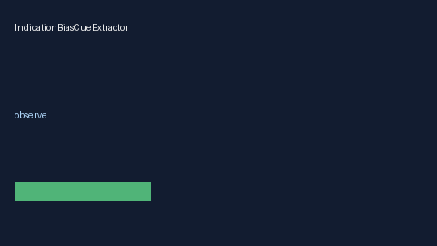

# IndicationBiasCueExtractor Guide



Offline deterministic cue extractor. Never network I/O. Gap vs Elicit/Consensus/AJE indication-bias cue extractors.

Optional later narrative via **GPT-5.5 / Claude Sonnet 4.6 / Gemini 3.x / Kimi K2**.

## Usage

```python
from retrieval.indication_bias_cues import IndicationBiasCueExtractor

cues = IndicationBiasCueExtractor().extract(
    [{"paper_id": "p1", "abstract": "Cohorts may reflect indication bias in treated patients."}]
)
print(cues[0].flagged, cues[0].cue_kind)
```
