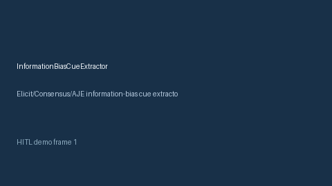

# InformationBiasCueExtractor Guide



Offline cue extractor. Gap vs Elicit/Consensus/AJE information-bias cue extractors. Distinct from `MeasurementErrorBiasCueExtractor` / `RecallBiasCueExtractor`.

Optional narrative via **GPT-5.5 / Claude Sonnet 4.6 / Gemini 3.x / Kimi K2**.

## Usage

```python
from retrieval.information_bias_cues import InformationBiasCueExtractor

out = InformationBiasCueExtractor().extract(
    [{"paper_id": "p1", "abstract": "We discuss information bias from exposure misclassification."}]
)
print(out[0].flagged, out[0].cue_kind)
```

## Safety

Advisory cues only. No network I/O.
