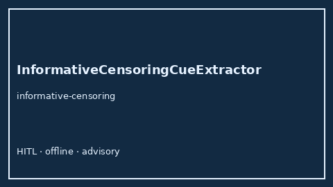

# InformativeCensoringCueExtractor Guide



Offline advisory bias/method cue extractor.
Gap vs Elicit/Consensus/Connected Papers informative-censoring cue extractors. Distinct from `IntervalCensoringCueExtractor` / `LossToFollowupBiasCueExtractor`.

Optional narrative via **GPT-5.5 / Claude Sonnet 4.6 / Gemini 3.x / Kimi K2**.

## Usage

```python
from retrieval.informative_censoring_cues import InformativeCensoringCueExtractor

rows = InformativeCensoringCueExtractor().extract(
    [{"paper_id": "p1", "abstract": "We discuss informative censoring."}]
)
print(rows[0].cues)
```

## Safety

Advisory only. No network I/O.
