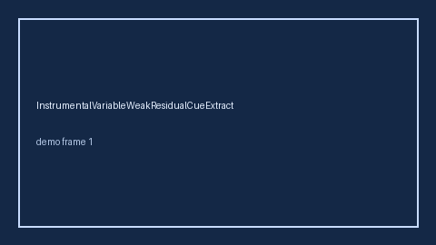

# InstrumentalVariableWeakResidualCueExtractor Guide



Offline helper.
Gap vs Elicit/Consensus/Connected Papers weak-IV residual cue extractors. Distinct from `InstrumentalVariableExclusionCueExtractor` / `InstrumentalVariableStrengthCueExtractor`.

Stack: **GPT-6 Astra / Claude Opus 5.5 / Gemini 4 Argon / Kimi K3.1 Pro**.

## Usage

```python
from retrieval.instrumental_variable_weak_residual_cues import (
    InstrumentalVariableWeakResidualCueExtractor,
)

rows = InstrumentalVariableWeakResidualCueExtractor().extract(
    [{"paper_id": "p1", "abstract": "We discuss iv weak residual."}]
)
print(rows[0].flagged, rows[0].cues)
```

## Safety

Advisory only. No network I/O. Never auto-acts. Humans decide.
