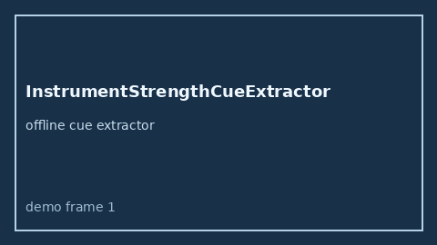

# InstrumentStrengthCueExtractor Guide



Offline advisory cue extractor.
Gap vs Elicit/Consensus/Connected Papers instrument-strength cue extractors. Distinct from `ResidualConfoundingCueExtractor` / `ColliderBiasInteractionCueExtractor`.

Optional narrative via **GPT-5.5 / Claude Sonnet 4.6 / Gemini 3.x / Kimi K2**.

## Usage

```python
from retrieval.instrument_strength_cues import InstrumentStrengthCueExtractor

rows = InstrumentStrengthCueExtractor().extract(
    [
        {
            "paper_id": "p1",
            "abstract": "Instrument Strength and first-stage F-stat were reported for the IV analysis.",
        }
    ],
)
print(rows[0].flagged, rows[0].cues)
```

## Safety

Advisory only. No network I/O. Never auto-acts.
