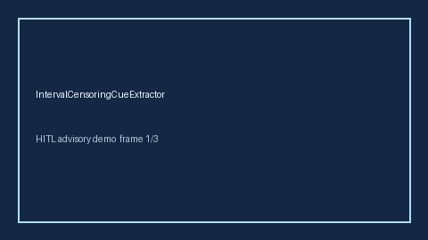

# IntervalCensoringCueExtractor Guide



Offline evidence cue extractor. Never network I/O. Gap vs Elicit/Consensus/AJE interval-censoring cue extractors.

Optional later narrative via **GPT-5.5 / Claude Sonnet 4.6 / Gemini 3.x / Kimi K2**.

Distinct from `LeftTruncationCueExtractor` / `AttritionInformativeCensoringCueExtractor`.

## Usage

```python
from retrieval.interval_censoring_cues import IntervalCensoringCueExtractor

rows = [{"paper_id": "p1", "abstract": "We discuss interval censoring in the survival analysis."}]
out = IntervalCensoringCueExtractor().extract(rows)
print(out[0].flagged, out[0].cue_kind)
```

## Safety

Advisory cues only. Humans decide.
