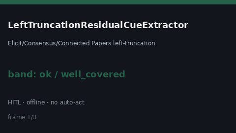

# LeftTruncationResidualCueExtractor Guide



Offline residual cue extractor.
Gap vs Elicit/Consensus/Connected Papers left-truncation residual cue extractors. Distinct from `LeftTruncationCueExtractor` / `RightTruncationBiasCueExtractor`.

Stack: **GPT-6 Astra / Claude Opus 5.5 / Gemini 4 Argon / Kimi K3.1 Pro**.

## Usage

```python
from retrieval.left_truncation_residual_cues import LeftTruncationResidualCueExtractor

rows = LeftTruncationResidualCueExtractor().extract(
    [{"paper_id": "p1", "abstract": "We discuss left truncation residual."}]
)
print(rows[0].flagged, rows[0].cues)
```

## Safety

Advisory only. No network I/O. Never auto-acts. Humans decide.
