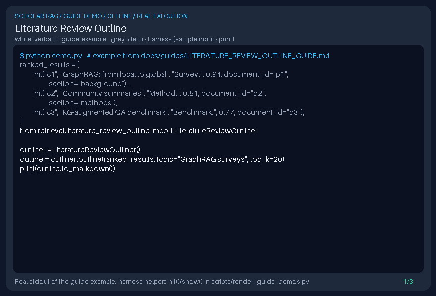

# Literature Review Outline Guide



`LiteratureReviewOutliner` builds a deterministic literature-review outline from
ranked `SearchResult` / `Document` lists. It fills a PaperQA-style review
synthesis gap: evidence is organized into Background, Methods, Findings,
Limitations, and Synthesis sections without calling an LLM. Optional later
narrative drafting can use GPT-6 Astra / Claude Opus 5.5 / Gemini 4 Argon / Kimi K3.1 Pro.
Distinct from retrieval gates and live DOI connectors.

## Usage

```python
from retrieval.literature_review_outline import LiteratureReviewOutliner

outliner = LiteratureReviewOutliner()
outline = outliner.outline(ranked_results, topic="GraphRAG surveys", top_k=20)
print(outline.to_markdown())
```

When `section` / `section_type` metadata matches a known heading, papers are
routed there; otherwise they are distributed round-robin by rank. Duplicate
`document_id` rows keep the highest score.
