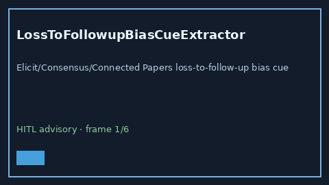

# LossToFollowupBiasCueExtractor Guide



Offline advisory cue extractor.
Gap vs Elicit/Consensus/Connected Papers loss-to-follow-up bias cue extractors. Distinct from `AttritionInformativeCensoringCueExtractor` / `NonresponseBiasCueExtractor`.

Optional narrative via **GPT-5.5 / Claude Sonnet 4.6 / Gemini 3.x / Kimi K2**.

## Usage

```python
from retrieval.loss_to_followup_bias_cues import LossToFollowupBiasCueExtractor

rows = LossToFollowupBiasCueExtractor().extract(
    [{"paper_id": "p1", "abstract": "Evidence of loss to follow-up in the cohort."}],
)
assert rows[0].flagged is True
```

## Safety

Advisory only. No network I/O. Never auto-acts. Humans decide.
