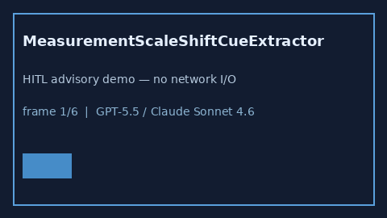

# MeasurementScaleShiftCueExtractor Guide



Offline advisory bias cues.
Gap vs Elicit/Consensus/Connected Papers measurement-scale shift cue extractors. Distinct from `MeasurementErrorBiasCueExtractor` / `NonDifferentialMisclassificationCueExtractor`.

Optional narrative via **GPT-5.5 / Claude Sonnet 4.6 / Gemini 3.x / Kimi K2**.

## Usage

```python
from retrieval.measurement_scale_shift_cues import MeasurementScaleShiftCueExtractor

rows = MeasurementScaleShiftCueExtractor().extract(
    [
        {
            "paper_id": "p1",
            "abstract": "Evidence of measurement-scale shift after instrument rescaling.",
        }
    ],
)
print(rows[0].flagged, rows[0].cues)
```

## Safety

Advisory only. No network I/O. Never auto-acts.
