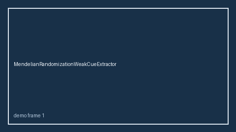

# MediationBiasCueExtractor Guide



Offline deterministic cue extractor.
Gap vs Elicit/Consensus/Connected Papers mediation-bias cue extractors. Distinct from `MediationAnalysisCueExtractor` / `SelectionIntoTreatmentCueExtractor`.

Optional narrative polish via **GPT-6 Astra / Claude Opus 5.5 / Gemini 4 Argon / Kimi K3.1 Pro**.

## Usage

```python
from retrieval.mediation_bias_cues import MediationBiasCueExtractor

rows = MediationBiasCueExtractor().extract(
    [{"paper_id": "p1", "abstract": "We discuss mediation bias."}]
)
print(rows[0].cues)
```

## Safety

Advisory only. No network I/O.
