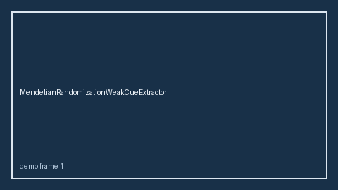

# MendelianRandomizationWeakCueExtractor Guide



Offline cue extractor.
Gap vs Elicit/Consensus/Connected Papers weak Mendelian-randomization cue extractors. Distinct from `InstrumentStrengthCueExtractor` / `GComputationCueExtractor`.

Stack: **GPT-5.5 / Claude Sonnet 4.6 / Gemini 3.x / Kimi K2**.

## Usage

```python
from retrieval.mendelian_randomization_weak_cues import MendelianRandomizationWeakCueExtractor

rows = MendelianRandomizationWeakCueExtractor().extract(
    [{"paper_id": "p1", "abstract": "We discuss weak instrument."}]
)
print(rows[0].flagged, rows[0].cues)
```

## Safety

Advisory only. No network I/O.
