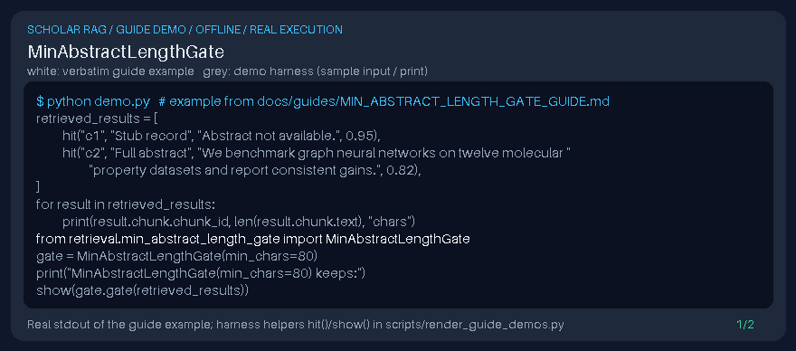

# MinAbstractLengthGate Guide



Local retrieval postprocessor for GPT-6 Astra / Claude Opus 5.5 / Gemini 4 Argon / Kimi K3.1 Pro pipelines (not a DOI connector).

Inspired by LlamaIndex/Haystack length filters that drop stub abstracts before generation.

## Usage

```python
from retrieval.min_abstract_length_gate import MinAbstractLengthGate
```

See unit tests for edge cases.
