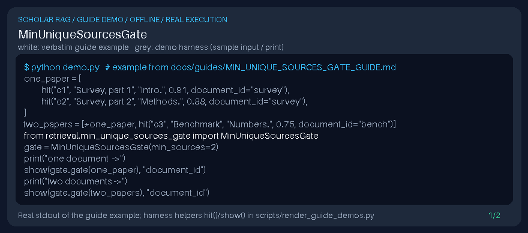

# MinUniqueSourcesGate Guide



Local retrieval postprocessor for GPT-6 Astra / Claude Opus 5.5 / Gemini 4 Argon / Kimi K3.1 Pro pipelines (not a DOI connector).

## Usage

```python
from retrieval.min_unique_sources_gate import MinUniqueSourcesGate
```

See unit tests for edge cases.
