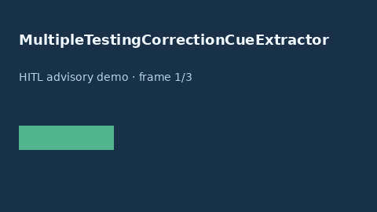

# MultipleTestingCorrectionCueExtractor Guide



Offline cue extractor. Never network I/O.

Gap vs Elicit/Consensus/AJE multiple-testing correction cue extractors.

Optional polish via **GPT-6 Astra / Claude Opus 5.5 / Gemini 4 Argon / Kimi K3.1 Pro**.

## Usage

```python
from retrieval.multiple_testing_correction_cues import MultipleTestingCorrectionCueExtractor

cues = MultipleTestingCorrectionCueExtractor().extract([{"paper_id": "p1", "abstract": "..."}])
print(cues[0].flagged)
```

## Safety

Advisory cues only. Humans decide evidence grading.
