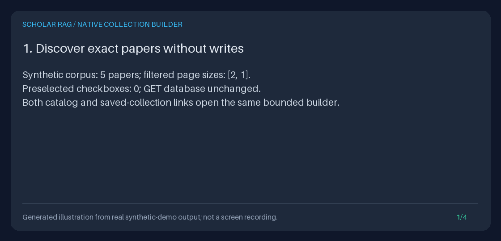

# Build a reusable paper collection in your browser

From the current corpus or saved-collection list, choose **Create a paper
collection**, filter a bounded catalog page, explicitly check exact papers,
name the selection, and press **Create collection**. No curl, hand-written
JSON, JavaScript, model or new storage is needed for this browser workflow.
This closes the gap between discovering papers and starting a reusable
screening/search/worksheet selection.

The builder creates metadata only. The separate
[native editor](NATIVE_COLLECTION_EDITOR_GUIDE.md) now supports explicit rename
and add/remove membership with preview and revision-checked save. Neither
workflow imports/deletes papers, maintains a multi-page cart, screens
automatically, authenticates reviewers, or changes retrieval policy. Membership
stores IDs, **not frozen paper contents**. The existing JSON API and Python
store remain independently usable.

[](../assets/collection-builder.gif)

The static preview makes animation opt-in. This is a **measured-output Pillow
illustration, not browser footage**, a benchmark or scientific findings.
The [exact text alternative](../assets/collection-builder.txt) records what ran.

<details>
<summary>Show the four-frame measured-output GIF</summary>



</details>

## Start offline with original synthetic papers

Use Python 3.11+ in a development checkout. Installation can download packages;
the demonstration itself needs no internet or model credentials. These commands
use a local virtual environment and an unused demo directory:

```bash
python3 -m venv .venv
.venv/bin/python -m pip install --no-cache-dir -e '.[dev]'
export COLLECTION_DEMO_PARENT="$(mktemp -d "${TMPDIR:-/tmp}/scholar-collection-builder.XXXXXX")"
export COLLECTION_DEMO_DIR="$COLLECTION_DEMO_PARENT/demo"
.venv/bin/python -m scripts.demo_collection_creation --output-dir "$COLLECTION_DEMO_DIR"
.venv/bin/python -m scripts.demo_collection_creation --serve "$COLLECTION_DEMO_DIR" --port 8765
```

The demo explicitly uses `offline_settings`: `default_model="fake"` and empty
OpenAI/Anthropic/Gemini/Moonshot keys, ignoring ambient environment, dotenv and
secret-file settings. No live **or fake** generation is invoked. It creates five
original synthetic papers and measures one actual native collection creation,
then persists its database and HTML/JSON/text evidence. Existing output paths
and symlinks are refused; this is not a backfill or a real-corpus importer.

The optional server binds only `127.0.0.1`, mounts the application at `/library`,
and keeps model/retrieval/ingestion/event operations guarded. It allows explicit
collection creation. Open
`http://127.0.0.1:8765/library/explore`. For an ordinary existing corpus, use
the [Quickstart](../../QUICKSTART.md) and `/explore` without the demo mount.
Normal app startup initializes stores and loads indexes before requests.

## Native workflow, step by step

1. In the corpus explorer set **Exact source** to
   `synthetic:collection-builder`, **Title contains** to `graph` and **Page size**
   to `2`; apply the filters. Choose **Create a paper collection**. The same
   action is available from **Browse saved collections**, including an empty
   list. Both entry points preserve the catalog's filters, size and cursor.
2. Inspect the first two papers and their JSON-displayed exact IDs. No checkbox
   is checked and the name is blank. **Next page** shows the remaining matching
   paper with fresh controls; **Start again** returns to the first page.
   The exact-source match is case-sensitive; the title match is a literal
   substring using SQLite ASCII case-insensitivity, not fuzzy search. `%`, `_`
   and spaces remain literal. Blank filters mean omitted, not an empty match.
3. On the desired page enter a new name, such as **Browser portfolio selection**,
   and check one or both visible papers yourself. Only those checked IDs are
   submitted. Unchecked papers and every other page remain excluded. Filters,
   paging and paper-inspection links leave this unsaved form: **name and choices
   are not carried forward**. There is no implicit selection of all filtered
   results. The browser's Back/resubmission behavior may retain a local draft;
   always inspect the visible checks before submitting.
4. Press **Create collection**. A successful POST returns **303** to the existing
   collection detail at its persisted ID and actual revision. The page rereads
   saved membership, rather than trusting a success flag or rendering submitted
   values as a saved result. Reloading this GET does not resubmit.
5. Follow **Open explicit human screening form** to inspect and deliberately
   record an opinion in the normal application, **Search all current collection
   members** for literal search, or **Open collection worksheet** to open its
   controls. Opening these tools is read-only. Worksheet submission separately
   retrieves/reranks and has its existing **ten-paper** limit; a larger collection
   is rejected, not silently reduced. The restricted demo server does not run
   retrieval. See the [screening](HUMAN_SCREENING_WORKBENCH_GUIDE.md),
   [search](BROWSER_PASSAGE_SEARCH_GUIDE.md) and
   [worksheet](RESEARCH_WORKSHEET_GUIDE.md) guides for subsequent explicit actions.
6. Stop the demo server with Ctrl-C and repeat **only** the `--serve` command with
   the same directory. Reopen **Browse saved collections** and choose the saved
   name. Do not rerun creation of the output directory or re-ingest to recover
   IDs. The [collection browser](COLLECTION_BROWSER_GUIDE.md) exposes current
   membership, human statuses and revision-bound downloads.

The demo's already-created name is **Synthetic native selection**. Reusing an
exact trimmed name produces **409**, never a replacement. A valid name with no
checked papers produces **422**. If a checked ID was deleted before submission,
the entire save fails with 422: no surviving subset is saved. On **503** or a
network interruption, inspect saved collections before retrying. There is no
idempotency token; a commit can precede a lost response, and another name would
create another collection. Error pages do not echo private submitted values.

New members start unscreened. Ordinary `collection_id` scope still means **all
current members**, not the current include list. Use the existing explicit
[screened scope](SCREENED_COLLECTION_GUIDE.md) if that is the intended later
retrieval. Membership revisions do not detect corpus edits under the same ID;
only saved run evidence freezes the passages actually used.

## Exact browser contract and finite bounds

| Surface | Contract |
| --- | --- |
| `GET /explore/collections/new` | Read-only form. Optional `limit` (default 20, 1-100), exact `source` (1-512 characters), literal `title` (1-300), exclusive exact document-ID `cursor` (1-128). Blank source/title omit filters; empty cursor is invalid. No GET body. |
| Catalog | Existing `SQLiteDocumentCatalog.list_documents`: at most limit+1 bounded summaries, ascending SQLite BINARY document-ID order. Titles show 300 characters, sources 512, with truncation notices. No document bodies or arbitrary metadata are loaded. Separate pages are not one snapshot. |
| Native POST | Only UTF-8 `application/x-www-form-urlencoded`, optional UTF-8 charset, no content encoding and no URL query fields. Required `name`; checked fields `document_1` through `document_100`, each exactly one JSON **string**, never an array/object or raw ID. At most 101 fields; unknown/repeated field names fail. |
| Identity and ordering | 1-100 distinct exact valid-Unicode IDs, 1-128 characters each, no surrounding whitespace. Slashes, dot segments, quotes, CR/LF, NUL, combining marks and other Unicode are preserved through ASCII JSON checkbox values. No trimming, Unicode normalization, guessing or deduplication of native IDs. Saved order is increasing checkbox index, not wire-field order. |
| Name | Existing `CollectionName`: 1-120 Unicode code points **after** trimming surrounding whitespace; internal ASCII controls and DEL rejected. Exact case-sensitive uniqueness. The input permits 240 UTF-16 units so 120 supplementary code points remain representable; the server's 120-character rule is authoritative. |
| Wire bounds | Query at most **16384 bytes**; streamed body at most **262144 bytes**. GET at most four fields with decoded values at most 512 characters; POST decoded values at most **1538 characters** (maximum ASCII JSON identity), field names at most 32. Strict ASCII wire with valid percent escapes and UTF-8; ambiguous/invalid content lengths fail. |
| Output | The entire escaped HTML must fit **1048576 bytes**. Oversized or unrepresentable labels fail without a partial form. The redirect contains only collection ID/revision, not the name, member IDs or arbitrary return URLs. |
| Write boundary | `SQLitePaperCollections.create` owns one `BEGIN IMMEDIATE` transaction: validate all selected IDs, enforce unique name, insert all metadata or roll back. Unknown/deleted IDs: 422; name conflict, including concurrent same-name creation: 409; unavailable/busy storage: 503. No new table, state/session store, dependency or migration. |

The one-page limit describes the **native UI**, not an authorization boundary.
Direct native clients can submit any 1-100 explicit valid IDs; the server does
not re-expand filters, assume a page is still current, or enforce that the
selected IDs still match earlier titles/source labels. Existence is rechecked
inside the write transaction. Nothing is selected merely by opening a URL.

Other failures are 403 for missing/null/ambiguous/wrong Origin or conflicting
Fetch Metadata, 405 for unsupported methods, 413 for byte bounds, 415 for
unsupported encoding, 422 for malformed/ambiguous controls or filters, and 409
for invalid stored catalog data or labels that cannot be represented faithfully.
Errors log stable sanitized codes, never raw SQLite exceptions or submitted
names/IDs. The global strict form parser still rejects repeated names; this
feature uses bounded indexed checkboxes instead of weakening that parser.

## Existing JSON API and Python equivalents

The original JSON interface still accepts **one explicit write**:

```http
POST /collections
Content-Type: application/json

{"name":"An independently chosen name","document_ids":["copy-exact-id-a","copy-exact-id-b"]}
```

It returns **201** with `PaperCollection` fields `collection_id`, `name`,
`document_ids`, `revision`, and a root-path-aware
`Location: /collections/{collection_id}`. `GET /collections` lists summaries;
`GET /collections/{collection_id}` reads full membership. Use the actual
returned ID and revision to open `/explore/collection?collection_id=...&collection_revision=...`.
Do not post the same selection to both interfaces unless two separate
collections are intended. Existing JSON normalization/deduplication behavior
and its lack of a new Origin requirement are unchanged. See the complete
[collection API contract](PAPER_COLLECTIONS_GUIDE.md).

Python uses the same service without loading providers or starting a server.
This is also an explicit write; choose actual IDs yourself from the catalog:

```python
from pathlib import Path

from storage.document_catalog import SQLiteDocumentCatalog
from storage.paper_collections import SQLitePaperCollections

database = Path("/absolute/path/to/existing/corpus.sqlite3")
if not database.is_file():
    raise FileNotFoundError(database)
page = SQLiteDocumentCatalog(database).list_documents(limit=20, title="graph")
for paper in page.documents:
    print(repr(paper.document_id), paper.title)
# Deliberately replace these with exact IDs you inspected, not all page IDs.
chosen_ids = ["copy-exact-id-a", "copy-exact-id-b"]
store = SQLitePaperCollections(database)
saved = store.create(name="An independently chosen Python selection", document_ids=chosen_ids)
assert SQLitePaperCollections(database).get(saved.collection_id) == saved
print(saved.model_dump_json(indent=2))
```

Constructor initialization is distinct from a request read; existing tables
may be initialized at startup. Neither interface copies or versions paper text,
records human screening, retrieves evidence or writes agent events.

## Local/trusted use and privacy

No authentication, reviewer attribution, tenant isolation or DNS-rebinding
protection is added. Use loopback or your own access controls and allowed-host
policy. Trust forwarded scheme/authority only from explicitly trusted proxies;
arbitrary `X-Forwarded-Host` does not redefine the accepted Origin. Mount/root
paths remain on forms, navigation, errors and 303 targets.

POST requires exactly one Origin equal to the request scheme, host and explicit
port, one Host, and optional **single** `Sec-Fetch-Site: same-origin`. Referer is
not a fallback. Direct clients can forge these headers; this is a cross-origin
browser safeguard, not authorization. Mismatched proxy configuration fails
closed rather than disabling the checks.

Builder pages/errors/redirects use `Referrer-Policy: same-origin`, preserving
native Chromium POST Origin rather than producing `Origin: null` under
`no-referrer`. This can send the local filter URL to the same server, never as a
cross-origin referrer. Other read-only pages retain their existing policy.
All builder HTML is escaped, no-store, nosniff, frame-denied, and script-free
under the existing hash-only CSS CSP. No cookies, external assets, analytics or
browser storage are introduced.

Names, IDs, filters and labels may be sensitive. POST keeps name/selection out
of the redirect URL, not browser resubmission state or infrastructure logs.
URLs may remain in history. No-store cannot prevent saving or screenshots.
Do not enter credentials or personal data; review artifacts before sharing.

## Reproducible evidence and portfolio walkthrough

The demo saves actual HTML, `collection.json`, `checks.json`, `pages.json`,
`transcript.txt` and the restartable synthetic database in the chosen directory.
It measures filtered pages of 2 and 1, zero default selections, an explicit
two-paper save/303, duplicate-name 409, empty/unknown selection 422,
cross-origin 403, atomic failures, restart equality and read-only handoff GETs.
HTTP/provider/socket guards make unintended work fail; model/retrieval/network/
event calls must remain zero. These are functional measurements, not
performance or scientific-quality results.

```bash
.venv/bin/python -m pytest tests/test_collection_creation.py tests/test_collection_creation_demo.py
.venv/bin/python -m scripts.create_collection_builder_gif \
  --transcript "$COLLECTION_DEMO_DIR/transcript.txt" \
  --output "$COLLECTION_DEMO_PARENT/collection-builder.gif" \
  --still "$COLLECTION_DEMO_PARENT/collection-builder.png"
```

The renderer uses the existing offline Pillow panel helper and the executed
transcript, not a recreated browser UI. Each of four 1120x540 frames is explicitly
labeled as an illustration. The still is the first frame; tests check four
frames, dimensions and exact first-frame pixels. Existing output files are
refused. The committed text alternative matches a fresh deterministic run.

For a portfolio demonstration, show the unchecked catalog, deliberately pick
two IDs while leaving the later page out, create a name, demonstrate a duplicate
conflict, restart, and reopen exact membership. Explain the distinction between
saved membership, human opinion, current corpus text and frozen run evidence.
Show the executed checks alongside the visual demonstration. No upstream
papers, code, prose or media are copied.

## Workflow inspiration, not parity

Public READMEs consulted **2026-10-28 (America/Los_Angeles)**:
[ASReview LAB](https://github.com/ASReview/asreview) connects project creation,
human screening, monitoring/export and editable Collection tags;
[PaperQA](https://github.com/Future-House/paper-qa) describes scientific
full-text evidence/citation workflows; [LightRAG](https://github.com/HKUDS/LightRAG)
describes WebUI insertion, querying and visualization. They motivate closing
this app's missing browser-native starting selection, **not** dependencies,
feature parity, active learning, scientific validity or performance claims.

The stack remains FastAPI/Pydantic/HTTPX, SQLite, Python and the existing
hand-written agent state machine. This feature invokes none of its models.
Current optional provider choices belong in the dated
[provider guide](PROVIDER_MODELS_GUIDE.md); there are no model-default changes.
