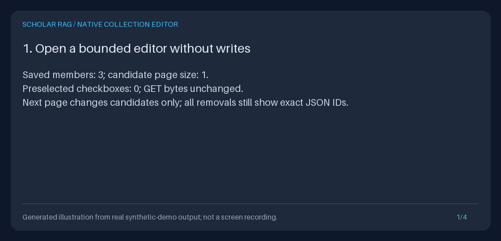

# Edit a paper collection without losing hidden members

Choose **Edit collection name and membership** on a saved collection or its
list card. Rename it, explicitly check additions/removals, **Preview changes**,
then **Save changes**. Unchecked members remain members, including papers outside
the current catalog filter or page. This extends the
[native builder](NATIVE_COLLECTION_BUILDER_GUIDE.md), not ingestion or retrieval.

[](../assets/collection-editor.gif)

The animation is an opt-in **Pillow illustration of executed synthetic HTTP
measurements, not browser footage**, a performance benchmark or scientific
findings. The [text alternative](../assets/collection-editor.txt) is the exact
executed transcript. No third-party source, prose, screenshots or papers were
copied.

<details>
<summary>Show the four-frame measured-output GIF</summary>



</details>

## Run a credential-free, persistent demonstration

Use Python 3.11+ in a development checkout. Dependency installation may use the
network; the demo itself does not. Choose a new output directory:

```bash
python3 -m venv .venv
.venv/bin/python -m pip install --no-cache-dir -e '.[dev]'
export COLLECTION_EDIT_PARENT="$(mktemp -d "${TMPDIR:-/tmp}/scholar-collection-editor.XXXXXX")"
export COLLECTION_EDIT_DIR="$COLLECTION_EDIT_PARENT/demo"
.venv/bin/python -m scripts.demo_collection_editing --output-dir "$COLLECTION_EDIT_DIR"
.venv/bin/python -m scripts.demo_collection_editing --serve "$COLLECTION_EDIT_DIR" --port 8765
```

Open `http://127.0.0.1:8765/library/explore/collections`. The optional server
binds only loopback and mounts at `/library`. It permits native collection edits
but guards generation, retrieval, ingestion, screening/opinion writes and agent
events. Its JSON full-replacement writes are intentionally guarded too; use the
separate API example below, or the normal application, for those writes.
Stop this foreground server with Ctrl-C when finished.

`offline_settings` explicitly uses `default_model="fake"` and empty provider
keys, ignoring environment, dotenv and secret-file settings. Neither live nor
fake generation is called. Setup directly seeds four original synthetic notes,
four chunks, a labeled synthetic frozen-evidence fixture with eight events,
two latest screening opinions and three historical decisions. The recorded
generation metadata says `synthetic-fixture`, not a model result. Startup still
initializes stores and loads indexes before the guarded requests.

The executed demo uses a one-row candidate page and a three-member collection,
removes the exact CR/LF/NUL-bearing source ID, adds `02-addition`, retains
`01-retained` and off-page `03-off-page`, and renames the collection. It measures:

| Check | Executed result |
| --- | --- |
| GET and preview | Database bytes unchanged; zero preselected checkboxes; preview 200 |
| Explicit save | 303; revision 1 to 2; three members before and after |
| Repeated old-revision save | 409 twice; database bytes unchanged |
| Screening afterward | One stale opinion, two unscreened members, no current includes |
| Restart | Same collection through Python/JSON; identical collection HTML |
| Preservation | All four document rows, four chunks, eight events, two latest opinions and three history rows unchanged; frozen evidence unchanged |
| Forbidden operations | Zero guarded model, retrieval, network, ingestion, opinion or event calls |

Actual HTML, before/after collection JSON, checks, browser paths, transcript
and the restartable synthetic database are saved in the selected directory.
Existing output paths and symlinks are refused. The generated artifacts describe
that execution; subsequent manual edits intentionally change the database, not
the original recorded measurements.

## Browser walkthrough

1. Choose **Edit collection name and membership** from the list or detail.
   The editor is tied to that exact collection revision. The demo has already
   saved **Synthetic after edit** at revision 2; manual work starts there.
2. Read **Remove only checked current members**. This always shows the complete
   membership, at most 100 exact JSON-string IDs, in saved order. Inspect-paper
   links open the current paper but leave the unsaved form. No removal is
   preselected. Removal means membership only, never document deletion.
3. Filter **addition candidates** by exact case-sensitive source and/or literal
   title substring. Title matching uses SQLite ASCII case-insensitivity, not
   fuzzy search. `%`, `_` and spaces are literal. Use page size 1 to inspect
   pagination. Current members are labeled, not offered as additions.
   Filters and pages never determine which old members survive.
4. Enter a new name and explicitly check only the desired removals/additions.
   For example, with the demo, remove `02-addition` and add the synthetic source
   containing the control-bearing ID from the full catalog. Decode the displayed
   JSON when a raw ID is needed; do not strip, normalize or paste it into a path.
   Filtering, paging and links discard unsaved controls: **there is no cart**.
   Save a reviewed batch before choosing another page.
5. Press **Preview changes**. Inspect the old/new names, before/retained/after
   counts, exact additions/removals and complete resulting membership. Preview
   does not write or reserve anything. **Discard preview / start again** opens
   a fresh form. Browser Back may restore local controls; recheck them yourself.
6. Press **Save changes** once. The server validates the current revision, all
   old members, added members and name uniqueness in one reserved SQLite
   transaction. A 303 opens the actual persisted revision. Refreshing this GET
   does not resubmit. An old tab, stale preview or replay fails with 409 rather
   than retrying, merging or overwriting.
7. Restart using only the same `--serve` command, then reopen the collection.
   Do not re-ingest or recreate the demo to recover membership. On a network
   interruption or 503, inspect the current collection before retrying: a save
   may have committed before its response was lost.

For your ordinary permitted corpus, use the [Quickstart](../../QUICKSTART.md)
and `/explore/collections` in the normal application. There are no new settings,
dependencies, tables, background jobs or browser state/session stores.

## Screening, evidence and deliberate limitations

Every successful edit increments the collection revision, including a
rename-only edit. Earlier screening decisions therefore become **stale**, not
current includes. New members are unscreened unless they have an earlier retained
opinion, which is stale. Removed members' opinions/history remain stored, but
existing screening/history readers require current membership; re-adding a
member exposes the earlier opinion as stale. Nothing silently rescreens a paper.

Documents, chunks, frozen run evidence, event records and human opinion history
are not rewritten or deleted. Ordinary `collection_id` retrieval still means
all current members; use [screened scope](SCREENED_COLLECTION_GUIDE.md) only when
current human includes are intended. Collection revisions bind metadata and
membership, not paper contents or later human decisions.

The editor does not reorder retained members, delete collections, auto-select
all filter matches, provide multi-page drafts, merge concurrent edits, repair
missing/corrupt membership, authenticate reviewers or synchronize libraries.
Retained members keep saved order; additions follow indexed checkbox order.
The complete result must contain 1-100 members. No-op edits are rejected, so
opening and saving an unchanged form does not needlessly stale screening.

## Browser contract and finite bounds

| Surface | Contract |
| --- | --- |
| GET `/explore/collections/edit` | Required exact `collection_id` and positive `expected_revision`; optional `limit` (default 20, 1-100), `source` (up to 512 characters), `title` (up to 300), exclusive exact `cursor` (1-128). Blank source/title omit filters. No GET body. |
| Candidate reads | Existing bounded catalog: at most limit+1 summaries, SQLite BINARY ID order, no bodies/arbitrary metadata. Titles/sources retain existing truncation notices. Catalog reads are not a frozen snapshot shared with membership. |
| POST | UTF-8 URL-encoded body only; required `collection_id`, `expected_revision`, `name`, `action=preview\|save`; optional `add_1` through `add_100`, `remove_1` through `remove_100`, each exactly one JSON string. Unknown/repeated fields, duplicate/overlapping IDs and ambiguous encodings fail. |
| Exact IDs | Valid Unicode, 1-128 code points, no surrounding whitespace. ASCII JSON checkbox/hidden values preserve slashes, dot segments, quotes, CR/LF, NUL, combining marks and supplementary Unicode through native controls. No trimming, deduplication or Unicode normalization. |
| Name | Existing exact case-sensitive uniqueness; 1-120 Unicode characters after trimming; internal ASCII controls and DEL rejected. Browser maxlength permits 240 UTF-16 units; server character rules are authoritative. |
| Input bounds | Query 16384 bytes; streamed body 524288 bytes; GET at most six fields with values up to 512 characters; POST at most 204 fields with values up to 1538 characters; field names at most 32 characters. |
| Output | Entire escaped HTML at most 1048576 bytes, no partial form. Redirect carries only persisted collection ID/revision. Error pages do not echo private submitted values. |
| Preview/save | Shared strict delta validation; preview uses a read transaction. Save uses `BEGIN IMMEDIATE`, validates **all old members**, then shares the existing replacement validation/write helper. Same-revision competing saves have one winner. |

The preview is a usability step, not an authorization token. Direct native
clients may submit explicit `action=save` deltas without visiting it; the final
save applies the same validation and does not trust a hidden resulting-member
list. Direct clients may choose any existing exact IDs, not just visible ones.
The server never re-expands a filter on submission.

Failures: 403 for missing/null/ambiguous/wrong Origin or Fetch Metadata; 404 for
a missing collection; 405 for unsupported methods; 409 for stale revisions,
missing old members, corrupt/unrepresentable stored data, name conflicts or
revision exhaustion; 413 for byte limits; 415 for encoding; 422 for invalid,
empty, over-limit, unchanged or unknown-added-member selections; 503 for
unavailable/busy storage. Reopen current membership after a conflict.

## Existing JSON API: full replacement, not a filtered-page patch

`GET /collections/{collection_id}` and
`PUT /collections/{collection_id}` are unchanged. PUT requires the **complete**
desired `document_ids`, `name` and `expected_revision`. Never send only a filtered
page as full replacement. Unlike the native editor, this existing contract can
deliberately repair missing/corrupt membership with a valid complete selection
and known current revision, and even an identical replacement increments revision.
Its existing normalization/deduplication and Origin behavior are unchanged.

This executable synthetic API example uses the demo database and in-process
HTTP rather than a live provider. Stop the optional server first. It deliberately
renames the current full selection, then demonstrates stale-write rejection:

```python
import json
import os
from pathlib import Path
from fastapi.testclient import TestClient
from api.application import create_app
from scripts.demo_evidence_export import offline_settings

directory = Path(os.environ["COLLECTION_EDIT_DIR"])
record = json.loads((directory / "collection-after.json").read_text())
with TestClient(create_app(offline_settings(directory / "corpus.sqlite3"))) as client:
    endpoint = "/collections/" + record["collection_id"]
    response = client.get(endpoint)
    response.raise_for_status()
    current = response.json()
    replacement = {
        "name": current["name"] + " API",
        "document_ids": current["document_ids"],  # Complete saved selection, not a page.
        "expected_revision": current["revision"],
    }
    saved = client.put(endpoint, json=replacement)
    saved.raise_for_status()
    assert saved.json()["document_ids"] == current["document_ids"]
    assert client.put(endpoint, json=replacement).status_code == 409
    print(saved.json())
```

The ordinary running app exposes these same JSON routes under its configured
mount prefix. API writes are separate from native browser form submissions.
See [paper collections](PAPER_COLLECTIONS_GUIDE.md) for all CRUD contracts.

## Python: explicit deltas using the same atomic service

This is an alternative explicit edit, not a mandatory second save. Use a fresh
demo directory if you already re-added the original source manually. Inspect
the printed preview before choosing to execute the final `edit` line:

```python
import json
import os
from pathlib import Path
from storage.paper_collections import CollectionEdit, SQLitePaperCollections

directory = Path(os.environ["COLLECTION_EDIT_DIR"])
before = json.loads((directory / "collection-before.json").read_text())
database = directory / "corpus.sqlite3"
if not database.is_file():
    raise FileNotFoundError(database)
store = SQLitePaperCollections(database)
current = store.get(before["collection_id"])
changes = CollectionEdit(
    name=current.name + " Python",
    expected_revision=current.revision,
    add_document_ids=(before["document_ids"][0],),
    remove_document_ids=("02-addition",),
)
original, proposed = store.preview_edit(current.collection_id, changes=changes)
print(original.model_dump_json(indent=2), proposed.model_dump_json(indent=2))
# Explicit save; preview did not reserve the revision.
saved = store.edit(current.collection_id, changes=changes)
assert SQLitePaperCollections(database).get(saved.collection_id) == saved
print(saved.model_dump_json(indent=2))
```

`CollectionEdit` rejects unordered collections, duplicate or overlapping IDs,
invalid exact IDs and unknown fields. Both `edit` and `preview_edit` revalidate
a detached `model_dump` before opening storage, including models made with
unvalidated `model_copy(update=...)` or `model_construct()`. Valid copied edits
remain supported. These methods return typed records or raise
`CollectionError`/Pydantic validation errors; no partial success is reported.
Existing `create`, `replace`, `delete` and JSON API contracts remain.

## Local/trusted use and privacy

Both POST stages require exactly one Origin matching the request scheme,
host and explicit port, one Host, and optional single
`Sec-Fetch-Site: same-origin`. Referer is not a fallback. Configure trusted
proxy scheme/authority and root paths correctly; mismatches fail closed.
These checks do not authenticate direct clients, isolate tenants or defend
against DNS rebinding. Use loopback or deployment-owned access/host controls.

The existing escaped, no-store, nosniff, frame-denied, hash-only-CSS/script-free
HTML is retained. Write pages use same-origin referrer policy so Chromium
native forms can send a valid Origin; same-origin referrers may reach this
server. No cookies, external resources or browser storage are added.
Names/IDs/filters can remain in browser history, resubmission state or logs.
No-store cannot prevent screenshots or saved pages. Do not enter credentials
or personal data, and inspect artifacts before sharing. Application failures
log stable codes rather than raw SQLite diagnostics or submitted selections.

## Reproduce the media and present an honest portfolio

```bash
.venv/bin/python -m pytest tests/test_collection_editing.py \
  tests/test_collection_edit_store.py tests/test_collection_editing_demo.py
.venv/bin/python -m scripts.create_collection_editor_gif \
  --transcript "$COLLECTION_EDIT_DIR/transcript.txt" \
  --output "$COLLECTION_EDIT_PARENT/collection-editor.gif" \
  --still "$COLLECTION_EDIT_PARENT/collection-editor.png"
```

The renderer reuses the repository's existing Pillow panel helper. Each
1120x540 frame labels its provenance; the still matches the first GIF frame.
Automated coverage verifies exact transcript reproduction, four frames and a
GIF smaller than 500000 bytes. It refuses to overwrite output files.

Present the original collection and exact IDs, a one-row candidate page with
off-page members, unchecked controls, preview, successful save, stale replay
and restart. Show the real checks beside the illustration. Explain why retained
membership is not a filter result, a human opinion is not a scientific finding,
and preserved frozen evidence is distinct from current corpus contents.

## Workflow inspiration, not parity

Research verified on **2026-10-29, America/Los_Angeles**:
[Zotero collections and tags](https://www.zotero.org/support/collections_and_tags)
distinguishes removing an item from a collection from deleting it from the
library. The [Zotero repository](https://github.com/zotero/zotero) had **15,796
stars observed that day**; the count is a dated observation, not a quality
metric or a claim about its current value.

This small local-first FastAPI/SQLite application adopts that understandable
membership boundary, not Zotero's feature set, synchronization, ecosystem or
implementation. No upstream code or media was copied and no parity is claimed.
The feature adds no model setting, dependency or call. Optional provider choices
remain in the [provider guide](PROVIDER_MODELS_GUIDE.md); no defaults change and
no live provider validation is claimed.
